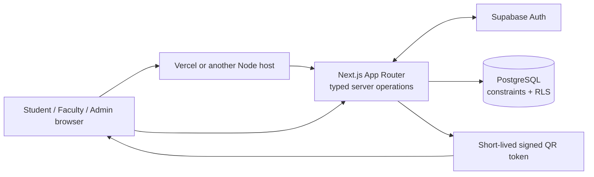

<div align="center">

# SAMS V2

### Open academic infrastructure for the people who make a campus work.

An open-source academic workspace for students, faculty, and administrators—with institution-scoped access and QR attendance.

[](https://github.com/SRY1X/sams-v2/actions/workflows/quality.yml)
[](LICENSE)
[](https://nextjs.org/docs)
[](https://www.typescriptlang.org/)

</div>

> **Project status:** Early MVP, actively developed. This is suitable for local exploration and synthetic-data demonstrations. Complete an institution-specific security, privacy, accessibility, backup, and operational review before using real academic records.

## Why SAMS?

Academic tools should be understandable, adaptable, and owned by the communities that use them. SAMS V2 is being built in public with clear setup instructions, PostgreSQL migrations, database-enforced authorization, and a local demonstration dataset. A new contributor should be able to clone it, run it, and understand where to make a change without private knowledge from the original author.

### MVP capabilities

| Students                                                                              | Faculty                                                                                | Administrators                                                                          |
| ------------------------------------------------------------------------------------- | -------------------------------------------------------------------------------------- | --------------------------------------------------------------------------------------- |
| View enrolled sections and personal attendance history; check in to eligible sessions | Manage assigned sections; create and close attendance sessions; review section records | Configure the institution's academic structure, membership, assignments, and enrollment |

The initial attendance method is a time-limited, rotating QR code. It limits casual reuse of an old screenshot, but **cannot prove physical presence or stop a live QR relay or a person using someone else's signed-in account**. Do not treat it as identity verification. Those risks require explicit policy and further security work; face recognition and location tracking are not part of the MVP.

## Architecture at a glance



Core academic data lives in PostgreSQL. Supabase provides the initial managed authentication and database services; Vercel is the initial hosting option. Domain rules are kept in typed application modules and PostgreSQL migrations so the application is not defined by a hosting dashboard. See [the architecture overview](docs/architecture.md) and [database/RLS guide](docs/database.md).

## Run the project locally — complete beginner guide

### Step 1: Install the prerequisites

Use [the detailed prerequisite guide](docs/prerequisites.md) for official install links and OS-specific steps. In brief, install:

- Git
- Node.js **22.22.2+ in the 22.x line**, **24.15.0+ in the 24.x line**, or **26.0.0+** (npm comes with Node.js)
- Docker Desktop on Windows/macOS, or another Docker-compatible runtime
- WSL 2 on Windows is recommended for a Linux development shell
- A modern browser

Supabase CLI is already pinned as a project dependency. You do not need to install it globally. Verify the tools in a fresh terminal:

```sh
git --version
node --version
npm --version
docker version
```

On Windows, choose PowerShell **or** WSL for the checkout and consistently use the corresponding Node, npm, and Git. Avoid installing a second Node/Docker runtime inside WSL if you intend to work from Windows PowerShell. Docker must be running before the local Supabase services can start.

### Step 2: Clone SAMS and install the locked dependencies

```sh
git clone https://github.com/SRY1X/sams-v2.git
cd sams-v2
npm ci
```

`npm ci` installs the exact dependency versions recorded in `package-lock.json`. For package changes, use `npm install <package>` and commit both the manifest and lockfile.

### Step 3: Start the local database and Auth services

Make sure Docker Desktop/Engine is running, then:

```sh
npm exec -- supabase --version
npm exec -- supabase start
npm exec -- supabase status
```

The first start downloads local service images and may take a few minutes. Supabase applies the migrations and synthetic academic seed. The status command displays local URLs and secret keys; keep that output private. Copy only the needed values into the local environment files in the next step. **Do not run demo seeding against a hosted Supabase URL.**

### Step 4: Configure local-only environment files

Create `.env.local` for the web application and `.env.demo.local` for the synthetic-user setup. These files are ignored by Git.

Windows PowerShell:

```powershell
Copy-Item .env.example .env.local
Copy-Item .env.example .env.demo.local
```

macOS/Linux:

```sh
cp .env.example .env.local
cp .env.example .env.demo.local
```

Edit `.env.local` with the local Supabase API URL and publishable/anon key from `supabase status`, plus a newly generated local signing key:

```sh
node -e "console.log(require('node:crypto').randomBytes(48).toString('base64url'))"
```

Set `ATTENDANCE_TOKEN_SECRET` to the generated value and `NEXT_PUBLIC_SITE_URL=http://localhost:3000`. In `.env.demo.local`, set the same local URL and the **local** `SUPABASE_SERVICE_ROLE_KEY` from local status. The service-role key bypasses RLS; the demo script will only accept a loopback URL, but still do not commit or share this key. See [every environment variable and its scope](docs/environment.md).

### Step 5: Create the synthetic demonstration accounts

```sh
npm run demo:seed
```

The idempotent script prepares the local administrator, faculty, and student accounts, connects the faculty and student to the sample course, and adds one historical attendance record. It refuses any non-loopback Supabase URL. All records are fictional and use reserved `.example.test` email addresses.

| Role    | Email                          | Local demo password      |
| ------- | ------------------------------ | ------------------------ |
| Admin   | `admin@sams-v2.example.test`   | `SamsDemo!LocalOnly2026` |
| Faculty | `faculty@sams-v2.example.test` | `SamsDemo!LocalOnly2026` |
| Student | `student@sams-v2.example.test` | `SamsDemo!LocalOnly2026` |

These published credentials are strictly for **local synthetic data**. Never create them or use their password in a hosted, preview, staging, or production database. A hosted demo must use a separate synthetic project and unique credentials that are not committed here.

### Step 6: Start the web application

```sh
npm run dev
```

Open [http://localhost:3000](http://localhost:3000) and sign in using any local demo identity above. Start with the faculty account to create an active attendance session; then scan its QR using the student account. For the seeded historical attendance, sign in as the student and open attendance history.

Camera access is restricted to secure browser contexts. `http://localhost` is treated as secure on the same computer, while `http://192.168.x.x` is not. For mobile scanning, use an HTTPS preview connected to your own isolated Supabase project with synthetic records. The seeded session is closed history; faculty must create a new active session to scan.

### Step 7: Validate a contribution

```sh
npm run format:check
npm run lint
npm run typecheck
npm run test
npm audit --omit=dev --audit-level=high
npm exec -- supabase db lint --local
npm exec -- supabase test db
npm run build
```

The local Supabase stack must be running for the database checks. GitHub Actions runs the project checks for pull requests; no production credentials are required in CI.

## Deploy an independent institution instance

Do not deploy this repository against the public project's development data. Create your own Supabase and Vercel projects, then follow [the deployment guide](docs/deployment.md):

1. Review and apply the versioned SQL migrations to your own Supabase project.
2. Set institution name, timezone, academic structure, Auth URLs, and a trusted initial administrator in that project.
3. Configure email delivery and disable open sign-up unless you have a reviewed provisioning policy.
4. Import the GitHub repository into Vercel (or another supported Node host).
5. Add the required environment variables in that host's encrypted project settings, using separate preview and production credentials.
6. Test authentication, RLS, student check-in, faculty records, backups, and rollback with synthetic data before inviting real users.

The local demo seeder is deliberately unsuitable for hosted environments. Never add real university names, accounts, identifiers, attendance exports, credentials, or screenshots to public seeds, issues, pull requests, or docs.

## Project map

```text
app/                  Next.js routes, pages, and narrow API endpoints
components/           Shared UI and feature components
lib/                  Auth, database clients, validation, and domain operations
supabase/migrations/  Versioned schema, constraints, functions, grants, and RLS
supabase/seed.sql     Synthetic local academic catalog only
scripts/              Local-only demo setup utilities
docs/                 Setup, architecture, database, security, and deployment guides
.github/              Contribution templates and automated quality checks
```

See [the documentation index](docs/architecture.md) for architecture boundaries and module responsibilities.

## Open-source and contribution guide

- **License:** MIT. See [LICENSE](LICENSE) and [third-party notices](DEPENDENCIES.md).
- **Start contributing:** [CONTRIBUTING.md](CONTRIBUTING.md)
- **Accessibility:** [ACCESSIBILITY.md](ACCESSIBILITY.md)
- **Security reports:** [SECURITY.md](SECURITY.md) — use GitHub private vulnerability reporting for sensitive security issues.
- **Community standards:** [CODE_OF_CONDUCT.md](CODE_OF_CONDUCT.md)
- **New contributor setup:** [docs/prerequisites.md](docs/prerequisites.md)
- **Local synthetic demo:** [docs/demo.md](docs/demo.md)

Issue and pull request templates guide reports. Use synthetic data only, include verification steps, and flag changes to RLS, Auth, session signing, role assignment, or personal-data handling. See [the troubleshooting guide](docs/troubleshooting.md) if setup fails.

## Documentation

- [Installation and first administrator](docs/setup.md)
- [Prerequisites: Node, npm, Git, Docker, WSL, Supabase CLI, and Vercel](docs/prerequisites.md)
- [Local development](docs/local-development.md)
- [Synthetic demonstration data](docs/demo.md)
- [Architecture](docs/architecture.md)
- [Database schema and RLS](docs/database.md)
- [Authentication and authorization](docs/auth-and-authorization.md)
- [Attendance lifecycle, security, and limitations](docs/attendance.md)
- [Environment variables](docs/environment.md)
- [Institution configuration](docs/configuration.md)
- [Vercel and Supabase deployment](docs/deployment.md)
- [Troubleshooting](docs/troubleshooting.md)

---

<div align="center">

**Built for the people who make a campus work.**

MIT licensed · community maintained · institution configurable

</div>
