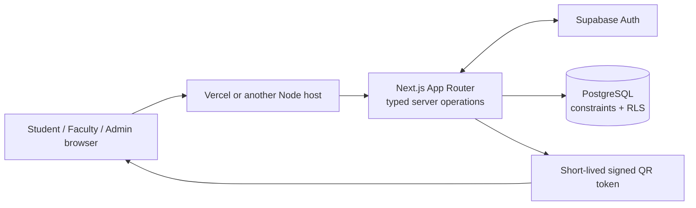

<div align="center">

# SAMS V2

### Open academic infrastructure for the people who make a campus work.

An open-source academic workspace for students, faculty, and administrators—with institution-scoped access and QR attendance.

[](https://github.com/SRY1X/sams-v2/actions/workflows/quality.yml)
[](LICENSE)
[](https://nextjs.org/docs)
[](https://www.typescriptlang.org/)

</div>

> **Project status:** Early MVP for evaluation and adaptation. Deploy each institution to its own Supabase and Vercel projects. Complete an institution-specific security, privacy, accessibility, backup, and operational review before using real academic records.

## What SAMS does

| Students                                                                              | Faculty                                                                                | Administrators                                                                 |
| ------------------------------------------------------------------------------------- | -------------------------------------------------------------------------------------- | ------------------------------------------------------------------------------ |
| View enrolled sections and personal attendance history; check in to eligible sessions | Manage assigned sections; create and close attendance sessions; review section records | Configure academic structure, memberships, faculty assignments, and enrollment |

Attendance uses a short-lived rotating QR token. It reduces casual reuse of an old screenshot, but **cannot prove physical presence or prevent a live QR relay or someone using another person's signed-in account**. Do not treat it as identity verification. Face recognition and location tracking are not part of the MVP.

## Deploy your own SAMS instance

The recommended path is hosted from the beginning: use your own Supabase project, create your institution's users in Supabase Auth, and deploy the app to Vercel. This avoids exposing a local HTTP address to mobile browsers; camera scanning is tested on the HTTPS Vercel deployment.

### What you need

- A GitHub account
- A [Supabase](https://supabase.com/) account and a new project for this SAMS instance
- A [Vercel](https://vercel.com/) account
- Git, Node.js and npm only if you will run the optional app development workflow or apply migrations from your computer

Docker Desktop and WSL are **not required** to deploy or use SAMS. GitHub Actions uses an isolated Supabase stack internally for database security checks; contributors do not need to start that stack for routine app work.

### Step 1 — Create a Supabase project and apply the database migrations

1. Create a new Supabase project for your institution. Keep its database password in a password manager.
2. Clone this repository, install its pinned packages, and link the Supabase CLI to your new project:

   ```sh
   git clone https://github.com/SRY1X/sams-v2.git
   cd sams-v2
   npm ci
   npm exec -- supabase login
   npm exec -- supabase link --project-ref YOUR_PROJECT_REF
   ```

3. Review the migration plan, then apply the migrations to the linked project:

   ```sh
   npm exec -- supabase db push --dry-run --linked
   npm exec -- supabase db push --linked
   ```

   Check the project reference in the Supabase dashboard before the second command. It changes the linked remote database. The migration creates a neutral placeholder institution and its policy settings; it does not create user accounts or a sample course catalog.

4. In **Supabase → SQL Editor**, customize the placeholder institution. Change the name and slug to your own values; `Asia/Kolkata` is the timezone for India Standard Time:

   ```sql
   update public.institutions
   set name = 'Your Institution',
       slug = 'your-institution',
       timezone = 'Asia/Kolkata'
   where id = '00000000-0000-4000-8000-000000000001';
   ```

   Use an IANA timezone such as `America/New_York` or `Europe/London` for other locations. The slug must contain lowercase letters, numbers, and single hyphens.

### Step 2 — Create three or more users in Supabase Auth

Create separate Auth users for every role you want to demonstrate. The quick-start setup uses three: one administrator, one faculty member, and one student.

1. Open **Supabase → Authentication → Users → Add user**.
2. Create the administrator, faculty, and student accounts with distinct email addresses and passwords. Confirm the users in the dashboard so they can sign in. For a demo, use test mailboxes or aliases you control; do not publish shared passwords or use real student records.
3. Copy each user's **UUID** from the Auth users table.
4. In the SQL Editor, replace the example UUID values below with the institution UUID and the three Auth user UUIDs. This trusted owner operation assigns each account its SAMS role; creating an Auth user alone does not grant access to a portal.

   ```sql
   insert into public.institution_memberships
     (institution_id, user_id, role, status)
   values
     ('00000000-0000-4000-8000-000000000001', 'ADMIN-AUTH-USER-UUID',   'admin',   'active'),
     ('00000000-0000-4000-8000-000000000001', 'FACULTY-AUTH-USER-UUID', 'faculty', 'active'),
     ('00000000-0000-4000-8000-000000000001', 'STUDENT-AUTH-USER-UUID', 'student', 'active')
   on conflict (institution_id, user_id)
   do update set role = excluded.role, status = 'active';
   ```

   Each account can have one role in an institution. The account UUID—not its email address—is the value used for role assignment, faculty assignment, and enrollment.

### Step 3 — Deploy the app to Vercel

1. Import `SRY1X/sams-v2` into Vercel and keep `main` as the production branch.
2. Add these variables in **Vercel → Project → Settings → Environment Variables**. Use a unique QR signing secret in every environment:

   | Variable                               | Value                                                     |
   | -------------------------------------- | --------------------------------------------------------- |
   | `NEXT_PUBLIC_SUPABASE_URL`             | Project URL from Supabase → Project Settings → API        |
   | `NEXT_PUBLIC_SUPABASE_PUBLISHABLE_KEY` | Publishable key from the same Supabase API settings page  |
   | `ATTENDANCE_TOKEN_SECRET`              | At least 32 random bytes; generate with the command below |
   | `NEXT_PUBLIC_SITE_URL`                 | The exact HTTPS Vercel domain for this environment        |

   Generate a signing secret on a machine with Node.js:

   ```sh
   node -e "console.log(require('node:crypto').randomBytes(48).toString('base64url'))"
   ```

   Set a different secret for Preview and Production. Do not add a Supabase secret/service-role key for this manual-user setup. If you later enable the optional invitation feature, its service-role key must be stored as a server-only Vercel variable and never exposed to the browser.

3. In **Supabase → Authentication → URL Configuration**, set the Site URL to your Vercel HTTPS domain and add the exact callback URL `https://YOUR-VERCEL-DOMAIN/auth/callback` to the redirect allow list. Keep public sign-up disabled; create and manage accounts deliberately.
4. Deploy. Open the HTTPS URL on a phone to test camera permission and QR scanning.

### Step 4 — Configure academic data and try the workflow

1. Sign in to Vercel as the admin user you provisioned.
2. In **Institution setup**, add a department, academic term, course, and course section.
3. Assign the faculty Auth UUID to that section and enroll the student Auth UUID.
4. Sign in as faculty on a laptop and create an attendance session. Sign in as the student on a phone and scan the live QR code. Check the faculty attendance list and the student's attendance history.

This deployment starts with no sample courses, sections, enrollments, or fake attendance records. Use synthetic names and data for a demonstration. Each institution should use a separate Supabase project and hosting environment.

## Optional app development workflow

You can run the Next.js application on your computer while connecting it to a **separate, non-production hosted Supabase project**. This is useful for UI work; mobile camera testing should still use an HTTPS Vercel Preview deployment. Docker, WSL, and a local Supabase stack are not part of the recommended onboarding path.

```sh
npm ci
cp .env.example .env.local
npm run dev
```

For PowerShell, use this copy command:

```powershell
Copy-Item .env.example .env.local
```

Fill `.env.local` with values from your own non-production Supabase project before starting the app. Do not use a production database for local development. See [hosted setup](docs/setup.md), [environment configuration](docs/environment.md), and [local app development](docs/local-development.md).

Before opening a pull request, run:

```sh
npm run format:check
npm run lint
npm run typecheck
npm run test
npm run build
```

The GitHub Actions workflow also runs database migrations, SQL lint, and RLS tests in an isolated CI database. Database contributors can use a disposable local Supabase stack if needed; it is not required for deploying SAMS or making ordinary UI/documentation changes.

## Architecture at a glance



Core academic data lives in PostgreSQL. Supabase provides the initial managed authentication and database services; Vercel is the initial hosting option. Domain rules live in typed application modules and versioned migrations. See [architecture](docs/architecture.md), [database/RLS](docs/database.md), and [attendance security](docs/attendance.md).

## Project map

```text
app/                  Next.js routes, pages, and narrow API endpoints
components/           Shared UI and feature components
lib/                  Auth, database clients, validation, and domain operations
supabase/migrations/  Versioned schema, constraints, functions, grants, and RLS
supabase/tests/       SQL security tests run by GitHub Actions
docs/                 Hosted setup, architecture, database, security, deployment
.github/              Contribution templates and automated quality checks
```

## Open-source and contribution guide

- **License:** MIT. See [LICENSE](LICENSE) and [third-party notices](DEPENDENCIES.md).
- **Contribute:** [CONTRIBUTING.md](CONTRIBUTING.md)
- **Accessibility:** [ACCESSIBILITY.md](ACCESSIBILITY.md)
- **Security reports:** [SECURITY.md](SECURITY.md) — use GitHub private vulnerability reporting for sensitive issues.
- **Community standards:** [CODE_OF_CONDUCT.md](CODE_OF_CONDUCT.md)
- **Troubleshooting:** [docs/troubleshooting.md](docs/troubleshooting.md)

Use synthetic data only. Include verification steps in pull requests and flag changes to RLS, Auth, session signing, role assignment, or personal-data handling.

## Documentation

- [Hosted setup and first users](docs/setup.md)
- [Prerequisites](docs/prerequisites.md)
- [Optional local app development](docs/local-development.md)
- [Hosted synthetic demonstration](docs/demo.md)
- [Architecture](docs/architecture.md)
- [Database schema and RLS](docs/database.md)
- [Authentication and authorization](docs/auth-and-authorization.md)
- [Attendance lifecycle, security, and limitations](docs/attendance.md)
- [Environment variables](docs/environment.md)
- [Institution configuration](docs/configuration.md)
- [Vercel and Supabase deployment](docs/deployment.md)
- [Troubleshooting](docs/troubleshooting.md)

---

<div align="center">

**Built for the people who make a campus work.**

MIT licensed · community maintained · institution configurable

</div>
