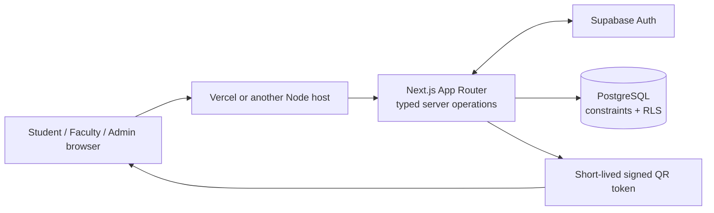

This file is a merged representation of the entire codebase, combined into a single document by Repomix.

# File Summary

## Purpose
This file contains a packed representation of the entire repository's contents.
It is designed to be easily consumable by AI systems for analysis, code review,
or other automated processes.

## File Format
The content is organized as follows:
1. This summary section
2. Repository information
3. Directory structure
4. Repository files (if enabled)
5. Multiple file entries, each consisting of:
  a. A header with the file path (## File: path/to/file)
  b. The full contents of the file in a code block

## Usage Guidelines
- This file should be treated as read-only. Any changes should be made to the
  original repository files, not this packed version.
- When processing this file, use the file path to distinguish
  between different files in the repository.
- Be aware that this file may contain sensitive information. Handle it with
  the same level of security as you would the original repository.

## Notes
- Some files may have been excluded based on .gitignore rules and Repomix's configuration
- Binary files are not included in this packed representation. Please refer to the Repository Structure section for a complete list of file paths, including binary files
- Files matching patterns in .gitignore are excluded
- Files matching default ignore patterns are excluded
- Files are sorted by Git change count (files with more changes are at the bottom)

# Directory Structure
````
.github/
  ISSUE_TEMPLATE/
    bug_report.yml
    config.yml
    feature_request.yml
  workflows/
    quality.yml
  dependabot.yml
  PULL_REQUEST_TEMPLATE.md
app/
  access/
    page.tsx
  admin/
    page.tsx
  api/
    attendance/
      claim/
        route.ts
      sessions/
        [id]/
          records/
            route.ts
          token/
            route.ts
  attendance/
    claim/
      page.tsx
  auth/
    callback/
      route.ts
    reset-password/
      page.tsx
  dashboard/
    page.tsx
  faculty/
    page.tsx
  login/
    page.tsx
  student/
    history/
      page.tsx
    scan/
      page.tsx
    page.tsx
  favicon.ico
  globals.css
  layout.tsx
  page.tsx
components/
  app-header.tsx
  attendance-claim.tsx
  attendance-qr.tsx
  attendance-scanner.tsx
  brand.tsx
  live-attendance-list.tsx
docs/
  architecture.md
  attendance.md
  auth-and-authorization.md
  configuration.md
  database.md
  demo.md
  deployment.md
  environment.md
  local-development.md
  prerequisites.md
  setup.md
  troubleshooting.md
lib/
  academic/
    actions.ts
  attendance/
    actions.ts
    constants.ts
    token-core.ts
    token.test.ts
    token.ts
  auth/
    actions.ts
    safe-redirect.test.ts
    safe-redirect.ts
    session.ts
  config/
    env.ts
    format.ts
    server-env.test.ts
    server-env.ts
  supabase/
    proxy.ts
    server.ts
  database.types.ts
supabase/
  migrations/
    20261014073119_initial_schema.sql
    20261014114900_use_institution_timezone_for_term_dates.sql
    20261014120814_attendance_fast_path_and_qr_rotation.sql
    20261014124955_split_admin_write_policies.sql
  tests/
    schema_security.test.sql
  config.toml
  seed.sql
.env.example
.gitattributes
.gitignore
ACCESSIBILITY.md
AGENTS.md
CODE_OF_CONDUCT.md
CONTRIBUTING.md
DEPENDENCIES.md
eslint.config.mjs
LICENSE
next.config.ts
package.json
postcss.config.mjs
proxy.ts
README.md
SECURITY.md
tsconfig.json
vercel.json
````

# Files

## File: .github/ISSUE_TEMPLATE/bug_report.yml
````yaml
name: Bug report
description: Report a reproducible issue using synthetic data.
title: "bug: "
labels: ["bug"]
body:
  - type: markdown
    attributes:
      value: "Never include credentials, attendance QR tokens, or real student/faculty data."
  - type: textarea
    id: summary
    attributes:
      label: What happened?
      description: Include the expected and actual behavior.
    validations:
      required: true
  - type: textarea
    id: reproduce
    attributes:
      label: Steps to reproduce
      placeholder: Use synthetic/local records only.
    validations:
      required: true
  - type: input
    id: version
    attributes:
      label: SAMS version or commit
    validations:
      required: true
  - type: textarea
    id: environment
    attributes:
      label: Environment
      description: Browser, operating system, and local/hosted setup. Do not paste secrets.
````

## File: .github/ISSUE_TEMPLATE/config.yml
````yaml
blank_issues_enabled: false
````

## File: .github/ISSUE_TEMPLATE/feature_request.yml
````yaml
name: Feature request
description: Propose a focused improvement to SAMS V2.
title: "feature: "
labels: ["enhancement"]
body:
  - type: textarea
    id: problem
    attributes:
      label: User need
      description: Which role has this problem and when does it occur?
    validations:
      required: true
  - type: textarea
    id: proposal
    attributes:
      label: Proposed behavior
      description: Describe a small, testable first version.
    validations:
      required: true
  - type: textarea
    id: impact
    attributes:
      label: Institution, privacy, or security impact
      description: Note policy differences, data collected, and any authorization changes.
````

## File: .github/dependabot.yml
````yaml
version: 2
updates:
  - package-ecosystem: npm
    directory: "/"
    schedule:
      interval: weekly
      day: monday
    open-pull-requests-limit: 5

  - package-ecosystem: github-actions
    directory: "/"
    schedule:
      interval: weekly
      day: monday
    open-pull-requests-limit: 5
````

## File: app/access/page.tsx
````typescript
import Link from "next/link";
import { signOut } from "@/lib/auth/actions";
import { Brand } from "@/components/brand";

export default function AccessPage() {
  return (
    <main className="grid min-h-screen place-items-center px-5">
      <div className="surface w-full max-w-md p-8 text-center">
        <div className="mb-8 flex justify-center">
          <Link href="/">
            <Brand />
          </Link>
        </div>
        <div className="mx-auto grid size-14 place-items-center rounded-2xl bg-[#142019] text-2xl text-[#ff8833]">
          ⌁
        </div>
        <h1 className="mt-5 text-2xl font-bold tracking-tight">
          Access is being set up
        </h1>
        <p className="mx-auto mt-3 max-w-sm text-sm leading-6 text-[#a1a1a1]">
          Your account is signed in, but it is not linked to an active
          institution role yet. Ask your academic administrator to add your
          account.
        </p>
        <form action={signOut} className="mt-7">
          <button className="button secondary" type="submit">
            Sign out
          </button>
        </form>
      </div>
    </main>
  );
}
````

## File: app/admin/page.tsx
````typescript
import { AppHeader } from "@/components/app-header";
import type { ReactNode } from "react";
import { requireMembership } from "@/lib/auth/session";
import {
  assignFaculty,
  createCourse,
  createDepartment,
  createSection,
  createTerm,
  enrollStudent,
  inviteMember,
  setMembershipStatus,
} from "@/lib/academic/actions";

function Field({
  label,
  name,
  type = "text",
  required = true,
  placeholder,
}: {
  label: string;
  name: string;
  type?: string;
  required?: boolean;
  placeholder?: string;
}) {
  return (
    <label className="block">
      <span className="label">{label}</span>
      <input
        className="input !min-h-10 !text-xs"
        name={name}
        type={type}
        required={required}
        placeholder={placeholder}
      />
    </label>
  );
}
function SelectField({
  label,
  name,
  items,
  placeholder,
}: {
  label: string;
  name: string;
  items: { id: string; label: string }[];
  placeholder: string;
}) {
  return (
    <label className="block">
      <span className="label">{label}</span>
      <select
        className="input !min-h-10 !text-xs"
        name={name}
        defaultValue=""
        required
      >
        <option value="" disabled>
          {placeholder}
        </option>
        {items.map((item) => (
          <option key={item.id} value={item.id}>
            {item.label}
          </option>
        ))}
      </select>
    </label>
  );
}
function Panel({
  title,
  description,
  children,
}: {
  title: string;
  description: string;
  children: ReactNode;
}) {
  return (
    <section className="surface p-5">
      <h2 className="text-sm font-bold">{title}</h2>
      <p className="mt-1 text-[11px] leading-5 text-[#a1a1a1]">{description}</p>
      {children}
    </section>
  );
}

export default async function AdminDashboard({
  searchParams,
}: {
  searchParams: Promise<Record<string, string | string[] | undefined>>;
}) {
  const member = await requireMembership("admin");
  const query = await searchParams;
  const [
    { data: profile },
    { data: institution },
    { data: departments },
    { data: terms },
    { data: courses },
    { data: sections },
    { data: memberships },
    { data: audit },
  ] = await Promise.all([
    member.supabase
      .from("profiles")
      .select("display_name")
      .eq("id", member.user_id)
      .maybeSingle(),
    member.supabase
      .from("institutions")
      .select("name,timezone")
      .eq("id", member.institution_id)
      .maybeSingle(),
    member.supabase
      .from("departments")
      .select("id,name,code")
      .eq("institution_id", member.institution_id)
      .order("name"),
    member.supabase
      .from("academic_terms")
      .select("id,name,starts_on,ends_on")
      .eq("institution_id", member.institution_id)
      .order("starts_on", { ascending: false }),
    member.supabase
      .from("courses")
      .select("id,code,title,department_id")
      .eq("institution_id", member.institution_id)
      .order("code"),
    member.supabase
      .from("course_sections")
      .select("id,course_id,term_id,section_code")
      .eq("institution_id", member.institution_id)
      .order("section_code"),
    member.supabase
      .from("institution_memberships")
      .select("id,user_id,role,status")
      .eq("institution_id", member.institution_id)
      .order("created_at", { ascending: false })
      .limit(100),
    member.supabase
      .from("audit_events")
      .select("id,action,entity_type,created_at")
      .eq("institution_id", member.institution_id)
      .order("created_at", { ascending: false })
      .limit(8),
  ]);
  const memberIds = [...new Set((memberships ?? []).map((row) => row.user_id))];
  const { data: memberProfiles } = memberIds.length
    ? await member.supabase
        .from("profiles")
        .select("id,display_name")
        .in("id", memberIds)
    : { data: [] };
  const profileById = new Map(
    (memberProfiles ?? []).map((row) => [row.id, row.display_name]),
  );
  const courseById = new Map((courses ?? []).map((row) => [row.id, row]));
  const result = typeof query.result === "string" ? query.result : "";

  return (
    <>
      <AppHeader role="admin" name={profile?.display_name ?? "Administrator"} />
      <main className="shell py-9 sm:py-12">
        <div className="flex flex-wrap items-end justify-between gap-4">
          <div>
            <p className="eyebrow">Institution administration</p>
            <h1 className="mt-2 text-3xl font-bold tracking-tight">
              {institution?.name ?? "Academic setup"}
            </h1>
            <p className="mt-2 text-sm text-[#a1a1a1]">
              Manage academic structure and member access for this institution.
            </p>
          </div>
          <span className="badge neutral">
            {institution?.timezone ?? "UTC"}
          </span>
        </div>
        {result && (
          <div
            className={`mt-6 rounded-lg border p-3 text-xs ${result === "saved" || result === "invited" ? "border-[#262626] bg-[#142019] text-[#7cc9a0]" : "border-[#63342e] bg-[#261715] text-[#ff9588]"}`}
            role="status"
          >
            {result === "saved"
              ? "Changes saved."
              : result === "invited"
                ? "Invitation sent and role assigned."
                : result === "invite-unavailable"
                  ? "Invitations are disabled until SUPABASE_SERVICE_ROLE_KEY is configured on the server."
                  : result === "invite-failed"
                    ? "Invitation could not be completed. Check the account and provider configuration."
                    : result === "invalid"
                      ? "Check the supplied fields and try again."
                      : "This change could not be saved. Check for duplicates and verify the selected records."}
          </div>
        )}
        <section className="mt-7 grid gap-3 sm:grid-cols-2 xl:grid-cols-4">
          {[
            ["Departments", departments?.length ?? 0],
            ["Academic terms", terms?.length ?? 0],
            ["Courses", courses?.length ?? 0],
            ["Course sections", sections?.length ?? 0],
          ].map(([label, count]) => (
            <div key={label} className="surface p-4">
              <p className="text-[10px] font-bold uppercase tracking-[.12em] text-[#a1a1a1]">
                {label}
              </p>
              <p className="mt-2 text-2xl font-bold">{count}</p>
            </div>
          ))}
        </section>
        <div className="mt-8 grid gap-6 xl:grid-cols-[1.2fr_.8fr]">
          <div className="space-y-6">
            <section>
              <div className="mb-3">
                <h2 className="text-lg font-bold">Academic structure</h2>
                <p className="mt-1 text-xs text-[#a1a1a1]">
                  Create the records used by student and faculty workflows.
                </p>
              </div>
              <div className="grid gap-4 md:grid-cols-2">
                <Panel
                  title="Add department"
                  description="A neutral organizational unit; customize terminology through configuration."
                >
                  <form action={createDepartment} className="mt-4 space-y-3">
                    <Field
                      label="Department name"
                      name="name"
                      placeholder="Department of Science"
                    />
                    <Field
                      label="Short code"
                      name="code"
                      required={false}
                      placeholder="SCI"
                    />
                    <button
                      className="button !min-h-9 !text-[11px]"
                      type="submit"
                    >
                      Add department
                    </button>
                  </form>
                </Panel>
                <Panel
                  title="Add academic term"
                  description="Terms use dates and institution timezone settings."
                >
                  <form action={createTerm} className="mt-4 space-y-3">
                    <Field
                      label="Term name"
                      name="name"
                      placeholder="2026 · Term 1"
                    />
                    <Field label="Starts on" name="starts_on" type="date" />
                    <Field label="Ends on" name="ends_on" type="date" />
                    <button
                      className="button !min-h-9 !text-[11px]"
                      type="submit"
                    >
                      Add term
                    </button>
                  </form>
                </Panel>
                <Panel
                  title="Add course"
                  description="Course codes are unique within this institution."
                >
                  <form action={createCourse} className="mt-4 space-y-3">
                    <Field
                      label="Course code"
                      name="code"
                      placeholder="BIO-101"
                    />
                    <Field
                      label="Course title"
                      name="title"
                      placeholder="Introduction to Biology"
                    />
                    <label className="block">
                      <span className="label">Department (optional)</span>
                      <select
                        className="input !min-h-10 !text-xs"
                        name="department_id"
                        defaultValue=""
                      >
                        <option value="">No department</option>
                        {departments?.map((item) => (
                          <option key={item.id} value={item.id}>
                            {item.name}
                          </option>
                        ))}
                      </select>
                    </label>
                    <button
                      className="button !min-h-9 !text-[11px]"
                      type="submit"
                    >
                      Add course
                    </button>
                  </form>
                </Panel>
                <Panel
                  title="Open course section"
                  description="Connect an existing course to a term and section identifier."
                >
                  <form action={createSection} className="mt-4 space-y-3">
                    <SelectField
                      label="Course"
                      name="course_id"
                      placeholder="Choose a course"
                      items={(courses ?? []).map((c) => ({
                        id: c.id,
                        label: `${c.code} · ${c.title}`,
                      }))}
                    />
                    <SelectField
                      label="Academic term"
                      name="term_id"
                      placeholder="Choose a term"
                      items={(terms ?? []).map((t) => ({
                        id: t.id,
                        label: t.name,
                      }))}
                    />
                    <Field
                      label="Section code"
                      name="section_code"
                      placeholder="A"
                    />
                    <button
                      className="button !min-h-9 !text-[11px]"
                      type="submit"
                    >
                      Create section
                    </button>
                  </form>
                </Panel>
              </div>
            </section>
            <section>
              <div className="mb-3">
                <h2 className="text-lg font-bold">
                  Assignments and enrollments
                </h2>
                <p className="mt-1 text-xs text-[#a1a1a1]">
                  Use an existing member’s user ID from the roster below.
                </p>
              </div>
              <div className="grid gap-4 md:grid-cols-2">
                <Panel
                  title="Assign faculty"
                  description="Only an active faculty membership can be assigned."
                >
                  <form action={assignFaculty} className="mt-4 space-y-3">
                    <SelectField
                      label="Section"
                      name="section_id"
                      placeholder="Choose a section"
                      items={(sections ?? []).map((s) => ({
                        id: s.id,
                        label: `${courseById.get(s.course_id)?.code ?? "Course"} · ${s.section_code}`,
                      }))}
                    />
                    <Field
                      label="Faculty user ID"
                      name="faculty_user_id"
                      placeholder="UUID from the member roster"
                    />
                    <button
                      className="button !min-h-9 !text-[11px]"
                      type="submit"
                    >
                      Assign faculty
                    </button>
                  </form>
                </Panel>
                <Panel
                  title="Enroll student"
                  description="Only an active student membership can be enrolled."
                >
                  <form action={enrollStudent} className="mt-4 space-y-3">
                    <SelectField
                      label="Section"
                      name="section_id"
                      placeholder="Choose a section"
                      items={(sections ?? []).map((s) => ({
                        id: s.id,
                        label: `${courseById.get(s.course_id)?.code ?? "Course"} · ${s.section_code}`,
                      }))}
                    />
                    <Field
                      label="Student user ID"
                      name="student_user_id"
                      placeholder="UUID from the member roster"
                    />
                    <button
                      className="button !min-h-9 !text-[11px]"
                      type="submit"
                    >
                      Enroll student
                    </button>
                  </form>
                </Panel>
              </div>
            </section>
            <Panel
              title="Invite a member"
              description="Invitations require the server-only service key. Roles are assigned by this protected admin action."
            >
              <form
                action={inviteMember}
                className="mt-4 grid gap-3 sm:grid-cols-2"
              >
                <Field
                  label="Full name"
                  name="display_name"
                  placeholder="Alex Morgan"
                />
                <Field
                  label="Institution email"
                  name="email"
                  type="email"
                  placeholder="alex@example.edu"
                />
                <label className="block">
                  <span className="label">Role</span>
                  <select
                    className="input !min-h-10 !text-xs"
                    name="role"
                    defaultValue="student"
                  >
                    <option value="student">Student</option>
                    <option value="faculty">Faculty</option>
                  </select>
                </label>
                <div className="flex items-end">
                  <button
                    className="button !min-h-10 !text-[11px]"
                    type="submit"
                  >
                    Send invitation
                  </button>
                </div>
              </form>
            </Panel>
          </div>
          <aside className="space-y-6">
            <section className="surface overflow-hidden">
              <div className="border-b border-[#262626] px-5 py-4">
                <h2 className="text-sm font-bold">Institution members</h2>
                <p className="mt-1 text-[10px] text-[#a1a1a1]">
                  Suspend or restore a member. Role changes require a trusted
                  owner operation.
                </p>
              </div>
              <div className="table-wrap max-h-[460px]">
                <table>
                  <thead>
                    <tr>
                      <th>Member</th>
                      <th>Role</th>
                      <th>Access</th>
                    </tr>
                  </thead>
                  <tbody>
                    {memberships?.map((item) => (
                      <tr key={item.id}>
                        <td>
                          <b>{profileById.get(item.user_id) ?? "Member"}</b>
                          <span className="mt-1 block max-w-[145px] truncate font-mono text-[9px] text-[#737373]">
                            {item.user_id}
                          </span>
                        </td>
                        <td>
                          <span className="badge neutral">{item.role}</span>
                        </td>
                        <td>
                          <form action={setMembershipStatus}>
                            <input
                              type="hidden"
                              name="user_id"
                              value={item.user_id}
                            />
                            <input
                              type="hidden"
                              name="status"
                              value={
                                item.status === "active"
                                  ? "suspended"
                                  : "active"
                              }
                            />
                            <button
                              className="text-[10px] font-bold text-[#ff8833]"
                              type="submit"
                              disabled={item.user_id === member.user_id}
                            >
                              {item.user_id === member.user_id
                                ? "Current admin"
                                : item.status === "active"
                                  ? "Suspend"
                                  : "Restore"}
                            </button>
                          </form>
                        </td>
                      </tr>
                    ))}
                    {!memberships?.length && (
                      <tr>
                        <td
                          colSpan={3}
                          className="py-10 text-center text-xs text-[#a1a1a1]"
                        >
                          No members yet.
                        </td>
                      </tr>
                    )}
                  </tbody>
                </table>
              </div>
            </section>
            <section className="surface overflow-hidden">
              <div className="border-b border-[#262626] px-5 py-4">
                <h2 className="text-sm font-bold">Recent audit events</h2>
                <p className="mt-1 text-[10px] text-[#a1a1a1]">
                  Security-sensitive actions, newest first.
                </p>
              </div>
              <div className="divide-y divide-[#262626]">
                {audit?.map((event) => (
                  <div key={event.id} className="px-5 py-3">
                    <p className="text-xs font-semibold">
                      {event.action.replaceAll(".", " · ")}
                    </p>
                    <p className="mt-1 text-[10px] text-[#a1a1a1]">
                      {event.entity_type} ·{" "}
                      {new Date(event.created_at).toLocaleString()}
                    </p>
                  </div>
                ))}
                {!audit?.length && (
                  <p className="px-5 py-8 text-center text-xs text-[#a1a1a1]">
                    No audit events recorded.
                  </p>
                )}
              </div>
            </section>
            <p className="rounded-xl bg-[#171717] p-4 text-[10px] leading-5 text-[#a1a1a1]">
              Initial administrator setup is documented in{" "}
              <code className="font-mono">docs/setup.md</code>. Admin membership
              cannot be self-assigned from this interface.
            </p>
          </aside>
        </div>
        <p className="mt-8 text-[10px] text-[#737373]">
          Academic records, membership changes, and attendance remain scoped to
          this institution by database policies.
        </p>
      </main>
    </>
  );
}
````

## File: app/attendance/claim/page.tsx
````typescript
import { AttendanceClaim } from "@/components/attendance-claim";

export default function AttendanceClaimPage() {
  return <AttendanceClaim />;
}
````

## File: app/auth/reset-password/page.tsx
````typescript
import { redirect } from "next/navigation";
import { Brand } from "@/components/brand";
import { resetPassword } from "@/lib/auth/actions";
import { getIdentity } from "@/lib/auth/session";

export default async function ResetPasswordPage({
  searchParams,
}: {
  searchParams: Promise<{ error?: string }>;
}) {
  if (!(await getIdentity())) redirect("/login");
  const query = await searchParams;
  return (
    <main className="grid min-h-screen place-items-center px-5">
      <section className="surface w-full max-w-md p-8">
        <div className="mb-8 flex justify-center">
          <Brand />
        </div>
        <p className="eyebrow text-center">Account recovery</p>
        <h1 className="mt-2 text-center text-2xl font-bold">
          Choose a new password
        </h1>
        <p className="mt-2 text-center text-sm text-[#a1a1a1]">
          Use at least 12 characters. You’ll sign in again after updating it.
        </p>
        {query.error && (
          <div className="error-box mt-5" role="alert">
            {query.error === "invalid"
              ? "Passwords must match and be at least 12 characters."
              : "The password could not be updated. Request a fresh recovery link and try again."}
          </div>
        )}
        <form action={resetPassword} className="mt-7 space-y-4">
          <div>
            <label className="label" htmlFor="password">
              New password
            </label>
            <input
              className="input"
              id="password"
              name="password"
              type="password"
              minLength={12}
              maxLength={200}
              autoComplete="new-password"
              required
            />
          </div>
          <div>
            <label className="label" htmlFor="confirmation">
              Confirm password
            </label>
            <input
              className="input"
              id="confirmation"
              name="confirmation"
              type="password"
              minLength={12}
              maxLength={200}
              autoComplete="new-password"
              required
            />
          </div>
          <button className="button w-full !min-h-12" type="submit">
            Update password <span aria-hidden="true">→</span>
          </button>
        </form>
      </section>
    </main>
  );
}
````

## File: app/dashboard/page.tsx
````typescript
import { redirect } from "next/navigation";
import { getMembership } from "@/lib/auth/session";

export default async function DashboardRedirect() {
  const membership = await getMembership();
  if (!membership) redirect("/access");
  redirect(`/${membership.role}`);
}
````

## File: app/faculty/page.tsx
````typescript
import { AppHeader } from "@/components/app-header";
import { AttendanceQr } from "@/components/attendance-qr";
import { LiveAttendanceList } from "@/components/live-attendance-list";
import { formatInstitutionDateTime } from "@/lib/config/format";
import {
  closeAttendanceSession,
  startAttendanceSession,
} from "@/lib/attendance/actions";
import { requireMembership } from "@/lib/auth/session";

export default async function FacultyDashboard({
  searchParams,
}: {
  searchParams: Promise<Record<string, string | string[] | undefined>>;
}) {
  const member = await requireMembership("faculty");
  const query = await searchParams;
  const [{ data: profile }, { data: institution }, { data: assignments }] =
    await Promise.all([
      member.supabase
        .from("profiles")
        .select("display_name")
        .eq("id", member.user_id)
        .maybeSingle(),
      member.supabase
        .from("institutions")
        .select("timezone")
        .eq("id", member.institution_id)
        .maybeSingle(),
      member.supabase
        .from("section_faculty")
        .select("section_id")
        .eq("faculty_user_id", member.user_id),
    ]);
  const sectionIds = (assignments ?? []).map((row) => row.section_id);
  const { data: sections } = sectionIds.length
    ? await member.supabase
        .from("course_sections")
        .select("id,course_id,term_id,section_code")
        .in("id", sectionIds)
    : { data: [] };
  const courseIds = [...new Set((sections ?? []).map((row) => row.course_id))];
  const termIds = [...new Set((sections ?? []).map((row) => row.term_id))];
  const [{ data: courses }, { data: terms }, { data: enrollments }] =
    await Promise.all([
      courseIds.length
        ? member.supabase
            .from("courses")
            .select("id,code,title")
            .in("id", courseIds)
        : Promise.resolve({ data: [] }),
      termIds.length
        ? member.supabase
            .from("academic_terms")
            .select("id,name")
            .in("id", termIds)
        : Promise.resolve({ data: [] }),
      sectionIds.length
        ? member.supabase
            .from("enrollments")
            .select("section_id,student_user_id")
            .in("section_id", sectionIds)
            .eq("status", "active")
        : Promise.resolve({ data: [] }),
    ]);
  const courseMap = new Map((courses ?? []).map((row) => [row.id, row]));
  const termMap = new Map((terms ?? []).map((row) => [row.id, row.name]));
  const selectedId = typeof query.session === "string" ? query.session : "";
  const { data: activeSession } = selectedId
    ? await member.supabase
        .from("attendance_sessions")
        .select("id,section_id,status,expires_at,starts_at")
        .eq("id", selectedId)
        .maybeSingle()
    : { data: null };
  const selectedSection = activeSession
    ? (sections ?? []).find((row) => row.id === activeSession.section_id)
    : undefined;
  const selectedCourse = selectedSection
    ? courseMap.get(selectedSection.course_id)
    : undefined;
  const studentsPerSection = new Map<string, number>();
  for (const item of enrollments ?? [])
    studentsPerSection.set(
      item.section_id,
      (studentsPerSection.get(item.section_id) ?? 0) + 1,
    );
  const error = typeof query.error === "string" ? query.error : "";

  return (
    <>
      <AppHeader role="faculty" name={profile?.display_name ?? "Faculty"} />
      <main className="shell py-9 sm:py-12">
        <div className="flex flex-wrap items-end justify-between gap-4">
          <div>
            <p className="eyebrow">Faculty workspace</p>
            <h1 className="mt-2 text-3xl font-bold tracking-tight">
              Your teaching day
            </h1>
            <p className="mt-2 text-sm text-[#a1a1a1]">
              Start a secure attendance session or review a class roster.
            </p>
          </div>
          <span className="badge neutral">
            {sections?.length ?? 0} assigned sections
          </span>
        </div>
        {error && (
          <div className="error-box mt-6">
            The action could not be completed. Refresh and try again.
          </div>
        )}
        {query.closed && (
          <div className="mt-6 rounded-lg border border-[#262626] bg-[#142019] p-3 text-xs text-[#7cc9a0]">
            Attendance session closed.
          </div>
        )}
        {activeSession && selectedSection && (
          <section className="surface mt-8 overflow-hidden">
            <div className="flex flex-wrap items-start justify-between gap-4 border-b border-[#262626] p-5 sm:p-6">
              <div>
                <p className="eyebrow">Live attendance session</p>
                <h2 className="mt-2 text-xl font-bold">
                  {selectedCourse?.title ?? "Class session"}{" "}
                  <span className="text-[#a1a1a1]">
                    · {selectedSection.section_code}
                  </span>
                </h2>
                <p className="mt-2 text-xs text-[#a1a1a1]">
                  Session ends{" "}
                  {formatInstitutionDateTime(
                    activeSession.expires_at,
                    institution?.timezone ?? "UTC",
                  )}
                </p>
              </div>
              <form action={closeAttendanceSession}>
                <input
                  type="hidden"
                  name="session_id"
                  value={activeSession.id}
                />
                <button className="button secondary" type="submit">
                  Close session
                </button>
              </form>
            </div>
            <div className="grid gap-8 p-5 sm:p-6 lg:grid-cols-[280px_1fr]">
              <div className="text-center">
                <AttendanceQr sessionId={activeSession.id} />
                <p className="mx-auto mt-3 max-w-[240px] text-[10px] leading-5 text-[#a1a1a1]">
                  Ask students to scan this rotating code with their phone
                  camera. Each student can check in once.
                </p>
              </div>
              <LiveAttendanceList
                sessionId={activeSession.id}
                timezone={institution?.timezone ?? "UTC"}
              />
            </div>
          </section>
        )}
        <section className="mt-9">
          <div className="mb-4 flex items-end justify-between">
            <div>
              <h2 className="text-lg font-bold">Assigned sections</h2>
              <p className="mt-1 text-xs text-[#a1a1a1]">
                Attendance sessions are limited to your current assignments.
              </p>
            </div>
          </div>
          <div className="grid gap-4 md:grid-cols-2">
            {sections?.map((section) => {
              const course = courseMap.get(section.course_id);
              return (
                <article key={section.id} className="surface p-5">
                  <div className="flex items-start justify-between gap-4">
                    <div className="flex gap-3">
                      <span className="grid size-10 place-items-center rounded-xl bg-[#171717] text-[10px] font-extrabold text-[#7cc9a0]">
                        {course?.code.slice(0, 3) ?? "CLS"}
                      </span>
                      <div>
                        <h3 className="font-bold">
                          {course?.title ?? "Course"}
                        </h3>
                        <p className="mt-1 text-[11px] text-[#a1a1a1]">
                          {course?.code} · Section {section.section_code}
                        </p>
                      </div>
                    </div>
                    <span className="badge neutral">
                      {studentsPerSection.get(section.id) ?? 0} students
                    </span>
                  </div>
                  <div className="mt-5 flex items-center justify-between border-t border-[#262626] pt-4">
                    <p className="text-[10px] text-[#a1a1a1]">
                      {termMap.get(section.term_id) ?? "Academic term"}
                    </p>
                    <form action={startAttendanceSession}>
                      <input
                        type="hidden"
                        name="section_id"
                        value={section.id}
                      />
                      <button
                        className="button !min-h-9 !px-3 !text-[11px]"
                        type="submit"
                      >
                        Start attendance <span aria-hidden="true">→</span>
                      </button>
                    </form>
                  </div>
                </article>
              );
            })}
            {!sections?.length && (
              <div className="surface col-span-full px-6 py-12 text-center">
                <p className="font-bold">No sections assigned yet</p>
                <p className="mt-2 text-xs text-[#a1a1a1]">
                  Ask an institution administrator to assign your faculty
                  account to a section.
                </p>
              </div>
            )}
          </div>
        </section>
        <p className="mt-8 text-[10px] text-[#737373]">
          QR check-in confirms a student account and enrollment; it cannot
          prevent real-time code sharing.
        </p>
      </main>
    </>
  );
}
````

## File: app/student/history/page.tsx
````typescript
import Link from "next/link";
import { AppHeader } from "@/components/app-header";
import { formatInstitutionDateTime } from "@/lib/config/format";
import { requireMembership } from "@/lib/auth/session";

export default async function StudentHistoryPage() {
  const member = await requireMembership("student");
  const [{ data: profile }, { data: institution }, { data: records }] =
    await Promise.all([
      member.supabase
        .from("profiles")
        .select("display_name")
        .eq("id", member.user_id)
        .maybeSingle(),
      member.supabase
        .from("institutions")
        .select("timezone")
        .eq("id", member.institution_id)
        .maybeSingle(),
      member.supabase
        .from("attendance_records")
        .select("session_id,recorded_at,status")
        .eq("student_user_id", member.user_id)
        .order("recorded_at", { ascending: false })
        .limit(200),
    ]);
  const sessionIds = [...new Set((records ?? []).map((row) => row.session_id))];
  const { data: sessions } = sessionIds.length
    ? await member.supabase
        .from("attendance_sessions")
        .select("id,section_id,starts_at")
        .in("id", sessionIds)
    : { data: [] };
  const sectionIds = [
    ...new Set((sessions ?? []).map((row) => row.section_id)),
  ];
  const { data: sections } = sectionIds.length
    ? await member.supabase
        .from("course_sections")
        .select("id,course_id,section_code")
        .in("id", sectionIds)
    : { data: [] };
  const courseIds = [...new Set((sections ?? []).map((row) => row.course_id))];
  const { data: courses } = courseIds.length
    ? await member.supabase
        .from("courses")
        .select("id,code,title")
        .in("id", courseIds)
    : { data: [] };
  const sessionMap = new Map((sessions ?? []).map((row) => [row.id, row]));
  const sectionMap = new Map((sections ?? []).map((row) => [row.id, row]));
  const courseMap = new Map((courses ?? []).map((row) => [row.id, row]));
  return (
    <>
      <AppHeader role="student" name={profile?.display_name ?? "Student"} />
      <main className="shell py-10">
        <Link href="/student" className="text-xs font-semibold text-[#ff8833]">
          ← Student overview
        </Link>
        <div className="mt-5">
          <p className="eyebrow">Your records</p>
          <h1 className="mt-2 text-3xl font-bold tracking-tight">
            Attendance history
          </h1>
          <p className="mt-2 text-sm text-[#a1a1a1]">
            A private record of the sessions you attended.
          </p>
        </div>
        <section className="surface mt-7 overflow-hidden">
          <div className="table-wrap">
            <table>
              <thead>
                <tr>
                  <th>Course</th>
                  <th>Section</th>
                  <th>Date and time</th>
                  <th>Status</th>
                </tr>
              </thead>
              <tbody>
                {records?.map((record) => {
                  const session = sessionMap.get(record.session_id);
                  const section = session
                    ? sectionMap.get(session.section_id)
                    : undefined;
                  const course = section
                    ? courseMap.get(section.course_id)
                    : undefined;
                  return (
                    <tr key={record.session_id}>
                      <td>
                        <b>{course?.title ?? "Course"}</b>
                        <span className="ml-2 text-[10px] text-[#a1a1a1]">
                          {course?.code}
                        </span>
                      </td>
                      <td>{section?.section_code ?? "—"}</td>
                      <td>
                        {formatInstitutionDateTime(
                          record.recorded_at,
                          institution?.timezone ?? "UTC",
                        )}
                      </td>
                      <td>
                        <span className="badge">Present</span>
                      </td>
                    </tr>
                  );
                })}
                {!records?.length && (
                  <tr>
                    <td
                      colSpan={4}
                      className="py-16 text-center text-sm text-[#a1a1a1]"
                    >
                      No attendance records yet.
                    </td>
                  </tr>
                )}
              </tbody>
            </table>
          </div>
        </section>
        <p className="mt-4 text-[10px] text-[#737373]">
          Showing the most recent 200 records.
        </p>
      </main>
    </>
  );
}
````

## File: app/student/scan/page.tsx
````typescript
import Link from "next/link";
import { AttendanceScanner } from "@/components/attendance-scanner";
import { AppHeader } from "@/components/app-header";
import { requireMembership } from "@/lib/auth/session";

export default async function StudentScanPage() {
  const member = await requireMembership("student");
  const { data: profile } = await member.supabase
    .from("profiles")
    .select("display_name")
    .eq("id", member.user_id)
    .maybeSingle();

  return (
    <>
      <AppHeader role="student" name={profile?.display_name ?? "Student"} />
      <main className="shell max-w-2xl py-9 sm:py-12">
        <Link
          className="text-sm font-semibold text-[#a1a1a1] hover:text-white"
          href="/student"
        >
          ← Student dashboard
        </Link>
        <p className="eyebrow mt-8">Attendance check-in</p>
        <h1 className="mt-2 text-3xl font-bold tracking-tight">
          Scan a class QR code
        </h1>
        <p className="mt-2 text-sm leading-6 text-[#a1a1a1]">
          Point your camera at the active QR code shown by your instructor. Keep
          this page open while the code is scanned.
        </p>
        <AttendanceScanner />
      </main>
    </>
  );
}
````

## File: app/layout.tsx
````typescript
import type { Metadata } from "next";
import type { ReactNode } from "react";
import "./globals.css";

export const metadata: Metadata = {
  title: {
    default: "SAMS V2 · Smart Academic Management",
    template: "%s · SAMS V2",
  },
  description: "A secure, community-built academic management platform.",
};

export default function RootLayout({ children }: { children: ReactNode }) {
  return (
    <html lang="en">
      <body>{children}</body>
    </html>
  );
}
````

## File: components/app-header.tsx
````typescript
import Link from "next/link";
import { signOut } from "@/lib/auth/actions";
import type { Role } from "@/lib/database.types";
import { Brand } from "@/components/brand";

const roleHome: Record<Role, string> = {
  student: "/student",
  faculty: "/faculty",
  admin: "/admin",
};

export function AppHeader({ role, name }: { role: Role; name: string }) {
  const root = roleHome[role];
  return (
    <header className="border-b border-[#262626] bg-[#171717]">
      <div className="shell flex min-h-[72px] items-center justify-between gap-4">
        <Link href={root} aria-label="SAMS V2 home">
          <Brand />
        </Link>
        <nav
          className="hidden items-center gap-7 text-[12px] font-semibold text-[#a1a1a1] sm:flex"
          aria-label="Main navigation"
        >
          <Link href={root} className="hover:text-[#ff8833]">
            Overview
          </Link>
          {role === "student" && (
            <Link href="/student/history" className="hover:text-[#ff8833]">
              Attendance history
            </Link>
          )}
          {role === "faculty" && (
            <Link href="/faculty" className="hover:text-[#ff8833]">
              My sections
            </Link>
          )}
          {role === "admin" && (
            <Link href="/admin" className="hover:text-[#ff8833]">
              Institution setup
            </Link>
          )}
        </nav>
        <div className="flex items-center gap-3">
          <span className="hidden text-right sm:block">
            <span className="block text-[12px] font-bold">{name}</span>
            <span className="block text-[10px] capitalize text-[#a1a1a1]">
              {role}
            </span>
          </span>
          <form action={signOut}>
            <button
              className="button secondary !min-h-9 !px-3 !text-[11px]"
              type="submit"
            >
              Sign out
            </button>
          </form>
        </div>
      </div>
    </header>
  );
}
````

## File: components/attendance-claim.tsx
````typescript
"use client";

import Link from "next/link";
import { useEffect, useState, useSyncExternalStore } from "react";
import { Brand } from "@/components/brand";

function subscribeToHash(callback: () => void) {
  window.addEventListener("hashchange", callback);
  return () => window.removeEventListener("hashchange", callback);
}
function readTokenFromHash() {
  return new URLSearchParams(window.location.hash.slice(1)).get("token") ?? "";
}
function getServerToken() {
  return "";
}

export function AttendanceClaim() {
  const token = useSyncExternalStore(
    subscribeToHash,
    readTokenFromHash,
    getServerToken,
  );
  const [state, setState] = useState("Checking your attendance session…");
  const [kind, setKind] = useState<"busy" | "success" | "error" | "signin">(
    "busy",
  );
  useEffect(() => {
    window.history.replaceState(null, "", "/attendance/claim");
  }, []);
  useEffect(() => {
    if (!token) return;
    window.history.replaceState(null, "", "/attendance/claim");
    let active = true;
    void fetch("/api/attendance/claim", {
      method: "POST",
      headers: { "Content-Type": "application/json" },
      body: JSON.stringify({ token }),
      cache: "no-store",
    })
      .then(async (response) => ({
        response,
        body: (await response.json()) as { status?: string; error?: string },
      }))
      .then(({ response, body }) => {
        if (!active) return;
        if (response.status === 401) {
          setKind("signin");
          setState(
            "Sign in with your student account, then scan the QR code again.",
          );
          return;
        }
        if (!response.ok)
          throw new Error(body.error ?? "This QR code is invalid or expired.");
        setKind("success");
        setState(
          body.status === "already_recorded"
            ? "You are already checked in for this session."
            : "Attendance recorded. You’re all set!",
        );
      })
      .catch((error: unknown) => {
        if (active) {
          setKind("error");
          setState(
            error instanceof Error
              ? error.message
              : "We couldn’t record attendance. Please scan again.",
          );
        }
      });
    return () => {
      active = false;
    };
  }, [token]);
  return (
    <main className="grid min-h-screen place-items-center px-5">
      <div className="surface w-full max-w-md p-8 text-center">
        <div className="mb-9 flex justify-center">
          <Link href="/">
            <Brand />
          </Link>
        </div>
        <div
          className={`mx-auto grid size-14 place-items-center rounded-2xl text-2xl ${(token ? kind : "error") === "success" ? "bg-[#142019] text-[#ff8833]" : (token ? kind : "error") === "error" ? "bg-[#261715] text-[#ff9588]" : "bg-[#171717] text-[#a1a1a1]"}`}
        >
          {(token ? kind : "error") === "success"
            ? "✓"
            : (token ? kind : "error") === "error"
              ? "!"
              : "⌗"}
        </div>
        <h1 className="mt-5 text-2xl font-bold tracking-tight">
          {(token ? kind : "error") === "success"
            ? "You’re checked in"
            : (token ? kind : "error") === "signin"
              ? "Student sign-in needed"
              : (token ? kind : "error") === "error"
                ? "Couldn’t check in"
                : "Recording attendance"}
        </h1>
        <p className="mt-3 text-sm leading-6 text-[#a1a1a1]" role="status">
          {token
            ? state
            : "No attendance code was found. Scan the QR code again."}
        </p>
        {(token ? kind : "error") === "signin" && (
          <Link className="button mt-6" href="/login">
            Go to sign in <span aria-hidden="true">→</span>
          </Link>
        )}
        {(token ? kind : "error") === "error" && (
          <Link className="button secondary mt-6" href="/student">
            Open student dashboard
          </Link>
        )}
        <p className="mt-8 border-t border-[#262626] pt-5 text-[10px] leading-5 text-[#737373]">
          QR codes expire quickly and can be used once per student for each
          session.
        </p>
      </div>
    </main>
  );
}
````

## File: components/attendance-scanner.tsx
````typescript
"use client";

import Link from "next/link";
import { useEffect, useRef, useState, useSyncExternalStore } from "react";
import type { IScannerControls } from "@zxing/browser";

type ScanState =
  "idle" | "starting" | "scanning" | "submitting" | "success" | "error";

function subscribeToCameraAvailability() {
  return () => {};
}

function getCameraAvailability() {
  return (
    window.isSecureContext && Boolean(navigator.mediaDevices?.getUserMedia)
  );
}

function getServerCameraAvailability() {
  return null;
}

function getCameraErrorMessage(error: unknown) {
  if (error instanceof DOMException) {
    if (
      error.name === "NotAllowedError" ||
      error.name === "PermissionDeniedError"
    )
      return "Camera access was denied. Allow camera permission for this site, then try again.";
    if (error.name === "NotFoundError")
      return "No camera was found on this device.";
    if (error.name === "NotReadableError")
      return "The camera is busy in another app. Close that app and try again.";
    if (error.name === "SecurityError")
      return "Camera scanning needs a secure HTTPS connection.";
  }
  return "We couldn’t start the camera. Check the site’s camera permission and try again.";
}

function getTokenFromQr(value: string) {
  try {
    const qrUrl = new URL(value);
    if (
      qrUrl.origin !== window.location.origin ||
      qrUrl.pathname !== "/attendance/claim"
    )
      return null;

    const token = new URLSearchParams(qrUrl.hash.slice(1)).get("token");
    return token && token.length <= 1500 ? token : null;
  } catch {
    return null;
  }
}

export function AttendanceScanner() {
  const videoRef = useRef<HTMLVideoElement>(null);
  const controlsRef = useRef<IScannerControls | null>(null);
  const scanHandledRef = useRef(false);
  const scanRunRef = useRef(0);
  const cameraAvailable = useSyncExternalStore(
    subscribeToCameraAvailability,
    getCameraAvailability,
    getServerCameraAvailability,
  );
  const [state, setState] = useState<ScanState>("idle");
  const [message, setMessage] = useState("");
  const [needsSignIn, setNeedsSignIn] = useState(false);

  useEffect(() => {
    return () => {
      scanRunRef.current += 1;
      controlsRef.current?.stop();
    };
  }, []);

  async function submitScannedQr(value: string) {
    const token = getTokenFromQr(value);
    if (!token) {
      setState("error");
      setMessage("That isn’t a valid QR code for this SAMS workspace.");
      scanHandledRef.current = false;
      return;
    }

    setState("submitting");
    setMessage("Checking your attendance…");
    try {
      const response = await fetch("/api/attendance/claim", {
        method: "POST",
        headers: { "Content-Type": "application/json" },
        body: JSON.stringify({ token }),
        cache: "no-store",
      });
      const body = (await response.json()) as {
        status?: string;
        error?: string;
      };

      if (response.status === 401) {
        setState("error");
        setNeedsSignIn(true);
        setMessage(
          "Your sign-in expired. Sign in, then scan the QR code again.",
        );
        return;
      }
      if (!response.ok) {
        setState("error");
        setMessage(body.error ?? "This QR code is invalid or has expired.");
        scanHandledRef.current = false;
        return;
      }

      setState("success");
      setMessage(
        body.status === "already_recorded"
          ? "You’re already checked in for this session."
          : "Attendance recorded. You’re all set!",
      );
    } catch {
      setState("error");
      setMessage(
        "We couldn’t reach SAMS. Check your connection and scan again.",
      );
      scanHandledRef.current = false;
    }
  }

  async function startCamera() {
    if (!window.isSecureContext || !navigator.mediaDevices?.getUserMedia) {
      setState("error");
      setMessage("In-browser camera scanning requires HTTPS on this device.");
      return;
    }
    if (!videoRef.current) return;

    const scanRun = ++scanRunRef.current;
    scanHandledRef.current = false;
    setNeedsSignIn(false);
    setState("starting");
    setMessage("Requesting camera access…");
    try {
      const { BrowserQRCodeReader } = await import("@zxing/browser");
      const reader = new BrowserQRCodeReader();
      const controls = await reader.decodeFromVideoDevice(
        undefined,
        videoRef.current,
        (result, _error, scanControls) => {
          if (
            !result ||
            scanHandledRef.current ||
            scanRunRef.current !== scanRun
          )
            return;
          scanHandledRef.current = true;
          scanControls.stop();
          controlsRef.current = null;
          void submitScannedQr(result.getText());
        },
      );
      if (scanRunRef.current !== scanRun) {
        controls.stop();
        return;
      }
      controlsRef.current = controls;
      if (scanHandledRef.current) controls.stop();
      else {
        setState("scanning");
        setMessage("Camera ready. Hold the QR code inside the frame.");
      }
    } catch (error) {
      if (scanRunRef.current !== scanRun) return;
      controlsRef.current?.stop();
      controlsRef.current = null;
      setState("error");
      setMessage(getCameraErrorMessage(error));
    }
  }

  function stopCamera() {
    scanRunRef.current += 1;
    controlsRef.current?.stop();
    controlsRef.current = null;
    if (state === "scanning" || state === "starting") {
      setState("idle");
      setMessage("Camera stopped.");
    }
  }

  return (
    <section className="surface mt-7 p-5 sm:p-7">
      <div className="relative mt-1 aspect-[4/3] overflow-hidden rounded-xl border border-[#262626] bg-black">
        <video
          ref={videoRef}
          className={`size-full object-cover ${state === "scanning" ? "" : "hidden"}`}
          aria-label="Camera preview for scanning an attendance QR code"
          autoPlay
          muted
          playsInline
        />
        {state !== "scanning" && (
          <div className="absolute inset-0 grid place-items-center px-6 text-center">
            <div>
              <span className="mx-auto grid size-14 place-items-center rounded-2xl bg-[#171717] text-2xl text-[#ff8833]">
                ⌗
              </span>
              <p className="mt-4 text-sm font-semibold">
                {state === "success" ? "Check-in complete" : "Camera scanner"}
              </p>
              <p className="mt-2 text-xs leading-5 text-[#a1a1a1]">
                {cameraAvailable === false
                  ? "Camera access needs HTTPS. For this local preview, use your phone’s Camera app to scan the QR displayed on your instructor’s screen."
                  : "Your camera is used to read the QR code on this device. Video is not uploaded."}
              </p>
            </div>
          </div>
        )}
        {state === "scanning" && (
          <div className="pointer-events-none absolute inset-0 grid place-items-center">
            <div className="size-[58%] rounded-2xl border-2 border-[#ff8833] shadow-[0_0_0_999px_rgb(0_0_0_/_28%)]" />
          </div>
        )}
      </div>

      <p
        className="mt-4 min-h-10 text-sm text-[#a1a1a1]"
        role="status"
        aria-live="polite"
      >
        {message ||
          (cameraAvailable === null
            ? "Checking camera availability…"
            : cameraAvailable
              ? "Ready when you are. Camera access starts only after you tap below."
              : "In-app scanning is unavailable over this local HTTP address.")}
      </p>

      <div className="mt-3 flex flex-wrap gap-3">
        {state === "scanning" || state === "starting" ? (
          <button
            className="button secondary"
            type="button"
            onClick={stopCamera}
          >
            Stop camera
          </button>
        ) : state === "success" ? (
          <Link className="button" href="/student">
            Return to dashboard
          </Link>
        ) : (
          <button
            className="button"
            type="button"
            onClick={() => void startCamera()}
            disabled={cameraAvailable !== true || state === "submitting"}
          >
            {state === "submitting"
              ? "Recording attendance…"
              : cameraAvailable === false
                ? "Camera requires HTTPS"
                : "Start QR scanner"}
          </button>
        )}
        <Link className="button secondary" href="/student">
          Back to dashboard
        </Link>
        {needsSignIn && (
          <Link className="button" href="/login?next=/student/scan">
            Sign in again
          </Link>
        )}
      </div>

      {state === "error" && message && (
        <p className="error-box mt-4" role="alert">
          {message}
          {cameraAvailable === false && (
            <span className="mt-2 block">
              For local testing, open your phone’s Camera app and scan the QR on
              the faculty screen. Tap the SAMS link to check in.
            </span>
          )}
        </p>
      )}
    </section>
  );
}
````

## File: components/brand.tsx
````typescript
export function Brand({ inverse = false }: { inverse?: boolean }) {
  return (
    <span className="inline-flex items-center gap-2.5">
      <span
        className={`grid size-9 place-items-center rounded-lg ${inverse ? "bg-white/15 text-white" : "bg-[#262626] text-[#ff8833]"}`}
        aria-hidden="true"
      >
        <svg
          viewBox="0 0 24 24"
          width="20"
          height="20"
          fill="none"
          stroke="currentColor"
          strokeWidth="1.8"
          strokeLinecap="round"
          strokeLinejoin="round"
        >
          <path d="M4 19.5A2.5 2.5 0 0 1 6.5 17H20" />
          <path d="M6.5 2H20v20H6.5A2.5 2.5 0 0 1 4 19.5v-15A2.5 2.5 0 0 1 6.5 2Z" />
          <path d="m9 9 2 2 4-4" />
        </svg>
      </span>
      <span className="leading-tight">
        <span
          className={`block text-[15px] font-extrabold tracking-tight ${inverse ? "text-white" : "text-[#fafafa]"}`}
        >
          SAMS <span className="font-medium opacity-60">V2</span>
        </span>
        <span
          className={`block text-[9px] font-bold uppercase tracking-[.15em] ${inverse ? "text-white/60" : "text-[#a1a1a1]"}`}
        >
          Academic workspace
        </span>
      </span>
    </span>
  );
}
````

## File: docs/auth-and-authorization.md
````markdown
# Authentication and authorization

SAMS uses cookie-based Supabase Auth with PKCE-compatible SSR helpers. Server-side page and mutation checks use verified claims; the app does not trust the profile name or user metadata as a role. Membership rows in PostgreSQL are authoritative.

## Roles

- **Student:** Read own profile, active enrollments, relevant section/session data, and personal attendance; claim attendance only for an active session in an enrolled section.
- **Faculty:** Read assigned sections, rosters, and attendance; create and close sessions only for assigned sections.
- **Admin:** Manage academic structure and institution memberships, inspect institution-scoped attendance/audit records, and invite students/faculty.

Admins cannot promote themselves from the UI. They may suspend or restore another member; role changes and first-admin bootstrap require an explicitly trusted project-owner operation. Admin invitations use the optional server-only service-role key only after checking the administrator’s active membership in the user-scoped request; routine data requests never use that key.

Every Server Action and Route Handler rechecks the current authenticated user and required role. RLS independently protects database rows. Authentication grants identity, not institutional access. Suspended or missing membership results in the access-pending screen.

Email recovery and invitation callback destinations are restricted to a same-origin path. Configure exact project redirect URLs, public sign-up disabled, a verified production mail provider, and appropriate Auth rate limits before production use.
````

## File: lib/attendance/actions.ts
````typescript
"use server";

import { revalidatePath } from "next/cache";
import { redirect } from "next/navigation";
import { z } from "zod";
import { requireMembership } from "@/lib/auth/session";

export async function startAttendanceSession(formData: FormData) {
  const member = await requireMembership("faculty");
  const sectionId = z
    .uuid()
    .safeParse(String(formData.get("section_id") ?? ""));
  if (!sectionId.success) redirect("/faculty?error=invalid");
  const { data, error } = await member.supabase.rpc(
    "create_attendance_session",
    { p_section_id: sectionId.data },
  );
  if (error || !data) redirect("/faculty?error=unavailable");
  redirect(`/faculty?session=${data}`);
}

export async function closeAttendanceSession(formData: FormData) {
  const member = await requireMembership("faculty");
  const sessionId = z
    .uuid()
    .safeParse(String(formData.get("session_id") ?? ""));
  if (!sessionId.success) redirect("/faculty?error=invalid");
  const { error } = await member.supabase.rpc("close_attendance_session", {
    p_session_id: sessionId.data,
  });
  revalidatePath("/faculty");
  redirect(error ? "/faculty?error=unavailable" : "/faculty?closed=1");
}
````

## File: lib/attendance/constants.ts
````typescript
export const DEFAULT_QR_ROTATION_SECONDS = 10;
export const DEFAULT_QR_TOKEN_TTL_SECONDS = 10;
export const ATTENDANCE_TOKEN_CLOCK_SKEW_SECONDS = 2;
export const LIVE_ATTENDANCE_REFRESH_MS = 2_000;
````

## File: lib/attendance/token.ts
````typescript
import "server-only";
export { issueAttendanceToken, verifyAttendanceToken } from "./token-core";
````

## File: lib/auth/safe-redirect.test.ts
````typescript
import { describe, expect, it } from "vitest";
import { safeInternalPath } from "./safe-redirect";

describe("safe internal redirects", () => {
  it("preserves a valid app path and its query and fragment", () => {
    expect(safeInternalPath("/student/history?term=current#records")).toBe(
      "/student/history?term=current#records",
    );
  });

  it.each([
    "https://outside.example",
    "//outside.example/path",
    "/\\outside.example/path",
    "/path\n//outside.example",
    "dashboard",
  ])("uses the fallback for unsafe destination %s", (candidate) => {
    expect(safeInternalPath(candidate)).toBe("/dashboard");
  });

  it("uses a caller-provided fallback for a missing destination", () => {
    expect(safeInternalPath(null, "/login")).toBe("/login");
  });
});
````

## File: lib/auth/session.ts
````typescript
import "server-only";
import { redirect } from "next/navigation";
import type { Role } from "@/lib/database.types";
import { createClient } from "@/lib/supabase/server";

export async function getIdentity() {
  const supabase = await createClient();
  if (!supabase) return null;
  const { data, error } = await supabase.auth.getClaims();
  if (error || !data || typeof data.claims?.sub !== "string") return null;
  return { supabase, userId: data.claims.sub };
}

export async function getMembership() {
  const identity = await getIdentity();
  if (!identity) return null;
  const { data } = await identity.supabase
    .from("institution_memberships")
    .select("id,institution_id,user_id,role,status")
    .eq("user_id", identity.userId)
    .eq("status", "active")
    .limit(1)
    .maybeSingle();
  if (!data) return null;
  return { ...data, supabase: identity.supabase };
}

export async function requireMembership(role?: Role) {
  const membership = await getMembership();
  if (!membership) redirect("/access");
  if (role && membership.role !== role && membership.role !== "admin")
    redirect("/dashboard");
  return membership;
}
````

## File: lib/config/env.ts
````typescript
export function getPublicEnv() {
  return {
    supabaseUrl: process.env.NEXT_PUBLIC_SUPABASE_URL ?? "",
    supabasePublishableKey:
      process.env.NEXT_PUBLIC_SUPABASE_PUBLISHABLE_KEY ?? "",
  };
}
````

## File: lib/config/format.ts
````typescript
export function formatInstitutionDateTime(value: string, timezone: string) {
  const date = new Date(value);
  try {
    return new Intl.DateTimeFormat(undefined, {
      dateStyle: "medium",
      timeStyle: "short",
      timeZone: timezone,
    }).format(date);
  } catch {
    return new Intl.DateTimeFormat(undefined, {
      dateStyle: "medium",
      timeStyle: "short",
      timeZone: "UTC",
    }).format(date);
  }
}
````

## File: lib/config/server-env.test.ts
````typescript
import { afterEach, beforeEach, describe, expect, it, vi } from "vitest";
import { getSiteOrigin } from "./server-env";

vi.mock("server-only", () => ({}));

describe("site origin", () => {
  beforeEach(() => {
    vi.stubEnv("NEXT_PUBLIC_SITE_URL", undefined);
    vi.stubEnv("VERCEL", "1");
    vi.stubEnv("VERCEL_URL", "sams-generated.vercel.app");
  });

  afterEach(() => {
    vi.unstubAllEnvs();
  });

  it.each(["production", "preview"])(
    "uses the configured canonical origin in %s",
    (environment) => {
      vi.stubEnv("VERCEL_ENV", environment);
      vi.stubEnv("NEXT_PUBLIC_SITE_URL", "https://sams.example/");

      expect(getSiteOrigin()).toBe("https://sams.example");
    },
  );

  it("derives the generated HTTPS origin for Preview", () => {
    vi.stubEnv("VERCEL_ENV", "preview");

    expect(getSiteOrigin()).toBe("https://sams-generated.vercel.app");
  });

  it.each(["production", "development", undefined])(
    "requires a canonical origin when VERCEL_ENV is %s",
    (environment) => {
      vi.stubEnv("VERCEL_ENV", environment);

      expect(() => getSiteOrigin()).toThrow(
        "Set NEXT_PUBLIC_SITE_URL to the canonical HTTPS site origin.",
      );
    },
  );

  it("requires a canonical origin when Preview has no generated host", () => {
    vi.stubEnv("VERCEL_ENV", "preview");
    vi.stubEnv("VERCEL_URL", undefined);

    expect(() => getSiteOrigin()).toThrow(
      "Set NEXT_PUBLIC_SITE_URL to the canonical HTTPS site origin.",
    );
  });
});
````

## File: lib/supabase/proxy.ts
````typescript
import { createServerClient } from "@supabase/ssr";
import { NextResponse, type NextRequest } from "next/server";

export async function updateSession(request: NextRequest) {
  let response = NextResponse.next({ request });
  const url = process.env.NEXT_PUBLIC_SUPABASE_URL;
  const key = process.env.NEXT_PUBLIC_SUPABASE_PUBLISHABLE_KEY;
  if (!url || !key) return response;

  const supabase = createServerClient(url, key, {
    cookies: {
      getAll: () => request.cookies.getAll(),
      setAll(cookiesToSet) {
        cookiesToSet.forEach(({ name, value }) =>
          request.cookies.set(name, value),
        );
        response = NextResponse.next({ request });
        cookiesToSet.forEach(({ name, value, options }) =>
          response.cookies.set(name, value, options),
        );
      },
    },
  });
  await supabase.auth.getClaims();
  return response;
}
````

## File: lib/supabase/server.ts
````typescript
import "server-only";
import { createServerClient } from "@supabase/ssr";
import { cookies } from "next/headers";
import type { Database } from "@/lib/database.types";
import { getPublicEnv } from "@/lib/config/env";

export async function createClient() {
  const env = getPublicEnv();
  if (!env.supabaseUrl || !env.supabasePublishableKey) return null;
  const cookieStore = await cookies();
  return createServerClient<Database>(
    env.supabaseUrl,
    env.supabasePublishableKey,
    {
      cookies: {
        getAll() {
          return cookieStore.getAll();
        },
        setAll(cookiesToSet) {
          try {
            cookiesToSet.forEach(({ name, value, options }) =>
              cookieStore.set(name, value, options),
            );
          } catch {
            /* Server Components cannot write cookies; proxy.ts refreshes them. */
          }
        },
      },
    },
  );
}
````

## File: supabase/migrations/20261014073119_initial_schema.sql
````sql
-- Project-level defaults can grant broad Data API privileges to anon and
-- authenticated. Keep new public objects closed by default; grant only what
-- the application needs below. Preserve service_role defaults for trusted
-- server-side operations.
alter default privileges for role postgres in schema public
  revoke all on tables from anon, authenticated;
alter default privileges for role postgres in schema public
  revoke all on functions from public, anon, authenticated;
-- PostgreSQL grants EXECUTE on new functions to PUBLIC globally by default;
-- that built-in grant cannot be revoked by a per-schema default ACL.
alter default privileges for role postgres
  revoke execute on functions from public;
alter default privileges for role postgres in schema public
  revoke all on sequences from anon, authenticated;

create schema if not exists private;
revoke all on schema private from public, anon;
grant usage on schema private to authenticated;

create table public.institutions (
  id uuid primary key default gen_random_uuid(),
  name text not null check (length(trim(name)) between 2 and 160),
  slug text not null unique check (slug ~ '^[a-z0-9]+(-[a-z0-9]+)*$'),
  timezone text not null default 'UTC',
  created_at timestamptz not null default now(),
  unique (id)
);

create table public.institution_settings (
  institution_id uuid primary key references public.institutions(id) on delete cascade,
  settings jsonb not null default '{"qr_rotation_seconds":25,"qr_token_ttl_seconds":40,"max_session_seconds":7200}'::jsonb,
  updated_at timestamptz not null default now(),
  check (settings ?& array['qr_rotation_seconds','qr_token_ttl_seconds','max_session_seconds']),
  check ((settings->>'qr_rotation_seconds')::integer between 10 and 120),
  check ((settings->>'qr_token_ttl_seconds')::integer between 10 and 180),
  check ((settings->>'qr_token_ttl_seconds')::integer >= (settings->>'qr_rotation_seconds')::integer),
  check ((settings->>'max_session_seconds')::integer between 300 and 28800)
);

create table public.profiles (
  id uuid primary key references auth.users(id) on delete cascade,
  display_name text not null default 'SAMS member' check (length(trim(display_name)) between 1 and 120),
  created_at timestamptz not null default now(),
  updated_at timestamptz not null default now()
);

create table public.institution_memberships (
  id uuid primary key default gen_random_uuid(),
  institution_id uuid not null references public.institutions(id) on delete cascade,
  user_id uuid not null references auth.users(id) on delete cascade,
  role text not null check (role in ('student','faculty','admin')),
  status text not null default 'active' check (status in ('active','suspended')),
  created_at timestamptz not null default now(),
  unique (institution_id,user_id),
  unique (institution_id,user_id,role)
);

create table public.departments (
  id uuid primary key default gen_random_uuid(),
  institution_id uuid not null references public.institutions(id) on delete cascade,
  name text not null check (length(trim(name)) between 2 and 120),
  code text,
  created_at timestamptz not null default now(),
  unique (id,institution_id),
  unique (institution_id,name),
  unique (institution_id,code)
);

create table public.academic_terms (
  id uuid primary key default gen_random_uuid(),
  institution_id uuid not null references public.institutions(id) on delete cascade,
  name text not null check (length(trim(name)) between 2 and 100),
  starts_on date not null,
  ends_on date not null,
  created_at timestamptz not null default now(),
  unique (id,institution_id),
  unique (institution_id,name),
  check (starts_on < ends_on)
);

create table public.courses (
  id uuid primary key default gen_random_uuid(),
  institution_id uuid not null references public.institutions(id) on delete cascade,
  department_id uuid,
  code text not null check (length(trim(code)) between 1 and 40),
  title text not null check (length(trim(title)) between 2 and 160),
  created_at timestamptz not null default now(),
  unique (id,institution_id),
  unique (institution_id,code),
  foreign key (department_id,institution_id) references public.departments(id,institution_id) on delete set null (department_id)
);

create table public.course_sections (
  id uuid primary key default gen_random_uuid(),
  institution_id uuid not null references public.institutions(id) on delete cascade,
  course_id uuid not null,
  term_id uuid not null,
  section_code text not null check (length(trim(section_code)) between 1 and 40),
  created_at timestamptz not null default now(),
  unique (id,institution_id),
  unique (course_id,term_id,section_code),
  foreign key (course_id,institution_id) references public.courses(id,institution_id) on delete cascade,
  foreign key (term_id,institution_id) references public.academic_terms(id,institution_id) on delete cascade
);

create table public.section_faculty (
  id uuid primary key default gen_random_uuid(),
  institution_id uuid not null,
  section_id uuid not null,
  faculty_user_id uuid not null,
  member_role text not null default 'faculty' check (member_role='faculty'),
  created_at timestamptz not null default now(),
  unique (section_id,faculty_user_id),
  foreign key (section_id,institution_id) references public.course_sections(id,institution_id) on delete cascade,
  foreign key (institution_id,faculty_user_id,member_role) references public.institution_memberships(institution_id,user_id,role) on delete cascade
);
create index section_faculty_faculty_section_idx on public.section_faculty(faculty_user_id,section_id);

create table public.enrollments (
  id uuid primary key default gen_random_uuid(),
  institution_id uuid not null,
  section_id uuid not null,
  student_user_id uuid not null,
  member_role text not null default 'student' check (member_role='student'),
  status text not null default 'active' check (status in ('active','withdrawn')),
  created_at timestamptz not null default now(),
  unique (section_id,student_user_id),
  foreign key (section_id,institution_id) references public.course_sections(id,institution_id) on delete cascade,
  foreign key (institution_id,student_user_id,member_role) references public.institution_memberships(institution_id,user_id,role) on delete cascade
);
create index enrollments_student_section_status_idx on public.enrollments(student_user_id,section_id,status);

create table public.attendance_sessions (
  id uuid primary key default gen_random_uuid(),
  institution_id uuid not null,
  section_id uuid not null,
  created_by uuid not null references auth.users(id),
  status text not null default 'open' check (status in ('open','closed')),
  starts_at timestamptz not null default now(),
  expires_at timestamptz not null,
  closed_at timestamptz,
  created_at timestamptz not null default now(),
  unique (id,institution_id),
  foreign key (section_id,institution_id) references public.course_sections(id,institution_id) on delete cascade,
  check (expires_at > starts_at),
  check ((status = 'open' and closed_at is null) or (status = 'closed' and closed_at is not null))
);

create unique index attendance_one_open_session_per_section
  on public.attendance_sessions(section_id) where status = 'open';
create index attendance_sessions_section_started_idx on public.attendance_sessions(section_id,starts_at desc);

create table public.attendance_records (
  id uuid primary key default gen_random_uuid(),
  institution_id uuid not null,
  session_id uuid not null,
  student_user_id uuid not null,
  member_role text not null default 'student' check (member_role='student'),
  recorded_at timestamptz not null default now(),
  status text not null default 'present' check (status in ('present')),
  unique (session_id,student_user_id),
  foreign key (session_id,institution_id) references public.attendance_sessions(id,institution_id) on delete cascade,
  foreign key (institution_id,student_user_id,member_role) references public.institution_memberships(institution_id,user_id,role) on delete cascade
);
create index attendance_records_student_history_idx on public.attendance_records(student_user_id,recorded_at desc);
create index attendance_records_session_idx on public.attendance_records(session_id,recorded_at);

create table public.audit_events (
  id uuid primary key default gen_random_uuid(),
  institution_id uuid not null references public.institutions(id) on delete cascade,
  actor_id uuid references auth.users(id) on delete set null,
  action text not null check (length(action) between 1 and 80),
  entity_type text not null check (length(entity_type) between 1 and 80),
  entity_id uuid,
  details jsonb not null default '{}'::jsonb,
  created_at timestamptz not null default now()
);
create index audit_events_institution_created_idx on public.audit_events(institution_id,created_at desc);

create function private.touch_updated_at()
returns trigger language plpgsql set search_path = '' as $$
begin
  new.updated_at := now();
  return new;
end;
$$;
create trigger profiles_touch_updated_at before update on public.profiles
  for each row execute function private.touch_updated_at();
create trigger settings_touch_updated_at before update on public.institution_settings
  for each row execute function private.touch_updated_at();

create function private.on_auth_user_created()
returns trigger language plpgsql security definer set search_path = '' as $$
begin
  insert into public.profiles(id,display_name)
  values (new.id, coalesce(nullif(trim(new.raw_user_meta_data->>'full_name'),''), 'SAMS member'))
  on conflict (id) do nothing;
  return new;
end;
$$;
revoke all on function private.on_auth_user_created() from public, anon, authenticated;
create trigger on_auth_user_created after insert on auth.users
  for each row execute function private.on_auth_user_created();

create function private.has_membership(p_institution_id uuid, p_roles text[] default null)
returns boolean language sql stable security definer set search_path = '' as $$
  select exists (
    select 1 from public.institution_memberships m
    where m.institution_id = p_institution_id
      and m.user_id = (select auth.uid())
      and m.status = 'active'
      and (p_roles is null or m.role = any(p_roles))
  );
$$;

create function private.is_section_faculty(p_section_id uuid)
returns boolean language sql stable security definer set search_path = '' as $$
  select exists (
    select 1 from public.section_faculty sf
    where sf.section_id = p_section_id and sf.faculty_user_id = (select auth.uid())
  );
$$;

create function private.is_enrolled(p_section_id uuid)
returns boolean language sql stable security definer set search_path = '' as $$
  select exists (
    select 1 from public.enrollments e
    where e.section_id = p_section_id and e.student_user_id = (select auth.uid()) and e.status = 'active'
  );
$$;

create function private.can_read_profile(p_user_id uuid)
returns boolean language sql stable security definer set search_path = '' as $$
  select p_user_id = (select auth.uid()) or exists (
    select 1
    from public.institution_memberships target
    join public.institution_memberships viewer on viewer.institution_id=target.institution_id
    where target.user_id=p_user_id and viewer.user_id=(select auth.uid()) and viewer.status='active'
      and (viewer.role='admin' or (viewer.role='faculty' and exists (
        select 1 from public.enrollments e join public.section_faculty sf on sf.section_id=e.section_id
        where e.student_user_id=target.user_id and e.status='active' and sf.faculty_user_id=viewer.user_id
      )))
  );
$$;

create function private.can_manage_session(p_session_id uuid)
returns boolean language sql stable security definer set search_path = '' as $$
  select exists (
    select 1 from public.attendance_sessions s
    where s.id = p_session_id
      and (private.has_membership(s.institution_id, array['admin']::text[])
        or (private.has_membership(s.institution_id, array['faculty']::text[]) and private.is_section_faculty(s.section_id)))
  );
$$;

create function private.create_attendance_session(p_section_id uuid)
returns uuid language plpgsql security definer set search_path = '' as $$
declare
  v_institution_id uuid;
  v_starts_on date;
  v_ends_on date;
  v_duration integer;
  v_session_id uuid;
begin
  select s.institution_id, t.starts_on, t.ends_on into v_institution_id, v_starts_on, v_ends_on
  from public.course_sections s
  join public.academic_terms t on (t.id,t.institution_id) = (s.term_id,s.institution_id)
  where s.id = p_section_id;
  if v_institution_id is null then raise exception using errcode = '42501', message = 'Not authorized'; end if;
  if not (private.has_membership(v_institution_id,array['admin']::text[])
    or (private.has_membership(v_institution_id,array['faculty']::text[]) and private.is_section_faculty(p_section_id)))
  then raise exception using errcode = '42501', message = 'Not authorized'; end if;
  if current_date < v_starts_on or current_date > v_ends_on then
    raise exception using errcode = '55000', message = 'The academic term is not active';
  end if;
  select coalesce((settings->>'max_session_seconds')::integer,7200) into v_duration
  from public.institution_settings where institution_id = v_institution_id;
  v_duration := coalesce(v_duration,7200);
  update public.attendance_sessions set status='closed', closed_at=expires_at
    where section_id=p_section_id and status='open' and expires_at <= now();
  insert into public.attendance_sessions(institution_id,section_id,created_by,expires_at)
  values (v_institution_id,p_section_id,(select auth.uid()),now()+make_interval(secs=>v_duration))
  returning id into v_session_id;
  insert into public.audit_events(institution_id,actor_id,action,entity_type,entity_id)
  values (v_institution_id,(select auth.uid()),'attendance.session.created','attendance_session',v_session_id);
  return v_session_id;
exception when unique_violation then
  raise exception using errcode = '55000', message = 'An attendance session is already active for this section';
end;
$$;

create function private.close_attendance_session(p_session_id uuid)
returns void language plpgsql security definer set search_path = '' as $$
declare v_institution_id uuid;
begin
  select institution_id into v_institution_id from public.attendance_sessions where id=p_session_id and status='open';
  if v_institution_id is null or not private.can_manage_session(p_session_id) then
    raise exception using errcode = '42501', message = 'Not authorized';
  end if;
  update public.attendance_sessions set status='closed',closed_at=now() where id=p_session_id and status='open';
  insert into public.audit_events(institution_id,actor_id,action,entity_type,entity_id)
  values (v_institution_id,(select auth.uid()),'attendance.session.closed','attendance_session',p_session_id);
end;
$$;

create function private.record_attendance(p_session_id uuid)
returns text language plpgsql security definer set search_path = '' as $$
declare
  v_user_id uuid := (select auth.uid());
  v_institution_id uuid;
  v_section_id uuid;
  v_session_status text;
  v_expires_at timestamptz;
  v_record_id uuid;
begin
  if v_user_id is null then raise exception using errcode='42501',message='Not authorized'; end if;
  select institution_id,section_id,status,expires_at
    into v_institution_id,v_section_id,v_session_status,v_expires_at
    from public.attendance_sessions where id=p_session_id;
  if v_institution_id is null or v_session_status <> 'open' or now() > v_expires_at then
    raise exception using errcode='55000',message='Attendance session is not active';
  end if;
  if not private.has_membership(v_institution_id,array['student']::text[]) or not private.is_enrolled(v_section_id) then
    raise exception using errcode='42501',message='Not eligible for this session';
  end if;
  insert into public.attendance_records(institution_id,session_id,student_user_id)
    values (v_institution_id,p_session_id,v_user_id)
    on conflict (session_id,student_user_id) do nothing returning id into v_record_id;
  if v_record_id is null then return 'already_recorded'; end if;
  insert into public.audit_events(institution_id,actor_id,action,entity_type,entity_id)
    values (v_institution_id,v_user_id,'attendance.record.created','attendance_record',v_record_id);
  return 'recorded';
end;
$$;

create function private.audit_academic_change()
returns trigger language plpgsql security definer set search_path = '' as $$
declare
  v_row jsonb;
  v_action text;
begin
  if tg_op='DELETE' then v_row:=to_jsonb(old); v_action:='deleted';
  elsif tg_op='UPDATE' then v_row:=to_jsonb(new); v_action:='updated';
  else v_row:=to_jsonb(new); v_action:='created'; end if;
  insert into public.audit_events(institution_id,actor_id,action,entity_type,entity_id)
  values ((v_row->>'institution_id')::uuid,(select auth.uid()),'academic.'||tg_table_name||'.'||v_action,tg_table_name,coalesce((v_row->>'id')::uuid,(v_row->>'institution_id')::uuid));
  if tg_op='DELETE' then return old; else return new; end if;
end;
$$;
revoke all on function private.audit_academic_change() from public,anon,authenticated;
create trigger departments_audit after insert or update or delete on public.departments
  for each row execute function private.audit_academic_change();
create trigger terms_audit after insert or update or delete on public.academic_terms
  for each row execute function private.audit_academic_change();
create trigger courses_audit after insert or update or delete on public.courses
  for each row execute function private.audit_academic_change();
create trigger sections_audit after insert or update or delete on public.course_sections
  for each row execute function private.audit_academic_change();
create trigger faculty_assignments_audit after insert or update or delete on public.section_faculty
  for each row execute function private.audit_academic_change();
create trigger institution_settings_audit after update on public.institution_settings
  for each row execute function private.audit_academic_change();
create trigger enrollments_audit after insert or update or delete on public.enrollments
  for each row execute function private.audit_academic_change();
create trigger membership_audit after update on public.institution_memberships
  for each row execute function private.audit_academic_change();

create function public.create_attendance_session(p_section_id uuid)
returns uuid language sql security invoker set search_path = '' as $$
  select private.create_attendance_session(p_section_id);
$$;
create function public.close_attendance_session(p_session_id uuid)
returns void language sql security invoker set search_path = '' as $$
  select private.close_attendance_session(p_session_id);
$$;
create function public.record_attendance(p_session_id uuid)
returns text language sql security invoker set search_path = '' as $$
  select private.record_attendance(p_session_id);
$$;
create function public.can_manage_attendance_session(p_session_id uuid)
returns boolean language sql security invoker set search_path = '' as $$
  select private.can_manage_session(p_session_id);
$$;

revoke all on all functions in schema private from public, anon, authenticated;
revoke all on function private.has_membership(uuid,text[]) from public,anon;
revoke all on function private.is_section_faculty(uuid) from public,anon;
revoke all on function private.is_enrolled(uuid) from public,anon;
revoke all on function private.can_read_profile(uuid) from public,anon;
revoke all on function private.can_manage_session(uuid) from public,anon;
revoke all on function private.create_attendance_session(uuid) from public,anon;
revoke all on function private.close_attendance_session(uuid) from public,anon;
revoke all on function private.record_attendance(uuid) from public,anon;
grant execute on function private.has_membership(uuid,text[]) to authenticated;
grant execute on function private.is_section_faculty(uuid) to authenticated;
grant execute on function private.is_enrolled(uuid) to authenticated;
grant execute on function private.can_read_profile(uuid) to authenticated;
grant execute on function private.can_manage_session(uuid) to authenticated;
grant execute on function private.create_attendance_session(uuid) to authenticated;
grant execute on function private.close_attendance_session(uuid) to authenticated;
grant execute on function private.record_attendance(uuid) to authenticated;
revoke all on all functions in schema public from public, anon, authenticated;
revoke all on function public.create_attendance_session(uuid) from public,anon;
revoke all on function public.close_attendance_session(uuid) from public,anon;
revoke all on function public.record_attendance(uuid) from public,anon;
revoke all on function public.can_manage_attendance_session(uuid) from public,anon;
grant execute on function public.create_attendance_session(uuid) to authenticated;
grant execute on function public.close_attendance_session(uuid) to authenticated;
grant execute on function public.record_attendance(uuid) to authenticated;
grant execute on function public.can_manage_attendance_session(uuid) to authenticated;

alter table public.institutions enable row level security;
alter table public.institution_settings enable row level security;
alter table public.profiles enable row level security;
alter table public.institution_memberships enable row level security;
alter table public.departments enable row level security;
alter table public.academic_terms enable row level security;
alter table public.courses enable row level security;
alter table public.course_sections enable row level security;
alter table public.section_faculty enable row level security;
alter table public.enrollments enable row level security;
alter table public.attendance_sessions enable row level security;
alter table public.attendance_records enable row level security;
alter table public.audit_events enable row level security;

revoke all on all tables in schema public from anon, authenticated;
-- Regrant the minimum table and column privileges after clearing project defaults.
grant select on public.institutions,public.institution_settings,public.profiles,public.institution_memberships,
  public.departments,public.academic_terms,public.courses,public.course_sections,public.section_faculty,
  public.enrollments,public.attendance_sessions,public.attendance_records,public.audit_events to authenticated;
revoke all on all sequences in schema public from anon, authenticated;
grant update (display_name) on public.profiles to authenticated;
grant update (status) on public.institution_memberships to authenticated;
grant insert,update,delete on public.institution_settings,public.departments,public.academic_terms,public.courses,
  public.course_sections,public.section_faculty,public.enrollments to authenticated;

create policy "members read institutions" on public.institutions for select to authenticated
  using (private.has_membership(id,null));
create policy "members read settings" on public.institution_settings for select to authenticated
  using (private.has_membership(institution_id,null));
create policy "admins manage settings" on public.institution_settings for all to authenticated
  using (private.has_membership(institution_id,array['admin']::text[]))
  with check (private.has_membership(institution_id,array['admin']::text[]));
create policy "users read own profile" on public.profiles for select to authenticated
  using (private.can_read_profile(id));
create policy "users update own profile" on public.profiles for update to authenticated
  using (id=(select auth.uid())) with check (id=(select auth.uid()));
create policy "users read own membership" on public.institution_memberships for select to authenticated
  using (user_id=(select auth.uid()) or private.has_membership(institution_id,array['admin']::text[]));
create policy "admins update other member status" on public.institution_memberships for update to authenticated
  using (user_id<>(select auth.uid()) and private.has_membership(institution_id,array['admin']::text[]))
  with check (user_id<>(select auth.uid()) and private.has_membership(institution_id,array['admin']::text[]));

create policy "members read departments" on public.departments for select to authenticated
  using (private.has_membership(institution_id,null));
create policy "admins manage departments" on public.departments for all to authenticated
  using (private.has_membership(institution_id,array['admin']::text[]))
  with check (private.has_membership(institution_id,array['admin']::text[]));
create policy "members read terms" on public.academic_terms for select to authenticated
  using (private.has_membership(institution_id,null));
create policy "admins manage terms" on public.academic_terms for all to authenticated
  using (private.has_membership(institution_id,array['admin']::text[]))
  with check (private.has_membership(institution_id,array['admin']::text[]));
create policy "members read courses" on public.courses for select to authenticated
  using (private.has_membership(institution_id,null));
create policy "admins manage courses" on public.courses for all to authenticated
  using (private.has_membership(institution_id,array['admin']::text[]))
  with check (private.has_membership(institution_id,array['admin']::text[]));
create policy "users read relevant sections" on public.course_sections for select to authenticated
  using (private.has_membership(institution_id,array['admin']::text[])
    or (private.has_membership(institution_id,array['faculty']::text[]) and private.is_section_faculty(id))
    or (private.has_membership(institution_id,array['student']::text[]) and private.is_enrolled(id)));
create policy "admins manage sections" on public.course_sections for all to authenticated
  using (private.has_membership(institution_id,array['admin']::text[]))
  with check (private.has_membership(institution_id,array['admin']::text[]));
create policy "users read relevant faculty links" on public.section_faculty for select to authenticated
  using (private.has_membership(institution_id,array['admin']::text[])
    or faculty_user_id=(select auth.uid())
    or private.is_enrolled(section_id));
create policy "admins manage faculty links" on public.section_faculty for all to authenticated
  using (private.has_membership(institution_id,array['admin']::text[]))
  with check (private.has_membership(institution_id,array['admin']::text[]));
create policy "users read relevant enrollments" on public.enrollments for select to authenticated
  using (student_user_id=(select auth.uid())
    or private.has_membership(institution_id,array['admin']::text[])
    or (private.has_membership(institution_id,array['faculty']::text[]) and private.is_section_faculty(section_id)));
create policy "admins manage enrollments" on public.enrollments for all to authenticated
  using (private.has_membership(institution_id,array['admin']::text[]))
  with check (private.has_membership(institution_id,array['admin']::text[]));
create policy "users read relevant attendance sessions" on public.attendance_sessions for select to authenticated
  using (private.has_membership(institution_id,array['admin']::text[])
    or (private.has_membership(institution_id,array['faculty']::text[]) and private.is_section_faculty(section_id))
    or (private.has_membership(institution_id,array['student']::text[]) and private.is_enrolled(section_id)));
create policy "users read relevant attendance" on public.attendance_records for select to authenticated
  using (student_user_id=(select auth.uid())
    or private.has_membership(institution_id,array['admin']::text[])
    or exists (select 1 from public.attendance_sessions s
      where s.id=attendance_records.session_id and private.has_membership(institution_id,array['faculty']::text[])
      and private.is_section_faculty(s.section_id)));
create policy "admins read audit events" on public.audit_events for select to authenticated
  using (private.has_membership(institution_id,array['admin']::text[]));

insert into public.institutions(id,name,slug,timezone)
values ('00000000-0000-4000-8000-000000000001','SAMS Demo Institution','sams-demo','UTC')
on conflict (id) do nothing;
insert into public.institution_settings(institution_id)
values ('00000000-0000-4000-8000-000000000001') on conflict (institution_id) do nothing;
````

## File: supabase/migrations/20261014114900_use_institution_timezone_for_term_dates.sql
````sql
create or replace function private.create_attendance_session(p_section_id uuid)
returns uuid language plpgsql security definer set search_path = '' as $$
declare
  v_institution_id uuid;
  v_timezone text;
  v_starts_on date;
  v_ends_on date;
  v_duration integer;
  v_session_id uuid;
begin
  select s.institution_id, i.timezone, t.starts_on, t.ends_on
    into v_institution_id, v_timezone, v_starts_on, v_ends_on
  from public.course_sections s
  join public.academic_terms t on (t.id,t.institution_id) = (s.term_id,s.institution_id)
  join public.institutions i on i.id = s.institution_id
  where s.id = p_section_id;
  if v_institution_id is null then raise exception using errcode = '42501', message = 'Not authorized'; end if;
  if not (private.has_membership(v_institution_id,array['admin']::text[])
    or (private.has_membership(v_institution_id,array['faculty']::text[]) and private.is_section_faculty(p_section_id)))
  then raise exception using errcode = '42501', message = 'Not authorized'; end if;
  if (now() at time zone v_timezone)::date < v_starts_on
    or (now() at time zone v_timezone)::date > v_ends_on then
    raise exception using errcode = '55000', message = 'The academic term is not active';
  end if;
  select coalesce((settings->>'max_session_seconds')::integer,7200) into v_duration
  from public.institution_settings where institution_id = v_institution_id;
  v_duration := coalesce(v_duration,7200);
  update public.attendance_sessions set status='closed', closed_at=expires_at
    where section_id=p_section_id and status='open' and expires_at <= now();
  insert into public.attendance_sessions(institution_id,section_id,created_by,expires_at)
  values (v_institution_id,p_section_id,(select auth.uid()),now()+make_interval(secs=>v_duration))
  returning id into v_session_id;
  insert into public.audit_events(institution_id,actor_id,action,entity_type,entity_id)
  values (v_institution_id,(select auth.uid()),'attendance.session.created','attendance_session',v_session_id);
  return v_session_id;
exception when unique_violation then
  raise exception using errcode = '55000', message = 'An attendance session is already active for this section';
end;
$$;
````

## File: supabase/migrations/20261014120814_attendance_fast_path_and_qr_rotation.sql
````sql
-- Shorten the shipped QR lifetime without overwriting institution-specific
-- policy choices that differ from the previous shipped defaults.
alter table public.institution_settings
  alter column settings set default
  '{"qr_rotation_seconds":10,"qr_token_ttl_seconds":10,"max_session_seconds":7200}'::jsonb;

update public.institution_settings
set settings = jsonb_set(
  jsonb_set(settings, '{qr_rotation_seconds}', '10'::jsonb, true),
  '{qr_token_ttl_seconds}',
  '10'::jsonb,
  true
)
where settings->>'qr_rotation_seconds' = '25'
  and settings->>'qr_token_ttl_seconds' = '40';

-- Return only the QR policy fields required by the server-side signer. RLS on
-- attendance_sessions and institution_settings remains in effect because this
-- is an invoker function; the explicit manager predicate is defense in depth.
create function public.get_attendance_qr_context(p_session_id uuid)
returns table (
  expires_at timestamptz,
  qr_rotation_seconds integer,
  qr_token_ttl_seconds integer
)
language sql
stable
security invoker
set search_path = ''
as $$
  select
    s.expires_at,
    coalesce((settings.settings->>'qr_rotation_seconds')::integer, 10),
    coalesce((settings.settings->>'qr_token_ttl_seconds')::integer, 10)
  from public.attendance_sessions as s
  left join public.institution_settings as settings
    on settings.institution_id = s.institution_id
  where s.id = p_session_id
    and s.status = 'open'
    and s.expires_at > now()
    and private.can_manage_session(s.id);
$$;

-- Fetch a manager-scoped attendance list and timezone in one round trip. The
-- invoker context preserves RLS on sessions, records, profiles, and institutions.
create function public.get_attendance_session_snapshot(p_session_id uuid)
returns table (
  timezone text,
  records jsonb
)
language sql
stable
security invoker
set search_path = ''
as $$
  select
    i.timezone,
    coalesce(
      jsonb_agg(
        jsonb_build_object(
          'id', r.id,
          'name', coalesce(p.display_name, 'Student'),
          'recordedAt', r.recorded_at,
          'status', r.status
        ) order by r.recorded_at, r.id
      ) filter (where r.id is not null),
      '[]'::jsonb
    )
  from public.attendance_sessions as s
  join public.institutions as i on i.id = s.institution_id
  left join public.attendance_records as r on r.session_id = s.id
  left join public.profiles as p on p.id = r.student_user_id
  where s.id = p_session_id
    and private.can_manage_session(s.id)
  group by i.timezone;
$$;

revoke all on function public.get_attendance_qr_context(uuid) from public, anon;
revoke all on function public.get_attendance_session_snapshot(uuid) from public, anon;
grant execute on function public.get_attendance_qr_context(uuid) to authenticated;
grant execute on function public.get_attendance_session_snapshot(uuid) to authenticated;
````

## File: supabase/migrations/20261014124955_split_admin_write_policies.sql
````sql
-- Keep administrator writes scoped to their institution while allowing the
-- dedicated member/section SELECT policies to handle reads exactly once.
drop policy if exists "admins manage terms" on public.academic_terms;
create policy "admins insert terms" on public.academic_terms
  for insert to authenticated
  with check (private.has_membership(institution_id, array['admin']::text[]));
create policy "admins update terms" on public.academic_terms
  for update to authenticated
  using (private.has_membership(institution_id, array['admin']::text[]))
  with check (private.has_membership(institution_id, array['admin']::text[]));
create policy "admins delete terms" on public.academic_terms
  for delete to authenticated
  using (private.has_membership(institution_id, array['admin']::text[]));

drop policy if exists "admins manage sections" on public.course_sections;
create policy "admins insert sections" on public.course_sections
  for insert to authenticated
  with check (private.has_membership(institution_id, array['admin']::text[]));
create policy "admins update sections" on public.course_sections
  for update to authenticated
  using (private.has_membership(institution_id, array['admin']::text[]))
  with check (private.has_membership(institution_id, array['admin']::text[]));
create policy "admins delete sections" on public.course_sections
  for delete to authenticated
  using (private.has_membership(institution_id, array['admin']::text[]));

drop policy if exists "admins manage courses" on public.courses;
create policy "admins insert courses" on public.courses
  for insert to authenticated
  with check (private.has_membership(institution_id, array['admin']::text[]));
create policy "admins update courses" on public.courses
  for update to authenticated
  using (private.has_membership(institution_id, array['admin']::text[]))
  with check (private.has_membership(institution_id, array['admin']::text[]));
create policy "admins delete courses" on public.courses
  for delete to authenticated
  using (private.has_membership(institution_id, array['admin']::text[]));

drop policy if exists "admins manage departments" on public.departments;
create policy "admins insert departments" on public.departments
  for insert to authenticated
  with check (private.has_membership(institution_id, array['admin']::text[]));
create policy "admins update departments" on public.departments
  for update to authenticated
  using (private.has_membership(institution_id, array['admin']::text[]))
  with check (private.has_membership(institution_id, array['admin']::text[]));
create policy "admins delete departments" on public.departments
  for delete to authenticated
  using (private.has_membership(institution_id, array['admin']::text[]));

drop policy if exists "admins manage enrollments" on public.enrollments;
create policy "admins insert enrollments" on public.enrollments
  for insert to authenticated
  with check (private.has_membership(institution_id, array['admin']::text[]));
create policy "admins update enrollments" on public.enrollments
  for update to authenticated
  using (private.has_membership(institution_id, array['admin']::text[]))
  with check (private.has_membership(institution_id, array['admin']::text[]));
create policy "admins delete enrollments" on public.enrollments
  for delete to authenticated
  using (private.has_membership(institution_id, array['admin']::text[]));

drop policy if exists "admins manage settings" on public.institution_settings;
create policy "admins insert settings" on public.institution_settings
  for insert to authenticated
  with check (private.has_membership(institution_id, array['admin']::text[]));
create policy "admins update settings" on public.institution_settings
  for update to authenticated
  using (private.has_membership(institution_id, array['admin']::text[]))
  with check (private.has_membership(institution_id, array['admin']::text[]));
create policy "admins delete settings" on public.institution_settings
  for delete to authenticated
  using (private.has_membership(institution_id, array['admin']::text[]));

drop policy if exists "admins manage faculty links" on public.section_faculty;
create policy "admins insert faculty links" on public.section_faculty
  for insert to authenticated
  with check (private.has_membership(institution_id, array['admin']::text[]));
create policy "admins update faculty links" on public.section_faculty
  for update to authenticated
  using (private.has_membership(institution_id, array['admin']::text[]))
  with check (private.has_membership(institution_id, array['admin']::text[]));
create policy "admins delete faculty links" on public.section_faculty
  for delete to authenticated
  using (private.has_membership(institution_id, array['admin']::text[]));
````

## File: .gitattributes
````
# Keep text files on LF so Windows and Unix formatting checks agree.
* text=auto eol=lf
````

## File: .gitignore
````
# See https://help.github.com/articles/ignoring-files/ for more about ignoring files.

# dependencies
/node_modules
/.pnp
.pnp.*
.yarn/*
!.yarn/patches
!.yarn/plugins
!.yarn/releases
!.yarn/versions

# testing
/coverage

# next.js
/.next/
/out/

# production
/build

# misc
.DS_Store
*.pem

# debug
npm-debug.log*
yarn-debug.log*
yarn-error.log*
npm-debug.log*

# env files (can opt-in for committing if needed)
.env*
!.env.example

# vercel
.vercel

# Supabase local runtime state (may contain generated local credentials)
/supabase/.temp/
/supabase/.branches/

# typescript
*.tsbuildinfo
next-env.d.ts
````

## File: ACCESSIBILITY.md
````markdown
# Accessibility commitment

SAMS V2 aims to be usable by people with different abilities, devices, and input methods. Accessibility is part of feature review, not a one-time finish-line task. The project does not currently claim WCAG conformance; that requires a documented audit of the released product and its complete workflows.

## Product expectations

- Support keyboard navigation, visible focus, logical heading order, and meaningful button/link names.
- Associate form labels and instructions with inputs; announce validation and asynchronous status changes to assistive technology.
- Use semantic HTML and accessible names for icon-only controls.
- Preserve contrast and do not use color alone to express attendance, error, or authorization state.
- Keep layouts usable at narrow viewports and browser zoom; avoid hover-only interactions.
- Ensure QR scanning has an understandable failure path and an accessible alternative where institution policy permits. Do not make the QR image itself the only way to learn whether a check-in succeeded.
- Respect reduced-motion preferences and avoid unnecessary animation.
- Format dates and times with the institution timezone and expose the meaning of ambiguous local times.

## Review and testing

For user-facing changes, contributors should check keyboard-only operation, focus order, form labels and error messages, mobile reflow, and at least one screen-reader flow where practical. Automated accessibility tools can help identify common problems but cannot replace manual testing. Include accessibility impact in pull requests; report barriers through the project's issue tracker without posting private student information.

The maintainers should record a manual accessibility audit and any known limitations before calling an MVP release accessible or claiming a conformance level.
````

## File: AGENTS.md
````markdown
<!-- BEGIN:nextjs-agent-rules -->

# This is NOT the Next.js you know

This version has breaking changes — APIs, conventions, and file structure may all differ from your training data. Read the relevant guide in `node_modules/next/dist/docs/` (resolved from this file's directory; in monorepos the `next` package may not be visible from the repo root) before writing any code. Heed deprecation notices.

This block is written and re-added by `next dev` — verify at `node_modules/next/dist/server/lib/generate-agent-files.js`. Removing it from a diff only re-creates the uncommitted change; committing it with your work keeps the tree clean.

<!-- END:nextjs-agent-rules -->
````

## File: eslint.config.mjs
````javascript
import { defineConfig, globalIgnores } from "eslint/config";
import nextVitals from "eslint-config-next/core-web-vitals";
import nextTs from "eslint-config-next/typescript";

const eslintConfig = defineConfig([
  ...nextVitals,
  ...nextTs,
  // Override default ignores of eslint-config-next.
  globalIgnores([
    // Default ignores of eslint-config-next:
    ".next/**",
    "out/**",
    "build/**",
    "next-env.d.ts",
  ]),
]);

export default eslintConfig;
````

## File: LICENSE
````
MIT License

Copyright (c) 2026 SAMS V2 contributors

Permission is hereby granted, free of charge, to any person obtaining a copy
of this software and associated documentation files (the "Software"), to deal
in the Software without restriction, including without limitation the rights
to use, copy, modify, merge, publish, distribute, sublicense, and/or sell
copies of the Software, and to permit persons to whom the Software is
furnished to do so, subject to the following conditions:

The above copyright notice and this permission notice shall be included in all
copies or substantial portions of the Software.

THE SOFTWARE IS PROVIDED "AS IS", WITHOUT WARRANTY OF ANY KIND, EXPRESS OR
IMPLIED, INCLUDING BUT NOT LIMITED TO THE WARRANTIES OF MERCHANTABILITY,
FITNESS FOR A PARTICULAR PURPOSE AND NONINFRINGEMENT. IN NO EVENT SHALL THE
AUTHORS OR COPYRIGHT HOLDERS BE LIABLE FOR ANY CLAIM, DAMAGES OR OTHER
LIABILITY, WHETHER IN AN ACTION OF CONTRACT, TORT OR OTHERWISE, ARISING FROM,
OUT OF OR IN CONNECTION WITH THE SOFTWARE OR THE USE OR OTHER DEALINGS IN THE
SOFTWARE.
````

## File: postcss.config.mjs
````javascript
const config = {
  plugins: {
    "@tailwindcss/postcss": {},
  },
};

export default config;
````

## File: proxy.ts
````typescript
import type { NextRequest } from "next/server";
import { updateSession } from "@/lib/supabase/proxy";

export async function proxy(request: NextRequest) {
  return updateSession(request);
}

export const config = {
  matcher: [
    "/((?!_next/static|_next/image|favicon.ico|.*\\.(?:svg|png|jpg|jpeg|gif|webp)$).*)",
  ],
};
````

## File: tsconfig.json
````json
{
  "compilerOptions": {
    "target": "ES2017",
    "lib": ["dom", "dom.iterable", "esnext"],
    "allowJs": true,
    "skipLibCheck": true,
    "strict": true,
    "noEmit": true,
    "esModuleInterop": true,
    "module": "esnext",
    "moduleResolution": "bundler",
    "resolveJsonModule": true,
    "isolatedModules": true,
    "jsx": "react-jsx",
    "incremental": true,
    "plugins": [
      {
        "name": "next"
      }
    ],
    "paths": {
      "@/*": ["./*"]
    }
  },
  "include": [
    "next-env.d.ts",
    "**/*.ts",
    "**/*.tsx",
    ".next/types/**/*.ts",
    ".next/dev/types/**/*.ts",
    "**/*.mts"
  ],
  "exclude": ["node_modules"]
}
````

## File: vercel.json
````json
{
  "$schema": "https://openapi.vercel.sh/vercel.json",
  "regions": ["bom1"]
}
````

## File: .github/PULL_REQUEST_TEMPLATE.md
````markdown
## What changed

<!-- Describe the user-facing or maintenance change. -->

## Verification

- [ ] `npm run format:check`
- [ ] `npm run lint`
- [ ] `npm run typecheck`
- [ ] `npm run test`
- [ ] `npm audit --omit=dev --audit-level=high`
- [ ] `npm exec -- supabase db lint --local` (when database behavior is affected)
- [ ] `npm exec -- supabase test db` (when database behavior is affected)
- [ ] `npm run build`

## Database, authorization, and privacy

- [ ] No schema change
- [ ] Migration and RLS/policy tests included
- [ ] Auth/role checks reviewed
- [ ] No real personal data, credentials, or QR tokens added

## Notes

<!-- Screenshots, migration steps, configuration changes, risks, or follow-up work. -->
````

## File: app/student/page.tsx
````typescript
import Link from "next/link";
import { AppHeader } from "@/components/app-header";
import { formatInstitutionDateTime } from "@/lib/config/format";
import { requireMembership } from "@/lib/auth/session";

export default async function StudentDashboard() {
  const member = await requireMembership("student");
  const { data: profile } = await member.supabase
    .from("profiles")
    .select("display_name")
    .eq("id", member.user_id)
    .maybeSingle();
  const { data: institution } = await member.supabase
    .from("institutions")
    .select("timezone")
    .eq("id", member.institution_id)
    .maybeSingle();
  const { data: enrollments } = await member.supabase
    .from("enrollments")
    .select("section_id,status")
    .eq("student_user_id", member.user_id)
    .eq("status", "active");
  const sectionIds = (enrollments ?? []).map((row) => row.section_id);
  const { data: sections } = sectionIds.length
    ? await member.supabase
        .from("course_sections")
        .select("id,course_id,term_id,section_code")
        .in("id", sectionIds)
    : { data: [] };
  const courseIds = [...new Set((sections ?? []).map((row) => row.course_id))];
  const termIds = [...new Set((sections ?? []).map((row) => row.term_id))];
  const [{ data: courses }, { data: terms }, { data: records }] =
    await Promise.all([
      courseIds.length
        ? member.supabase
            .from("courses")
            .select("id,code,title")
            .in("id", courseIds)
        : Promise.resolve({ data: [] }),
      termIds.length
        ? member.supabase
            .from("academic_terms")
            .select("id,name")
            .in("id", termIds)
        : Promise.resolve({ data: [] }),
      member.supabase
        .from("attendance_records")
        .select("session_id,recorded_at,status")
        .eq("student_user_id", member.user_id)
        .order("recorded_at", { ascending: false })
        .limit(8),
    ]);
  const sessionIds = [...new Set((records ?? []).map((row) => row.session_id))];
  const { data: sessions } = sessionIds.length
    ? await member.supabase
        .from("attendance_sessions")
        .select("id,section_id,starts_at")
        .in("id", sessionIds)
    : { data: [] };
  const historySectionIds = [
    ...new Set((sessions ?? []).map((row) => row.section_id)),
  ];
  const historySections = historySectionIds.length
    ? await member.supabase
        .from("course_sections")
        .select("id,course_id,section_code")
        .in("id", historySectionIds)
    : { data: [] };
  const historyCourseIds = [
    ...new Set((historySections.data ?? []).map((row) => row.course_id)),
  ];
  const { data: historyCourses } = historyCourseIds.length
    ? await member.supabase
        .from("courses")
        .select("id,code,title")
        .in("id", historyCourseIds)
    : { data: [] };
  const courseById = new Map(
    [...(courses ?? []), ...(historyCourses ?? [])].map((row) => [row.id, row]),
  );
  const termById = new Map((terms ?? []).map((row) => [row.id, row.name]));
  const sessionById = new Map((sessions ?? []).map((row) => [row.id, row]));
  const historySectionById = new Map(
    (historySections.data ?? []).map((row) => [row.id, row]),
  );
  const sectionCards = sections ?? [];
  const presentCount = records?.length ?? 0;

  return (
    <>
      <AppHeader role="student" name={profile?.display_name ?? "Student"} />
      <main className="shell py-9 sm:py-12">
        <div className="flex flex-wrap items-end justify-between gap-4">
          <div>
            <p className="eyebrow">Student workspace</p>
            <h1 className="mt-2 text-3xl font-bold tracking-tight">
              Good day, {profile?.display_name?.split(" ")[0] ?? "there"}.
            </h1>
            <p className="mt-2 text-sm text-[#a1a1a1]">
              Your classes and attendance, all in one place.
            </p>
          </div>
          <Link className="button" href="/student/history">
            View attendance history <span aria-hidden="true">→</span>
          </Link>
        </div>
        <section className="mt-8 grid gap-4 sm:grid-cols-3">
          <div className="surface p-5">
            <p className="eyebrow">Enrolled sections</p>
            <p className="mt-3 text-3xl font-bold">
              {sectionCards.length.toString().padStart(2, "0")}
            </p>
            <p className="mt-1 text-xs text-[#a1a1a1]">
              Current course sections
            </p>
          </div>
          <div className="surface p-5">
            <p className="eyebrow">Recent check-ins</p>
            <p className="mt-3 text-3xl font-bold">
              {presentCount.toString().padStart(2, "0")}
            </p>
            <p className="mt-1 text-xs text-[#a1a1a1]">
              Most recent attendance records
            </p>
          </div>
          <div className="surface flex flex-wrap items-center gap-3 bg-[#142019] p-5">
            <span className="grid size-10 place-items-center rounded-xl bg-[#171717] text-lg text-[#ff8833]">
              ⌗
            </span>
            <div>
              <p className="text-sm font-bold">Ready to check in?</p>
              <p className="mt-1 text-xs text-[#a1a1a1]">
                Open the scanner and scan your instructor’s active QR code.
              </p>
            </div>
            <Link
              className="button secondary w-full sm:w-auto"
              href="/student/scan"
            >
              Scan attendance QR <span aria-hidden="true">→</span>
            </Link>
          </div>
        </section>
        <div className="mt-9 grid gap-6 lg:grid-cols-[1.35fr_.85fr]">
          <section className="surface overflow-hidden">
            <div className="flex items-center justify-between border-b border-[#262626] px-5 py-4">
              <div>
                <h2 className="font-bold">Your sections</h2>
                <p className="mt-1 text-[11px] text-[#a1a1a1]">
                  Courses you are currently enrolled in
                </p>
              </div>
              <span className="badge neutral">
                {sectionCards.length} sections
              </span>
            </div>
            {sectionCards.length ? (
              <div className="divide-y divide-[#262626]">
                {sectionCards.map((section) => {
                  const course = courseById.get(section.course_id);
                  return (
                    <div
                      key={section.id}
                      className="flex items-center gap-4 px-5 py-4"
                    >
                      <span className="grid size-10 place-items-center rounded-xl bg-[#171717] text-[10px] font-extrabold text-[#7cc9a0]">
                        {course?.code.slice(0, 3) ?? "CLS"}
                      </span>
                      <div className="min-w-0 flex-1">
                        <p className="truncate text-sm font-bold">
                          {course?.title ?? "Course"}
                        </p>
                        <p className="mt-1 text-[11px] text-[#a1a1a1]">
                          {course?.code ?? ""} · Section {section.section_code}{" "}
                          · {termById.get(section.term_id) ?? "Academic term"}
                        </p>
                      </div>
                      <span className="badge">Enrolled</span>
                    </div>
                  );
                })}
              </div>
            ) : (
              <div className="px-5 py-12 text-center">
                <p className="text-sm font-semibold">No sections yet</p>
                <p className="mt-2 text-xs text-[#a1a1a1]">
                  Your institution administrator will enroll you in your
                  courses.
                </p>
              </div>
            )}
          </section>
          <section className="surface overflow-hidden">
            <div className="border-b border-[#262626] px-5 py-4">
              <h2 className="font-bold">Recent attendance</h2>
              <p className="mt-1 text-[11px] text-[#a1a1a1]">
                Your latest check-ins
              </p>
            </div>
            {records?.length ? (
              <div className="divide-y divide-[#262626]">
                {records.slice(0, 5).map((record) => {
                  const session = sessionById.get(record.session_id);
                  const section = session
                    ? historySectionById.get(session.section_id)
                    : undefined;
                  const course = section
                    ? courseById.get(section.course_id)
                    : undefined;
                  return (
                    <div
                      key={record.session_id}
                      className="flex items-center justify-between gap-3 px-5 py-4"
                    >
                      <div>
                        <p className="text-xs font-bold">
                          {course?.title ?? "Class session"}
                        </p>
                        <p className="mt-1 text-[10px] text-[#a1a1a1]">
                          {formatInstitutionDateTime(
                            record.recorded_at,
                            institution?.timezone ?? "UTC",
                          )}
                        </p>
                      </div>
                      <span className="badge">Present</span>
                    </div>
                  );
                })}
              </div>
            ) : (
              <div className="px-5 py-12 text-center text-xs text-[#a1a1a1]">
                Your attendance history will appear here.
              </div>
            )}
            <div className="border-t border-[#262626] px-5 py-3">
              <Link
                className="text-xs font-bold text-[#ff8833]"
                href="/student/history"
              >
                Open full history →
              </Link>
            </div>
          </section>
        </div>
        <p className="mt-8 text-[10px] text-[#737373]">
          Attendance records are visible only to you and authorized staff for
          your enrolled sections.
        </p>
      </main>
    </>
  );
}
````

## File: app/globals.css
````css
@import "tailwindcss";

@theme {
  --color-obsidian-canvas: #0a0a0a;
  --color-true-black: #000000;
  --color-charcoal-surface: #171717;
  --color-graphite-edge: #262626;
  --color-steel-border: #464646;
  --color-cloud-white: #fafafa;
  --color-paper-white: #e5e5e5;
  --color-fog: #a1a1a1;
  --color-ash: #737373;
  --color-signal-orange: #ff8833;
  --font-sans: Arial, Helvetica, sans-serif;
}

:root {
  color-scheme: dark;
  --canvas: #0a0a0a;
  --surface: #111111;
  --surface-raised: #171717;
  --edge: #262626;
  --edge-strong: #464646;
  --text: #fafafa;
  --muted: #a1a1a1;
  --subtle: #737373;
  --accent: #ff8833;
  --success: #7cc9a0;
  --success-surface: #142019;
  --danger: #ff9588;
  --danger-surface: #261715;
}

* {
  box-sizing: border-box;
}
html {
  min-height: 100%;
  background: var(--canvas);
}
body {
  min-height: 100vh;
  margin: 0;
  background: var(--canvas);
  color: var(--text);
  font-family:
    Inter,
    ui-sans-serif,
    system-ui,
    -apple-system,
    BlinkMacSystemFont,
    "Segoe UI",
    sans-serif;
  -webkit-font-smoothing: antialiased;
}
button,
input,
select,
textarea {
  font: inherit;
}
a {
  color: inherit;
  text-decoration: none;
}
a:hover {
  color: var(--accent);
}
::selection {
  background: #693b20;
  color: var(--text);
}
:focus-visible {
  outline: 2px solid var(--accent);
  outline-offset: 3px;
}

.shell {
  width: min(1152px, calc(100% - 48px));
  margin-inline: auto;
}
.eyebrow {
  color: var(--muted);
  font-size: 11px;
  font-weight: 700;
  letter-spacing: 0.12em;
  text-transform: uppercase;
}
.surface {
  border: 1px solid var(--edge);
  border-radius: 10px;
  background: var(--surface);
  box-shadow: 0 4px 12px rgb(0 0 0 / 18%);
}
.lattice-art {
  position: absolute;
  inset: -5% -8%;
  display: grid;
  place-items: center;
  overflow: hidden;
  pointer-events: none;
}
.lattice-art::before,
.lattice-art::after {
  position: absolute;
  width: 74%;
  aspect-ratio: 1;
  border: 1px solid rgb(250 250 250 / 28%);
  border-radius: 18%;
  content: "";
  filter: drop-shadow(0 0 10px rgb(250 250 250 / 12%));
  transform: rotate(24deg);
}
.lattice-art::after {
  width: 58%;
  border-color: transparent;
  background:
    linear-gradient(var(--canvas), var(--canvas)) padding-box,
    linear-gradient(115deg, #ffb931 12%, #fafafa 38%, #fafafa 58%, #2e73fc 80%)
      border-box;
  border: 1px solid transparent;
  filter: drop-shadow(0 0 12px rgb(255 255 255 / 20%));
  transform: rotate(42deg);
}
.button {
  display: inline-flex;
  min-height: 42px;
  align-items: center;
  justify-content: center;
  gap: 8px;
  border: 1px solid rgb(255 255 255 / 10%);
  border-radius: 8px;
  background: #e5e5e5;
  padding: 0 16px;
  color: #171717;
  font-size: 13px;
  font-weight: 600;
  cursor: pointer;
  transition:
    background 0.16s ease,
    transform 0.16s ease;
}
.button:hover {
  transform: translateY(-1px);
  background: #fff;
  color: #171717;
}
.button:disabled {
  cursor: wait;
  opacity: 0.6;
}
.button.secondary {
  border-color: var(--edge-strong);
  background: var(--edge);
  color: var(--text);
  box-shadow: 0 1px 3px rgb(0 0 0 / 20%);
}
.button.secondary:hover {
  background: #333;
  color: var(--text);
}
.input {
  width: 100%;
  min-height: 44px;
  border: 1px solid var(--edge-strong);
  border-radius: 8px;
  background: var(--surface-raised);
  padding: 0 12px;
  color: var(--text);
}
.input:focus {
  border-color: var(--muted);
  outline: 2px solid rgb(255 255 255 / 10%);
}
.input::placeholder {
  color: var(--subtle);
}
select option {
  background: var(--surface-raised);
  color: var(--text);
}
.label {
  display: block;
  margin-bottom: 7px;
  color: var(--muted);
  font-size: 12px;
  font-weight: 600;
}
.muted {
  color: var(--muted);
}
.table-wrap {
  overflow-x: auto;
}
table {
  width: 100%;
  border-collapse: collapse;
  text-align: left;
}
th {
  color: var(--subtle);
  font-size: 10px;
  font-weight: 700;
  letter-spacing: 0.09em;
  text-transform: uppercase;
}
th,
td {
  border-bottom: 1px solid var(--edge);
  padding: 13px 15px;
}
td {
  color: #d4d4d4;
  font-size: 13px;
}
tr:last-child td {
  border-bottom: 0;
}
.badge {
  display: inline-flex;
  align-items: center;
  border: 1px solid #244332;
  border-radius: 999px;
  background: var(--success-surface);
  padding: 5px 9px;
  color: var(--success);
  font-size: 10px;
  font-weight: 700;
}
.badge.neutral {
  border-color: var(--edge);
  background: var(--surface-raised);
  color: var(--muted);
}
.error-box {
  border: 1px solid #63342e;
  border-radius: 8px;
  background: var(--danger-surface);
  padding: 11px 13px;
  color: var(--danger);
  font-size: 13px;
}

@media (max-width: 680px) {
  .shell {
    width: min(calc(100% - 28px), 1152px);
  }
}
@media (prefers-reduced-motion: reduce) {
  *,
  *::before,
  *::after {
    scroll-behavior: auto !important;
    transition-duration: 0.01ms !important;
    animation-duration: 0.01ms !important;
    animation-iteration-count: 1 !important;
  }
}
````

## File: app/page.tsx
````typescript
import Link from "next/link";
import { redirect } from "next/navigation";
import { Brand } from "@/components/brand";
import { getPublicEnv } from "@/lib/config/env";
import { getMembership } from "@/lib/auth/session";

export default async function Home() {
  const membership = await getMembership();
  if (membership) redirect("/dashboard");
  const configured = Boolean(
    getPublicEnv().supabaseUrl && getPublicEnv().supabasePublishableKey,
  );
  return (
    <main className="min-h-screen overflow-hidden bg-[#0a0a0a]">
      <header className="shell flex h-[84px] items-center justify-between">
        <Brand />
        <Link className="button secondary !min-h-10" href="/login">
          Sign in <span aria-hidden="true">↗</span>
        </Link>
      </header>
      <section className="shell grid min-h-[670px] items-center gap-12 py-16 lg:grid-cols-[1.04fr_.96fr] lg:py-20">
        <div className="relative z-10">
          <div className="eyebrow mb-6 flex items-center gap-2">
            <span className="size-2 rounded-full bg-[#7cc9a0]" /> Open academic
            infrastructure
          </div>
          <h1 className="max-w-[690px] text-[clamp(3rem,6vw,3.75rem)] font-medium leading-none tracking-[-.04em] text-[#fafafa]">
            A clearer way to run a{" "}
            <span className="text-[#fafafa]">campus.</span>
          </h1>
          <p className="mt-7 max-w-[560px] text-[17px] leading-7 text-[#a1a1a1]">
            SAMS brings course operations and secure QR attendance into one
            thoughtful workspace for students, faculty, and academic
            administrators.
          </p>
          <div className="mt-9 flex flex-wrap items-center gap-4">
            <Link className="button !min-h-12 !px-5" href="/login">
              Open your workspace <span aria-hidden="true">→</span>
            </Link>
            <span className="text-xs font-semibold text-[#a1a1a1]">
              MIT licensed · community built
            </span>
          </div>
          {!configured && (
            <p className="mt-7 max-w-lg rounded-[10px] border border-[#57411e] bg-[#211b12] p-4 text-[12px] leading-5 text-[#f1c878]">
              <strong>Local setup required.</strong> Add the Supabase URL and
              publishable key to your local environment to enable sign-in.
            </p>
          )}
          <div className="mt-12 flex flex-wrap gap-x-8 gap-y-3 text-[11px] font-semibold text-[#a1a1a1]">
            <span>01 &nbsp; Role-aware by design</span>
            <span>02 &nbsp; Database-enforced privacy</span>
            <span>03 &nbsp; Open source</span>
          </div>
        </div>
        <div className="relative mx-auto w-full max-w-[510px]">
          <div className="lattice-art" aria-hidden="true" />
          <div
            className="absolute -inset-12 rounded-full bg-[#171717] blur-3xl"
            aria-hidden="true"
          />
          <div className="surface relative rotate-[1deg] overflow-hidden p-5 sm:p-7">
            <div className="flex items-center justify-between border-b border-[#262626] pb-4">
              <div>
                <p className="text-[10px] font-bold uppercase tracking-[.12em] text-[#737373]">
                  Sample workspace preview
                </p>
                <h2 className="mt-1 text-[17px] font-bold">
                  Academic overview
                </h2>
              </div>
              <span className="badge">Synthetic data</span>
            </div>
            <div className="mt-5 grid grid-cols-2 gap-3">
              <div className="rounded-xl bg-[#171717] p-4">
                <span className="text-[10px] font-bold text-[#a1a1a1]">
                  ATTENDANCE RATE
                </span>
                <div className="mt-2 flex items-end gap-2">
                  <b className="text-3xl tracking-tight">92.4%</b>
                  <span className="mb-1 text-[10px] font-bold text-[#7cc9a0]">
                    +2.1%
                  </span>
                </div>
                <div className="mt-4 h-1.5 rounded-full bg-[#262626]">
                  <div className="h-full w-[92%] rounded-full bg-[#7cc9a0]" />
                </div>
              </div>
              <div className="rounded-xl bg-[#171717] p-4">
                <span className="text-[10px] font-bold text-[#a1a1a1]">
                  THIS WEEK
                </span>
                <div className="mt-2 text-3xl font-bold tracking-tight">
                  18{" "}
                  <span className="text-sm font-medium text-[#a1a1a1]">
                    sessions
                  </span>
                </div>
                <p className="mt-4 text-[10px] text-[#a1a1a1]">
                  Across 6 active sections
                </p>
              </div>
            </div>
            <div className="mt-5 rounded-xl border border-[#262626] p-4">
              <div className="mb-3 flex items-center justify-between">
                <span className="text-[11px] font-bold">Recent activity</span>
                <span className="text-[10px] text-[#a1a1a1]">See all</span>
              </div>
              {[
                [
                  "CS",
                  "Computer Science · Section A",
                  "Present",
                  "#142019",
                  "#7cc9a0",
                ],
                [
                  "MA",
                  "Applied Mathematics · Section B",
                  "Present",
                  "#142019",
                  "#7cc9a0",
                ],
                [
                  "PH",
                  "Physics Lab · Section A",
                  "On time",
                  "#171717",
                  "#a1a1a1",
                ],
              ].map(([initials, title, status, bg, color]) => (
                <div
                  key={title}
                  className="flex items-center gap-3 border-t border-[#262626] py-3 first:border-0"
                >
                  <span className="grid size-9 place-items-center rounded-lg bg-[#171717] text-[10px] font-extrabold text-[#7cc9a0]">
                    {initials}
                  </span>
                  <span className="min-w-0 flex-1 truncate text-[11px] font-semibold">
                    {title}
                  </span>
                  <span
                    className="rounded-full px-2 py-1 text-[9px] font-bold"
                    style={{ background: bg, color }}
                  >
                    {status}
                  </span>
                </div>
              ))}
            </div>
            <div className="mt-4 flex items-center gap-3 rounded-xl bg-[#142019] p-4">
              <span className="grid size-10 place-items-center rounded-lg bg-[#171717] text-[#ff8833]">
                ◉
              </span>
              <span className="flex-1">
                <b className="block text-[11px]">Attendance is ready</b>
                <span className="mt-1 block text-[10px] text-[#a1a1a1]">
                  Scan a live QR code to check in securely.
                </span>
              </span>
              <span className="text-[#ff8833]">→</span>
            </div>
          </div>
          <div className="surface absolute -bottom-8 -left-9 hidden items-center gap-3 p-3 sm:flex">
            <span className="grid size-9 place-items-center rounded-full bg-[#171717] text-sm text-[#7cc9a0]">
              ✓
            </span>
            <span>
              <b className="block text-[11px]">Secure by default</b>
              <span className="text-[9px] text-[#a1a1a1]">
                Your records stay yours
              </span>
            </span>
          </div>
        </div>
      </section>
      <section className="border-y border-[#262626] bg-[#171717] py-7">
        <div className="shell flex flex-wrap items-center justify-between gap-4">
          <p className="text-[11px] font-bold uppercase tracking-[.11em] text-[#737373]">
            Built for the people who make a campus work
          </p>
          <div className="flex gap-7 text-[12px] font-semibold text-[#a1a1a1]">
            <span>Students</span>
            <span>Faculty</span>
            <span>Administrators</span>
            <span>Contributors</span>
          </div>
        </div>
      </section>
      <footer className="shell flex flex-wrap justify-between gap-4 py-8 text-[10px] text-[#a1a1a1]">
        <span>© SAMS V2 · Community maintained</span>
        <span>
          Secure attendance · Open standards · Institution configurable
        </span>
      </footer>
    </main>
  );
}
````

## File: docs/architecture.md
````markdown
# Architecture overview

```text
Browser
  ├─ Next.js App Router pages and client interactions
  └─ Cookie-based Supabase Auth session
       ↓ verified server request
Next.js server layer (Server Components, Actions, Route Handlers)
  ├─ Role-scoped queries through the user's Supabase JWT
  ├─ HMAC QR issue/validation (signing secret stays server-side)
  ├─ Narrow, typed attendance context and roster RPCs (one database round trip per refresh)
  └─ Admin invitation adapter (service key isolated and optional)
       ↓ Row Level Security + narrow transaction functions
Supabase Auth and PostgreSQL
  ├─ Auth users / profiles / memberships
  ├─ Academic structure / enrollment
  └─ Attendance sessions / records / audit events
```

The PostgreSQL schema is the source of truth for roles, institution ownership, enrollment, and attendance uniqueness. Supabase is the initial authentication and database adapter; the domain rules are expressed in typed TypeScript and PostgreSQL rather than hidden in the UI. A future backend can replace Supabase client calls while preserving PostgreSQL data shape and transaction rules.

`lib/supabase/` contains request clients; `lib/auth/` verifies identity and membership; `lib/academic/` handles academic setup; `lib/attendance/` validates signed QR claims and calls the transactional database operations; `components/` owns shared and interactive UI; `app/` maps routes to role portals and APIs. SQL in `supabase/migrations/` owns integrity, policies, audit triggers, and atomic attendance operations.

The app intentionally has no analytics, external image service, remote font, payment provider, or proprietary UI framework. The only external runtime services are the configured Auth and PostgreSQL instances. Vercel and Supabase are the initial deployment choices, not requirements in the domain model.
````

## File: docs/configuration.md
````markdown
# Institution configuration

The first installation uses one institution, but all academic, attendance, membership, and audit rows carry `institution_id`. Keep institution-specific names and academic terms in data/configuration rather than route names or components.

The database stores a timezone and constrained attendance policy values per institution. The initial QR defaults are a 10-second rotation and 10-second token lifetime, with a two-second verification tolerance; the maximum session duration defaults to two hours. These values can be changed within database-validated bounds. Labels, dates, and time display should use the institution timezone. The MVP models departments, terms, courses, sections, faculty assignments, and enrollments as the supported baseline. It deliberately does not ship a generic organization builder, gradebook, or plugin framework.

To adapt an institution, configure its name, slug, timezone, term records, department/course catalog, enrollment policy, and attendance policy. Prefer migrations and settings for behavior over editing shared source code. Attendance timestamps use the institution time zone; user-facing strings should remain centralized as translation work is introduced. The initial UI is English.
````

## File: docs/demo.md
````markdown
# Preparing a synthetic demonstration

SAMS does not publish shared login credentials or automatically create hosted demo users. Create an isolated Supabase project for the demonstration and provision its users manually. The public repository contains no real institutional roster or attendance data.

## Create the accounts

1. Complete [hosted setup](setup.md) through the migration step.
2. In **Supabase → Authentication → Users**, create three distinct accounts and confirm them: one administrator, one faculty member, and one student. Use test email addresses or aliases you control. Choose unique passwords and do not publish them.
3. Copy each account's Auth UUID and run the membership SQL in the setup guide, replacing the example UUIDs.
4. Optionally update `profiles.display_name` for clearer demonstration screens. The Auth user creation trigger creates each profile automatically.
5. Deploy to a Vercel Preview or isolated Vercel project using the same Supabase sandbox and synthetic data.

## Prepare the workflow

Sign in as admin and create a department, academic term, course, and section. Assign the faculty user's UUID to that section and enroll the student user's UUID. Then sign in on separate browser sessions as faculty and student: faculty starts a session; student scans the live QR on an HTTPS phone page; faculty checks the attendance list and student checks their own history.

Do not seed this public repository with institution-specific records. For a presentation, use invented names and course data. Do not use real student photos, identifiers, emails, attendance exports, or shared passwords in screenshots or documentation.

## Refresh or remove a demonstration

Manage synthetic Auth users in the Supabase Authentication dashboard. Remove test accounts and their memberships when the demo is no longer needed. Use a dedicated disposable Supabase project so cleanup cannot affect production data. Never use a database reset, bulk delete, or project credential from a production institution to refresh a demo.
````

## File: docs/prerequisites.md
````markdown
# Prerequisites

Choose the hosted setup unless you are actively changing the application. Docker Desktop, WSL, and a local Supabase stack are not required to deploy SAMS or to develop the Next.js app against an isolated hosted sandbox.

## For an institution deployment

You need:

- A GitHub account to access the source repository
- A Supabase account and a new project for your SAMS instance
- A Vercel account to deploy the web application
- A password manager for database passwords and signing keys

Follow [hosted setup](setup.md). You can use the Supabase and Vercel dashboards for most steps. To apply versioned SQL migrations from the repository, install Git and a supported Node.js version with npm as described below; the Supabase CLI is pinned in this project and invoked with `npm exec`.

## For contributors running the app

Install Git and Node.js from their official sources:

- [Git](https://git-scm.com/downloads)
- [Node.js](https://nodejs.org/en/download) — SAMS supports Node.js 22.22.2+ in the 22.x line, 24.15.0+ in the 24.x line, or 26.0.0+. npm is bundled with Node.js.

Verify in a new terminal:

```sh
git --version
node --version
npm --version
```

On Windows, PowerShell or Git Bash is sufficient. WSL is optional; if you use it, keep the checkout and the Node/npm/Git installations in one environment instead of mixing Windows and WSL toolchains.

Clone the project and install the lockfile-pinned dependencies:

```sh
git clone https://github.com/SRY1X/sams-v2.git
cd sams-v2
npm ci
```

For app work, configure `.env.local` with a **non-production hosted Supabase project** and follow [local app development](local-development.md). The team can use GitHub Actions to validate pull requests. Contributors changing SQL can optionally use Docker-compatible local Supabase for isolated database tests; see [contributing](../CONTRIBUTING.md). Docker is not a prerequisite for ordinary UI, documentation, or hosted deployment work.

## Vercel CLI (optional)

The Vercel dashboard can import the GitHub repository and deploy it without a local CLI. If you choose to use the CLI, install it using Vercel's official instructions. Never put a Vercel token in the repository, `.env.example`, a public issue, or a screenshot.
````

## File: lib/attendance/token.test.ts
````typescript
import { describe, expect, it } from "vitest";
import { issueAttendanceToken, verifyAttendanceToken } from "./token-core";
import { ATTENDANCE_TOKEN_CLOCK_SKEW_SECONDS } from "./constants";

const sessionId = "00000000-0000-4000-8000-000000000042";
const secret = "local-test-only-secret-that-is-long-enough-123456";

describe("attendance token", () => {
  it("signs and verifies a short-lived session token", () => {
    const token = issueAttendanceToken(sessionId, secret, 40, 1_000_000);
    expect(verifyAttendanceToken(token, secret, 1_000_000)?.sid).toBe(
      sessionId,
    );
  });
  it("defaults to a 10-second token and permits only the configured clock skew", () => {
    const issuedAt = 1_000_000;
    const token = issueAttendanceToken(sessionId, secret, undefined, issuedAt);
    const claims = verifyAttendanceToken(token, secret, issuedAt);
    if (!claims) throw new Error("The freshly issued token should verify.");

    expect(claims.exp - claims.iat).toBe(10);
    expect(
      verifyAttendanceToken(
        token,
        secret,
        (claims.exp + ATTENDANCE_TOKEN_CLOCK_SKEW_SECONDS) * 1000,
      ),
    ).not.toBeNull();
    expect(
      verifyAttendanceToken(
        token,
        secret,
        (claims.exp + ATTENDANCE_TOKEN_CLOCK_SKEW_SECONDS + 1) * 1000,
      ),
    ).toBeNull();
  });
  it("rejects a token signed with a different secret or modified contents", () => {
    const token = issueAttendanceToken(sessionId, secret, 40, 1_000_000);
    expect(
      verifyAttendanceToken(
        token,
        "different-secret-that-is-long-enough-123456",
        1_000_000,
      ),
    ).toBeNull();
    expect(verifyAttendanceToken(`${token}x`, secret, 1_000_000)).toBeNull();
  });
  it("rejects expired, future-issued, and malformed tokens and caps the issued lifetime", () => {
    const token = issueAttendanceToken(sessionId, secret, 40, 1_000_000);
    expect(verifyAttendanceToken(token, secret, 1_100_000)).toBeNull();
    expect(verifyAttendanceToken(token, secret, 900_000)).toBeNull();
    expect(verifyAttendanceToken("not-a-token", secret)).toBeNull();
    const capped = verifyAttendanceToken(
      issueAttendanceToken(sessionId, secret, 400, 1_000_000),
      secret,
      1_000_000,
    );
    expect(capped?.exp).toBe(1180);
    expect(capped?.iat).toBe(1000);
  });
});
````

## File: lib/auth/safe-redirect.ts
````typescript
const redirectBase = "https://sams-v2.invalid";

/**
 * Parses a root-relative destination against the app base and returns its normalized path, query, and hash.
 * Returns the caller-provided fallback (which must be a trusted app path) for rejected input.
 */
export function safeInternalPath(
  candidate: string | null | undefined,
  fallback = "/dashboard",
) {
  if (
    !candidate ||
    !candidate.startsWith("/") ||
    candidate.startsWith("//") ||
    /[\\\u0000-\u001f\u007f]/.test(candidate)
  ) {
    return fallback;
  }

  try {
    const destination = new URL(candidate, redirectBase);
    if (destination.origin !== redirectBase) return fallback;
    return `${destination.pathname}${destination.search}${destination.hash}`;
  } catch {
    return fallback;
  }
}
````

## File: lib/database.types.ts
````typescript
export type Role = "student" | "faculty" | "admin";
export type MembershipStatus = "active" | "suspended";
export type Json =
  | string
  | number
  | boolean
  | null
  | { [key: string]: Json | undefined }
  | Json[];

type Table<Row, Insert = Partial<Row>, Update = Partial<Insert>> = {
  Row: Row;
  Insert: Insert;
  Update: Update;
  Relationships: [];
};

export type Database = {
  public: {
    Tables: {
      institutions: Table<{
        id: string;
        name: string;
        slug: string;
        timezone: string;
        created_at: string;
      }>;
      institution_settings: Table<{
        institution_id: string;
        settings: Json;
        updated_at: string;
      }>;
      profiles: Table<{
        id: string;
        display_name: string;
        created_at: string;
        updated_at: string;
      }>;
      institution_memberships: Table<{
        id: string;
        institution_id: string;
        user_id: string;
        role: Role;
        status: MembershipStatus;
        created_at: string;
      }>;
      departments: Table<{
        id: string;
        institution_id: string;
        name: string;
        code: string | null;
        created_at: string;
      }>;
      academic_terms: Table<{
        id: string;
        institution_id: string;
        name: string;
        starts_on: string;
        ends_on: string;
        created_at: string;
      }>;
      courses: Table<{
        id: string;
        institution_id: string;
        department_id: string | null;
        code: string;
        title: string;
        created_at: string;
      }>;
      course_sections: Table<{
        id: string;
        institution_id: string;
        course_id: string;
        term_id: string;
        section_code: string;
        created_at: string;
      }>;
      section_faculty: Table<{
        id: string;
        institution_id: string;
        section_id: string;
        faculty_user_id: string;
        member_role: "faculty";
        created_at: string;
      }>;
      enrollments: Table<{
        id: string;
        institution_id: string;
        section_id: string;
        student_user_id: string;
        member_role: "student";
        status: string;
        created_at: string;
      }>;
      attendance_sessions: Table<{
        id: string;
        institution_id: string;
        section_id: string;
        created_by: string;
        status: string;
        starts_at: string;
        expires_at: string;
        closed_at: string | null;
        created_at: string;
      }>;
      attendance_records: Table<{
        id: string;
        institution_id: string;
        session_id: string;
        student_user_id: string;
        recorded_at: string;
        status: string;
      }>;
      audit_events: Table<{
        id: string;
        institution_id: string;
        actor_id: string | null;
        action: string;
        entity_type: string;
        entity_id: string | null;
        details: Json;
        created_at: string;
      }>;
    };
    Views: Record<string, never>;
    Functions: {
      create_attendance_session: {
        Args: { p_section_id: string };
        Returns: string;
      };
      close_attendance_session: {
        Args: { p_session_id: string };
        Returns: undefined;
      };
      record_attendance: { Args: { p_session_id: string }; Returns: string };
      can_manage_attendance_session: {
        Args: { p_session_id: string };
        Returns: boolean;
      };
      get_attendance_qr_context: {
        Args: { p_session_id: string };
        Returns: {
          expires_at: string;
          qr_rotation_seconds: number;
          qr_token_ttl_seconds: number;
        }[];
      };
      get_attendance_session_snapshot: {
        Args: { p_session_id: string };
        Returns: { timezone: string; records: Json }[];
      };
    };
    Enums: Record<string, never>;
    CompositeTypes: Record<string, never>;
  };
};
````

## File: DEPENDENCIES.md
````markdown
# Third-party packages, assets, and services

`package-lock.json` records the exact npm dependency graph used by `npm ci`. The table below covers packages declared directly in `package.json`; transitive package licenses remain governed by their own distributed notices and must be reviewed when dependencies change. Do not copy package licenses or assets into SAMS without preserving their terms.

| Package                                           | Purpose                                              | License recorded for the installed package                                                                                                                                                                              |
| ------------------------------------------------- | ---------------------------------------------------- | ----------------------------------------------------------------------------------------------------------------------------------------------------------------------------------------------------------------------- |
| Next.js                                           | App Router and server runtime                        | MIT                                                                                                                                                                                                                     |
| React / React DOM                                 | UI runtime                                           | MIT                                                                                                                                                                                                                     |
| `@supabase/ssr` / `@supabase/supabase-js`         | Cookie-aware Auth and PostgreSQL client              | MIT                                                                                                                                                                                                                     |
| `@zxing/browser`                                  | Browser camera and QR decoding integration           | MIT                                                                                                                                                                                                                     |
| `@zxing/library`                                  | QR/barcode decoding library used by `@zxing/browser` | **License metadata conflict:** package metadata says MIT; the bundled `LICENSE` file contains Apache-2.0 text. Preserve the upstream notice and verify with upstream before changing or redistributing a vendored copy. |
| `qrcode.react`                                    | SVG QR rendering                                     | MIT                                                                                                                                                                                                                     |
| Zod                                               | Runtime input validation                             | MIT                                                                                                                                                                                                                     |
| Tailwind CSS / `@tailwindcss/postcss`             | Utility styling and build integration                | MIT                                                                                                                                                                                                                     |
| TypeScript                                        | Type checker/compiler                                | Apache-2.0                                                                                                                                                                                                              |
| `@types/node`, `@types/react`, `@types/react-dom` | Type declarations                                    | MIT                                                                                                                                                                                                                     |
| ESLint / `eslint-config-next`                     | Static checks                                        | MIT                                                                                                                                                                                                                     |
| Prettier                                          | Formatting                                           | MIT                                                                                                                                                                                                                     |
| Vitest                                            | Unit test runner                                     | MIT                                                                                                                                                                                                                     |
| Supabase CLI                                      | Local development and database checks                | MIT                                                                                                                                                                                                                     |

The UI uses custom inline SVG icons and system fonts. No third-party font, stock image, analytics pixel, or external design asset is bundled. Supabase Auth/PostgreSQL and Vercel are the initial hosted services, not redistributable code dependencies; review their current service terms for each deployment. The application stores migrations in the repository and uses PostgreSQL-compatible database rules so its core academic and attendance domain is not tied to Vercel-only APIs.

Before each public release or dependency update, review the package metadata and bundled notices for the exact lockfile, especially the ZXing license discrepancy above. Document the origin and redistribution terms of any new package, icon, font, image, API, or other asset. Do not add proprietary or incompatibly licensed materials.

## Current npm audit note

As of 2026-10-14, `npm audit --omit=dev --audit-level=high` reports no production dependency vulnerabilities. A full `npm audit` reports a high-severity [braces advisory](https://github.com/advisories/GHSA-vfj7-8cjw-p6xm) for `braces@3.0.3`, reached only through the development lint chain `eslint-config-next → @next/eslint-plugin-next → fast-glob → micromatch → braces`. The GitHub advisory currently lists no patched version, and the installed version is the latest published release. It is not part of request handling, and SAMS does not pass user-controlled patterns to it. A malicious contribution could at most make the linter/CI fail; the workflow has no secrets and only read access. Keep the supported Next.js ESLint config, monitor upstream, and rerun the full audit before releases. Do not suppress the finding or apply npm's suggested force downgrade to an incompatible Next.js ESLint config.

The current lockfile uses ESLint 9.39.5. npm marks that release unsupported; attempting ESLint 10 with the current `eslint-config-next` stack fails linting because the installed React plugin still uses an incompatible ESLint rule API. Keep the working version for now, monitor Next.js and plugin compatibility, and upgrade only when the entire lint stack passes on a supported ESLint release.
````

## File: .github/workflows/quality.yml
````yaml
name: Quality checks

on:
  pull_request:
  push:
    branches: [main]
  workflow_dispatch:

permissions:
  contents: read

jobs:
  app:
    runs-on: ubuntu-latest
    timeout-minutes: 20
    # Build-time placeholders only. The job receives no project credentials and
    # these values must never be copied into a deployment environment.
    env:
      NEXT_PUBLIC_SUPABASE_URL: https://ci-placeholder.invalid
      NEXT_PUBLIC_SUPABASE_PUBLISHABLE_KEY: ci-placeholder-not-a-real-key
      ATTENDANCE_TOKEN_SECRET: ci-only-placeholder-signing-key-not-for-deployments-0000000000000000
      NEXT_PUBLIC_SITE_URL: https://ci-placeholder.invalid
    steps:
      - uses: actions/checkout@3d3c42e5aac5ba805825da76410c181273ba90b1 # v7.0.1
        with:
          persist-credentials: false
      - uses: actions/setup-node@949feb2413d6458794dcd2491c4babbbce0c15c1 # v7.1.0
        with:
          node-version: 24.21.0
          cache: npm
      - run: npm ci
      - run: npm audit --omit=dev --audit-level=high
      - run: npm run format:check
      - run: npm run lint
      - run: npm run typecheck
      - run: npm run test
      - run: npm run build

  database:
    runs-on: ubuntu-latest
    timeout-minutes: 45
    steps:
      - uses: actions/checkout@3d3c42e5aac5ba805825da76410c181273ba90b1 # v7.0.1
        with:
          persist-credentials: false
      - uses: actions/setup-node@949feb2413d6458794dcd2491c4babbbce0c15c1 # v7.1.0
        with:
          node-version: 24.21.0
          cache: npm
      - run: npm ci
      - run: npm exec -- supabase start
      - run: npm exec -- supabase db lint --local
      - run: npm exec -- supabase test db
````

## File: app/api/attendance/claim/route.ts
````typescript
import { NextResponse, type NextRequest } from "next/server";
import { z } from "zod";
import { getIdentity } from "@/lib/auth/session";
import { getServerEnv } from "@/lib/config/server-env";
import { verifyAttendanceToken } from "@/lib/attendance/token";

const bodySchema = z.object({ token: z.string().min(20).max(1500) });

/** Records attendance for a signed QR token using the authenticated user’s database permissions. */
export async function POST(request: NextRequest) {
  const requestStartedAt = performance.now();
  let authDuration = 0;
  let databaseDuration = 0;
  /** Builds a private, uncached JSON response with authentication, database, and total timings. */
  const respond = (body: object, status: number) =>
    NextResponse.json(body, {
      status,
      headers: {
        "Cache-Control": "no-store, private",
        "Server-Timing": `auth;dur=${authDuration.toFixed(1)}, db;dur=${databaseDuration.toFixed(1)}, app;dur=${(performance.now() - requestStartedAt).toFixed(1)}`,
      },
    });

  const authStartedAt = performance.now();
  const identity = await getIdentity();
  authDuration = performance.now() - authStartedAt;
  if (!identity)
    return respond({ error: "Sign in to record attendance." }, 401);
  let payload: unknown;
  try {
    const raw = await request.text();
    if (raw.length > 2200)
      return respond({ error: "This QR code is invalid or expired." }, 400);
    payload = JSON.parse(raw);
  } catch {
    return respond({ error: "This QR code is invalid or expired." }, 400);
  }
  const parsed = bodySchema.safeParse(payload);
  if (!parsed.success)
    return respond({ error: "This QR code is invalid or expired." }, 400);
  const { ATTENDANCE_TOKEN_SECRET } = getServerEnv();
  const claims = verifyAttendanceToken(
    parsed.data.token,
    ATTENDANCE_TOKEN_SECRET,
  );
  if (!claims)
    return respond({ error: "This QR code is invalid or expired." }, 400);

  const databaseStartedAt = performance.now();
  const { data, error } = await identity.supabase.rpc("record_attendance", {
    p_session_id: claims.sid,
  });
  databaseDuration = performance.now() - databaseStartedAt;
  if (error) {
    const denied = error.code === "42501";
    return respond(
      {
        error: denied
          ? "You are not enrolled in this class."
          : "This attendance session is no longer active.",
      },
      denied ? 403 : 400,
    );
  }
  return respond(
    { status: data === "already_recorded" ? "already_recorded" : "recorded" },
    200,
  );
}
````

## File: app/api/attendance/sessions/[id]/records/route.ts
````typescript
import { NextResponse, type NextRequest } from "next/server";
import { z } from "zod";
import { getIdentity } from "@/lib/auth/session";

/** Returns a session roster snapshot when the database authorizes the authenticated user. */
export async function GET(
  _request: NextRequest,
  { params }: { params: Promise<{ id: string }> },
) {
  const id = (await params).id;
  if (!z.uuid().safeParse(id).success)
    return NextResponse.json({ error: "not_available" }, { status: 404 });
  const identity = await getIdentity();
  if (!identity)
    return NextResponse.json({ error: "not_available" }, { status: 404 });
  const { data: snapshots, error } = await identity.supabase.rpc(
    "get_attendance_session_snapshot",
    { p_session_id: id },
  );
  const snapshot = snapshots?.[0];
  if (error || !snapshot)
    return NextResponse.json({ error: "not_available" }, { status: 404 });
  const records = Array.isArray(snapshot.records) ? snapshot.records : [];
  return NextResponse.json(
    {
      timezone: snapshot.timezone,
      records,
    },
    { headers: { "Cache-Control": "no-store, private", Pragma: "no-cache" } },
  );
}
````

## File: app/api/attendance/sessions/[id]/token/route.ts
````typescript
import { NextResponse, type NextRequest } from "next/server";
import { z } from "zod";
import { getIdentity } from "@/lib/auth/session";
import { getServerEnv } from "@/lib/config/server-env";
import { issueAttendanceToken } from "@/lib/attendance/token";
import {
  DEFAULT_QR_ROTATION_SECONDS,
  DEFAULT_QR_TOKEN_TTL_SECONDS,
} from "@/lib/attendance/constants";

const idSchema = z.uuid();

/** Issues a rotating QR claim URL for an active session the authenticated user may manage. */
export async function GET(
  request: NextRequest,
  { params }: { params: Promise<{ id: string }> },
) {
  const identity = await getIdentity();
  if (!identity) {
    return NextResponse.json(
      { error: "not_available" },
      { status: 404, headers: { "Cache-Control": "no-store" } },
    );
  }
  const { id } = await params;
  if (!idSchema.safeParse(id).success)
    return NextResponse.json({ error: "not_available" }, { status: 404 });

  const { data: contexts, error } = await identity.supabase.rpc(
    "get_attendance_qr_context",
    { p_session_id: id },
  );
  const context = contexts?.[0];
  if (error || !context || Date.parse(context.expires_at) <= Date.now())
    return NextResponse.json(
      { error: "not_available" },
      { status: 404, headers: { "Cache-Control": "no-store" } },
    );

  const { ATTENDANCE_TOKEN_SECRET } = getServerEnv();
  const ttl = context.qr_token_ttl_seconds ?? DEFAULT_QR_TOKEN_TTL_SECONDS;
  const rotation = context.qr_rotation_seconds ?? DEFAULT_QR_ROTATION_SECONDS;
  const issuedAt = Date.now();
  const token = issueAttendanceToken(
    id,
    ATTENDANCE_TOKEN_SECRET,
    ttl,
    issuedAt,
  );
  const tokenExpiresAt = (Math.floor(issuedAt / 1000) + ttl) * 1000;
  const claimUrl = new URL("/attendance/claim", request.nextUrl.origin);
  claimUrl.hash = new URLSearchParams({ token }).toString();
  return NextResponse.json(
    {
      url: claimUrl.toString(),
      expiresAt: Math.min(tokenExpiresAt, Date.parse(context.expires_at)),
      rotateAfterMs: rotation * 1000,
    },
    {
      headers: { "Cache-Control": "no-store, private", Pragma: "no-cache" },
    },
  );
}
````

## File: app/auth/callback/route.ts
````typescript
import { NextResponse, type NextRequest } from "next/server";
import { safeInternalPath } from "@/lib/auth/safe-redirect";
import { getSiteOrigin } from "@/lib/config/server-env";
import { createClient } from "@/lib/supabase/server";

/** Exchanges an Auth code when present, then redirects using the validated site origin and next path. */
export async function GET(request: NextRequest) {
  const url = request.nextUrl;
  const code = url.searchParams.get("code");
  const next = url.searchParams.get("next") ?? "/dashboard";
  const destination = safeInternalPath(next);
  if (code) {
    const supabase = await createClient();
    if (supabase) await supabase.auth.exchangeCodeForSession(code);
  }
  return NextResponse.redirect(new URL(destination, getSiteOrigin()));
}
````

## File: app/login/page.tsx
````typescript
import Link from "next/link";
import { redirect } from "next/navigation";
import { Brand } from "@/components/brand";
import { signIn, requestPasswordReset } from "@/lib/auth/actions";
import { getIdentity } from "@/lib/auth/session";
import { safeInternalPath } from "@/lib/auth/safe-redirect";

/** Renders sign-in and password recovery forms, or redirects an authenticated user to the dashboard. */
export default async function LoginPage({
  searchParams,
}: {
  searchParams: Promise<Record<string, string | string[] | undefined>>;
}) {
  const identity = await getIdentity();
  if (identity) redirect("/dashboard");
  const query = await searchParams;
  const next = safeInternalPath(
    typeof query.next === "string" ? query.next : null,
  );
  const error = typeof query.error === "string" ? query.error : "";
  return (
    <main className="grid min-h-screen lg:grid-cols-[1fr_.9fr]">
      <aside className="relative hidden overflow-hidden bg-[#0a0a0a] p-12 text-white lg:flex lg:flex-col lg:justify-between">
        <div className="absolute -right-40 top-24 size-[560px] rounded-full border border-white/10" />
        <div className="absolute -right-20 top-44 size-[330px] rounded-full border border-white/10" />
        <Link href="/">
          <Brand inverse />
        </Link>
        <div className="relative max-w-[520px] pb-14">
          <div className="eyebrow !text-[#a1a1a1]">
            A better campus workflow
          </div>
          <h1 className="mt-6 text-5xl font-semibold leading-[1.03] tracking-[-.055em]">
            Your academic day, in one place.
          </h1>
          <p className="mt-6 max-w-md text-sm leading-6 text-white/65">
            A calmer way to manage classes, take attendance, and keep your
            academic community in sync.
          </p>
          <div className="mt-10 grid grid-cols-3 gap-3">
            <div className="rounded-[10px] border border-white/15 bg-white/[.06] p-4">
              <b className="text-xl">01</b>
              <span className="mt-2 block text-[10px] text-white/70">
                Sign in securely
              </span>
            </div>
            <div className="rounded-[10px] border border-white/15 bg-white/[.06] p-4">
              <b className="text-xl">02</b>
              <span className="mt-2 block text-[10px] text-white/70">
                See your role-based view
              </span>
            </div>
            <div className="rounded-[10px] border border-white/15 bg-white/[.06] p-4">
              <b className="text-xl">03</b>
              <span className="mt-2 block text-[10px] text-white/70">
                Get on with your day
              </span>
            </div>
          </div>
        </div>
        <p className="text-[10px] text-white/45">
          SAMS V2 · Open academic infrastructure
        </p>
      </aside>
      <section className="flex min-h-screen items-center justify-center px-5 py-12">
        <div className="w-full max-w-[390px]">
          <div className="mb-12 lg:hidden">
            <Link href="/">
              <Brand />
            </Link>
          </div>
          <p className="eyebrow">Welcome back</p>
          <h2 className="mt-3 text-3xl font-bold tracking-tight">
            Sign in to SAMS
          </h2>
          <p className="mt-2 text-sm text-[#a1a1a1]">
            Use the account provided by your institution.
          </p>
          {error && (
            <div className="error-box mt-6" role="alert">
              {error === "credentials"
                ? "We couldn’t sign you in with those details. Check them and try again."
                : error === "configuration"
                  ? "Sign-in is not configured yet. Follow the deployment guide."
                  : "Enter a valid email and password."}
            </div>
          )}
          {query.reset === "sent" && (
            <div
              className="mt-6 rounded-lg border border-[#262626] bg-[#142019] p-3 text-xs text-[#7cc9a0]"
              role="status"
            >
              If the account exists, a password reset email is on its way.
            </div>
          )}
          {query.reset === "complete" && (
            <div
              className="mt-6 rounded-lg border border-[#262626] bg-[#142019] p-3 text-xs text-[#7cc9a0]"
              role="status"
            >
              Password reset complete. Sign in with your new password.
            </div>
          )}
          <form action={signIn} className="mt-8 space-y-5">
            <input type="hidden" name="next" value={next} />
            <div>
              <label className="label" htmlFor="email">
                Email address
              </label>
              <input
                className="input"
                id="email"
                name="email"
                type="email"
                autoComplete="email"
                required
                maxLength={254}
                placeholder="you@example.edu"
              />
            </div>
            <div>
              <label className="label" htmlFor="password">
                Password
              </label>
              <input
                className="input"
                id="password"
                name="password"
                type="password"
                autoComplete="current-password"
                required
                maxLength={200}
                placeholder="Enter your password"
              />
            </div>
            <button className="button w-full !min-h-12" type="submit">
              Sign in <span aria-hidden="true">→</span>
            </button>
          </form>
          <form action={requestPasswordReset} className="mt-4 text-center">
            <details className="group text-xs text-[#ff8833]">
              <summary className="cursor-pointer list-none">
                Forgot password?
              </summary>
              <div className="mt-3 flex gap-2">
                <label className="sr-only" htmlFor="reset-email">
                  Email address
                </label>
                <input
                  className="input !min-h-10 text-xs"
                  id="reset-email"
                  name="email"
                  type="email"
                  required
                  placeholder="Your account email"
                />
                <button
                  className="button !min-h-10 !px-3 !text-xs"
                  type="submit"
                >
                  Send link
                </button>
              </div>
            </details>
          </form>
          <p className="mt-8 border-t border-[#262626] pt-6 text-center text-xs leading-5 text-[#a1a1a1]">
            Accounts are provided by your institution. Need access? Contact your
            academic administrator.
          </p>
          <Link
            href="/"
            className="mt-7 block text-center text-[11px] font-semibold text-[#a1a1a1]"
          >
            ← Back to SAMS overview
          </Link>
        </div>
      </section>
    </main>
  );
}
````

## File: components/attendance-qr.tsx
````typescript
"use client";

import { useEffect, useRef, useState } from "react";
import { QRCodeSVG } from "qrcode.react";
import { DEFAULT_QR_ROTATION_SECONDS } from "@/lib/attendance/constants";

type TokenResult = { url: string; expiresAt: number; rotateAfterMs?: number };
const EXPIRED_QR_RETRY_MS = 2_500;
const QR_EXPIRY_REFRESH_BUFFER_MS = 500;

/** Displays a session QR code and countdown, refreshing tokens while the page is visible. */
export function AttendanceQr({ sessionId }: { sessionId: string }) {
  const [token, setToken] = useState<TokenResult | null>(null);
  const [error, setError] = useState(false);
  const [seconds, setSeconds] = useState(0);
  const expiresRef = useRef(0);

  useEffect(() => {
    let alive = true;
    let refreshTimer = 0;
    let refreshing = false;
    /** Fetches one token at a time and schedules rotation before expiry or a retry after failure. */
    async function refresh() {
      if (!alive || refreshing || document.visibilityState === "hidden") return;
      refreshing = true;
      try {
        const response = await fetch(
          `/api/attendance/sessions/${sessionId}/token`,
          { cache: "no-store" },
        );
        if (!response.ok) throw new Error("unavailable");
        const body = (await response.json()) as TokenResult;
        const remainingMs = body.expiresAt - Date.now();
        if (remainingMs <= QR_EXPIRY_REFRESH_BUFFER_MS) {
          if (alive) {
            setError(true);
            refreshTimer = window.setTimeout(
              () => void refresh(),
              EXPIRED_QR_RETRY_MS,
            );
          }
          return;
        }
        if (alive) {
          setToken(body);
          expiresRef.current = body.expiresAt;
          setError(false);
          const refreshInMs = Math.max(
            100,
            Math.min(
              body.rotateAfterMs ?? DEFAULT_QR_ROTATION_SECONDS * 1000,
              remainingMs - QR_EXPIRY_REFRESH_BUFFER_MS,
            ),
          );
          refreshTimer = window.setTimeout(() => void refresh(), refreshInMs);
        }
      } catch {
        if (alive) {
          setError(true);
          refreshTimer = window.setTimeout(
            () => void refresh(),
            EXPIRED_QR_RETRY_MS,
          );
        }
      } finally {
        refreshing = false;
      }
    }
    /** Replaces the pending refresh timer with an immediate fetch when the page becomes visible. */
    function refreshWhenVisible() {
      if (document.visibilityState === "visible") {
        window.clearTimeout(refreshTimer);
        void refresh();
      }
    }
    void refresh();
    const ticker = window.setInterval(
      () =>
        setSeconds(
          expiresRef.current
            ? Math.max(0, Math.ceil((expiresRef.current - Date.now()) / 1000))
            : 0,
        ),
      1000,
    );
    document.addEventListener("visibilitychange", refreshWhenVisible);
    return () => {
      alive = false;
      window.clearTimeout(refreshTimer);
      window.clearInterval(ticker);
      document.removeEventListener("visibilitychange", refreshWhenVisible);
    };
  }, [sessionId]);

  return (
    <div className="mx-auto w-fit rounded-[10px] bg-white p-3 shadow-sm ring-1 ring-[#262626]">
      {token && !error ? (
        <>
          <QRCodeSVG
            value={token.url}
            size={196}
            level="M"
            marginSize={2}
            title="Rotating attendance QR code"
          />
          <p className="mt-2 text-center text-[10px] font-semibold text-[#525252]">
            This code expires in about {seconds || 0}s
          </p>
        </>
      ) : (
        <div className="grid size-[220px] place-items-center rounded-xl bg-[#171717] text-center text-xs text-[#a1a1a1]">
          {error
            ? "QR refresh unavailable. Try again shortly."
            : "Preparing secure QR…"}
        </div>
      )}
    </div>
  );
}
````

## File: components/live-attendance-list.tsx
````typescript
"use client";

import { useEffect, useState } from "react";
import { formatInstitutionDateTime } from "@/lib/config/format";
import { LIVE_ATTENDANCE_REFRESH_MS } from "@/lib/attendance/constants";

type RecordRow = {
  id: string;
  name: string;
  recordedAt: string;
  status: string;
};
/** Displays session check-ins with institution-local timestamps and polling while the page is visible. */
export function LiveAttendanceList({
  sessionId,
  timezone,
}: {
  sessionId: string;
  timezone: string;
}) {
  const [records, setRecords] = useState<RecordRow[]>([]);
  const [unavailable, setUnavailable] = useState(false);
  useEffect(() => {
    let active = true;
    let timer = 0;
    let fetching = false;
    /** Fetches the latest roster without overlapping requests and schedules the next visible-page poll. */
    async function refresh() {
      if (!active || fetching || document.hidden) return;
      fetching = true;
      try {
        const response = await fetch(
          `/api/attendance/sessions/${sessionId}/records`,
          { cache: "no-store" },
        );
        if (!response.ok) throw new Error("unavailable");
        const body = (await response.json()) as { records: RecordRow[] };
        if (active) {
          setRecords(body.records);
          setUnavailable(false);
        }
      } catch {
        if (active) setUnavailable(true);
      } finally {
        fetching = false;
        if (active && !document.hidden) {
          timer = window.setTimeout(
            () => void refresh(),
            LIVE_ATTENDANCE_REFRESH_MS,
          );
        }
      }
    }
    /** Clears the pending poll and requests current check-ins when the page becomes visible. */
    function refreshWhenVisible() {
      if (document.visibilityState === "visible") {
        window.clearTimeout(timer);
        void refresh();
      }
    }
    void refresh();
    document.addEventListener("visibilitychange", refreshWhenVisible);
    return () => {
      active = false;
      window.clearTimeout(timer);
      document.removeEventListener("visibilitychange", refreshWhenVisible);
    };
  }, [sessionId]);
  return (
    <div className="overflow-hidden rounded-xl border border-[#262626]">
      <div className="flex items-center justify-between bg-[#171717] px-4 py-3">
        <div>
          <p className="text-xs font-bold">Live check-ins</p>
          <p className="mt-1 text-[10px] text-[#a1a1a1]">
            Updates every 2 seconds while this page is open.
          </p>
        </div>
        <span className="badge">{records.length} present</span>
      </div>
      {unavailable && (
        <p className="px-4 py-2 text-[10px] text-[#ff9588]">
          Could not refresh check-ins. Retrying automatically.
        </p>
      )}
      <div className="table-wrap">
        <table>
          <thead>
            <tr>
              <th>Student</th>
              <th>Recorded</th>
              <th>Status</th>
            </tr>
          </thead>
          <tbody>
            {records.map((record) => (
              <tr key={record.id}>
                <td>
                  <b>{record.name}</b>
                </td>
                <td>
                  {formatInstitutionDateTime(record.recordedAt, timezone)}
                </td>
                <td>
                  <span className="badge">Present</span>
                </td>
              </tr>
            ))}
            {!records.length && (
              <tr>
                <td
                  colSpan={3}
                  className="py-12 text-center text-xs text-[#a1a1a1]"
                >
                  Waiting for students to scan.
                </td>
              </tr>
            )}
          </tbody>
        </table>
      </div>
    </div>
  );
}
````

## File: docs/database.md
````markdown
# Database and Row Level Security

The initial migration is the authoritative schema. IDs are UUIDs; event times use `timestamptz`; all academic and attendance records carry institution ownership. Composite foreign keys prevent cross-institution course/term/section assignments.

## Tables and relationships

| Table                     | Main columns and relationship                                                                                                     |
| ------------------------- | --------------------------------------------------------------------------------------------------------------------------------- |
| `institutions`            | `id`, `name`, `slug`, `timezone`; owner boundary.                                                                                 |
| `institution_settings`    | `institution_id`, JSON policy settings; one row per institution. Constrained QR rotation, token TTL, and session maximum values.  |
| `profiles`                | `id` references `auth.users.id`; display name only, no copied email. Auth trigger creates the profile.                            |
| `institution_memberships` | `institution_id`, `user_id`, role (`student`, `faculty`, `admin`), status. Unique institution/user pair.                          |
| `departments`             | Institution-owned units; unique name and optional code per institution.                                                           |
| `academic_terms`          | Institution-owned names and date ranges; `starts_on < ends_on`.                                                                   |
| `courses`                 | Institution-owned code/title and optional department FK. Course code is unique per institution.                                   |
| `course_sections`         | Course + term + section code. Composite FKs enforce the same institution for all three.                                           |
| `section_faculty`         | Unique section/faculty assignment; FK requires an institution membership with faculty role.                                       |
| `enrollments`             | Unique section/student pair and active/withdrawn status; FK requires a student membership.                                        |
| `attendance_sessions`     | Section, creator, open/closed state, start/expiry/close times. Partial unique index permits at most one open session per section. |
| `attendance_records`      | Session/student/time/status; unique `(session_id, student_user_id)` prevents duplicate check-ins.                                 |
| `audit_events`            | Actor, institution, action, entity, minimal metadata, server time. No client update/delete policy.                                |

Indexes cover institution membership lookup, active assignments/enrollment, section session history, student attendance history, and institution audit chronology. Add indexes with migrations when query patterns change.

## RLS and grants

RLS is enabled on every public table. Anonymous table access is revoked; authenticated access is explicitly granted and then constrained by policies. The migration also closes PostgreSQL's default grants for future public tables and functions, and removes the default `PUBLIC` function-execution grant for objects created by `postgres`. This prevents project-level Data API defaults from silently granting broad access. Trusted `service_role` defaults remain available for server-only invitation work. Admin academic writes are institution-scoped. Faculty visibility requires an active role and assigned section. Student reads are limited to their membership, enrollment, sections, sessions, and own attendance. Faculty may view names of students enrolled in their assigned sections; admins may view institution members. Attendance records and audit events have no direct client write permission.

`private` helper functions pin `search_path` and are not in the exposed API schema. Atomic attendance functions verify `auth.uid()`, role, assignment/enrollment, session state, and time window before writing. Public RPC wrappers are invoker functions with explicit execute grants. The QR-context and faculty attendance-snapshot RPCs are also invoker functions: they return only the fields needed by the caller and rely on RLS plus an explicit assigned-faculty/admin check. Review every function, grant, and policy when changing the schema. Never authorize from user-editable Auth metadata. Membership roles are provisioned by invitations or a trusted owner bootstrap; admins can suspend/restore other members but cannot change their own role or grant admin through the UI.

Use `supabase test db` plus role-based integration tests for allowed and denied reads/writes. The SQL migration is not a substitute for reviewing the actual project’s Data API grants and RLS settings.
````

## File: docs/local-development.md
````markdown
# Optional local app development

The recommended contributor flow runs the Next.js app locally but connects it to a **separate, non-production hosted Supabase sandbox**. There is no need to run a local PostgreSQL/Auth stack for routine UI or application work. Never point a local checkout or preview deployment at an institution's production database.

## Start the app

1. Install Node.js and npm, clone the repository, and run `npm ci` as described in [prerequisites](prerequisites.md).
2. Copy the safe template to the ignored local environment file:

   ```powershell
   Copy-Item .env.example .env.local
   ```

   On macOS or Linux, use `cp .env.example .env.local`.

3. In `.env.local`, set the URL and publishable key from your own non-production Supabase project. Generate a separate `ATTENDANCE_TOKEN_SECRET` and set `NEXT_PUBLIC_SITE_URL=http://localhost:3000`. Do not paste service-role keys, passwords, or Vercel OIDC tokens into public files or screenshots. See [environment configuration](environment.md).
4. Start the Next.js app:

   ```sh
   npm run dev
   ```

   Open `http://localhost:3000` on the same computer. Mobile camera checks should use the HTTPS Vercel Preview deployment described in [deployment](deployment.md), with a separate staging Supabase project.

## Working with database changes

Use a new timestamped migration for every schema, grant, function, or RLS change. Never edit a migration that has already been applied to a shared project. Review a remote migration plan before applying it:

```sh
npm exec -- supabase login
npm exec -- supabase link --project-ref YOUR_NONPRODUCTION_PROJECT_REF
npm exec -- supabase db push --dry-run --linked
```

Apply a migration to a shared hosted project only after it has been reviewed and tested. For isolated SQL/RLS testing, a database contributor may optionally use Supabase CLI with Docker on their own machine. The CLI's local database tests are also run in GitHub Actions; contributors making ordinary app or documentation changes do not need Docker, WSL, or local Supabase.

## Quality checks

```sh
npm run format:check
npm run lint
npm run typecheck
npm run test
npm run build
```

Database schema and RLS changes should include both allowed and denied cases in `supabase/tests/`. Never use real student/faculty data in fixtures, local app development, logs, or screenshots.

## Development conventions

- Prefer Server Components and server-side Supabase access; use client components for browser interactions such as QR refresh or camera scanning.
- Verify identity server-side and enforce permissions again in RLS or database functions.
- Treat every Server Action and Route Handler like a public API endpoint.
- Validate inputs at server boundaries. Never trust client-provided role, user ID, institution scope, or ownership.
- Keep secrets, institution data, and generated build output out of Git.
````

## File: docs/troubleshooting.md
````markdown
# Troubleshooting

## Sign-in says configuration is missing

Check that the Vercel environment has `NEXT_PUBLIC_SUPABASE_URL`, `NEXT_PUBLIC_SUPABASE_PUBLISHABLE_KEY`, and `ATTENDANCE_TOKEN_SECRET`. Redeploy after changing Vercel environment variables. For optional local app work, check `.env.local` and restart `npm run dev`.

## Auth user can sign in but has no portal

An Auth user needs an active `institution_memberships` row with the correct role. Copy the user's UUID from Supabase Authentication → Users and ask a trusted project owner to check the role assignment in SQL Editor. Changing profile metadata does not grant access.

## Invitation or password reset email is missing

Check Supabase Auth redirect allow-list, provider email settings, verified sender/SMTP configuration, and spam folders. The invitation UI also needs the server-only service-role key; manual Auth user creation does not. Do not paste the key into client-visible settings or share it in logs/screenshots.

## Session creation is rejected

Confirm the faculty membership is active and assigned to the section, the academic term is active, the section exists, and no unexpired session is already open. The admin must create the department/course/term/section, faculty assignment, and student enrollment first.

## QR says invalid or expired

Use the currently displayed code, keep the device clock accurate, confirm the session remains open, and scan again. Verify the server has the correct `ATTENDANCE_TOKEN_SECRET` and the phone can reach the same HTTPS deployment. Preview and production need different secrets; a secret mismatch invalidates tokens.

## Camera permission is unavailable

Browser camera APIs require a secure context. Open the deployed Vercel HTTPS site on the phone, allow camera access in the browser, and use that page to scan the faculty display. Plain HTTP addresses on a computer's LAN are not secure browser origins. If testing a Preview, configure it to use a separate staging Supabase project.

## User sees no courses or sections

Check that the user has an active membership, that the faculty user is assigned or the student enrolled in the correct section, and that the records belong to the same institution. RLS intentionally hides unrelated academic data.

## Migration command shows an unexpected project

Stop before applying it. Check the project reference in the Supabase dashboard and run `npm exec -- supabase link --project-ref YOUR_EXPECTED_PROJECT_REF`, then review `npm exec -- supabase db push --dry-run --linked` again. Never use a reset command or apply a migration to production without reviewing its target and effect.

## CI database job fails

Inspect the GitHub Actions `database` job output for migration, SQL lint, or pgTAP failures. That job starts its own isolated database in GitHub Actions. A contributor may reproduce database checks with a disposable local Supabase stack and Docker, but Docker/WSL are not required for ordinary application use or UI contributions.
````

## File: lib/academic/actions.ts
````typescript
"use server";

import { createClient as createSupabaseClient } from "@supabase/supabase-js";
import { revalidatePath } from "next/cache";
import { redirect } from "next/navigation";
import { z } from "zod";
import { requireMembership } from "@/lib/auth/session";
import type { Database, Role } from "@/lib/database.types";
import { getServerEnv, getSiteOrigin } from "@/lib/config/server-env";

const text = (form: FormData, key: string) =>
  String(form.get(key) ?? "").trim();
const uuid = z.uuid();
const requiredText = (min: number, max: number) =>
  z.string().trim().min(min).max(max);

function finishAdmin(message: string): never {
  revalidatePath("/admin");
  redirect(`/admin?result=${encodeURIComponent(message)}`);
}

export async function createDepartment(form: FormData) {
  const member = await requireMembership("admin");
  const name = requiredText(2, 120).safeParse(text(form, "name"));
  const code = z.string().trim().max(24).safeParse(text(form, "code"));
  if (!name.success || !code.success) finishAdmin("invalid");
  const { error } = await member.supabase.from("departments").insert({
    institution_id: member.institution_id,
    name: name.data,
    code: code.data || null,
  });
  finishAdmin(error ? "save-failed" : "saved");
}

export async function createTerm(form: FormData) {
  const member = await requireMembership("admin");
  const parsed = z
    .object({
      name: requiredText(2, 100),
      starts_on: z.iso.date(),
      ends_on: z.iso.date(),
    })
    .safeParse({
      name: text(form, "name"),
      starts_on: text(form, "starts_on"),
      ends_on: text(form, "ends_on"),
    });
  if (!parsed.success || parsed.data.starts_on >= parsed.data.ends_on)
    finishAdmin("invalid");
  const { error } = await member.supabase
    .from("academic_terms")
    .insert({ institution_id: member.institution_id, ...parsed.data });
  finishAdmin(error ? "save-failed" : "saved");
}

export async function createCourse(form: FormData) {
  const member = await requireMembership("admin");
  const parsed = z
    .object({
      code: requiredText(1, 40),
      title: requiredText(2, 160),
      department_id: z.union([uuid, z.literal("")]),
    })
    .safeParse({
      code: text(form, "code"),
      title: text(form, "title"),
      department_id: text(form, "department_id"),
    });
  if (!parsed.success) finishAdmin("invalid");
  const { error } = await member.supabase.from("courses").insert({
    institution_id: member.institution_id,
    code: parsed.data.code,
    title: parsed.data.title,
    department_id: parsed.data.department_id || null,
  });
  finishAdmin(error ? "save-failed" : "saved");
}

export async function createSection(form: FormData) {
  const member = await requireMembership("admin");
  const parsed = z
    .object({
      course_id: uuid,
      term_id: uuid,
      section_code: requiredText(1, 40),
    })
    .safeParse({
      course_id: text(form, "course_id"),
      term_id: text(form, "term_id"),
      section_code: text(form, "section_code"),
    });
  if (!parsed.success) finishAdmin("invalid");
  const { error } = await member.supabase
    .from("course_sections")
    .insert({ institution_id: member.institution_id, ...parsed.data });
  finishAdmin(error ? "save-failed" : "saved");
}

export async function assignFaculty(form: FormData) {
  const member = await requireMembership("admin");
  const parsed = z
    .object({ section_id: uuid, faculty_user_id: uuid })
    .safeParse({
      section_id: text(form, "section_id"),
      faculty_user_id: text(form, "faculty_user_id"),
    });
  if (!parsed.success) finishAdmin("invalid");
  const { error } = await member.supabase
    .from("section_faculty")
    .insert({ institution_id: member.institution_id, ...parsed.data });
  finishAdmin(error ? "save-failed" : "saved");
}

export async function enrollStudent(form: FormData) {
  const member = await requireMembership("admin");
  const parsed = z
    .object({ section_id: uuid, student_user_id: uuid })
    .safeParse({
      section_id: text(form, "section_id"),
      student_user_id: text(form, "student_user_id"),
    });
  if (!parsed.success) finishAdmin("invalid");
  const { error } = await member.supabase
    .from("enrollments")
    .insert({ institution_id: member.institution_id, ...parsed.data });
  finishAdmin(error ? "save-failed" : "saved");
}

export async function setMembershipStatus(form: FormData) {
  const member = await requireMembership("admin");
  const parsed = z
    .object({ user_id: uuid, status: z.enum(["active", "suspended"]) })
    .safeParse({
      user_id: text(form, "user_id"),
      status: text(form, "status"),
    });
  if (!parsed.success || parsed.data.user_id === member.user_id)
    finishAdmin("invalid");
  const { error } = await member.supabase
    .from("institution_memberships")
    .update({ status: parsed.data.status })
    .eq("institution_id", member.institution_id)
    .eq("user_id", parsed.data.user_id);
  finishAdmin(error ? "save-failed" : "saved");
}

/**
 * Requires an institution admin, invites a student or faculty member, and creates their membership.
 * Deletes the invited Auth user if membership creation fails, then redirects with the outcome.
 */
export async function inviteMember(form: FormData) {
  const member = await requireMembership("admin");
  const parsed = z
    .object({
      email: z.email().max(254),
      role: z.enum(["student", "faculty"]),
      display_name: requiredText(1, 120),
    })
    .safeParse({
      email: text(form, "email").toLowerCase(),
      role: text(form, "role"),
      display_name: text(form, "display_name"),
    });
  if (!parsed.success) finishAdmin("invalid");
  const secret = process.env.SUPABASE_SERVICE_ROLE_KEY;
  if (!secret) finishAdmin("invite-unavailable");
  let serverEnv: ReturnType<typeof getServerEnv>;
  let siteOrigin: string;
  try {
    serverEnv = getServerEnv();
    siteOrigin = getSiteOrigin();
  } catch {
    finishAdmin("invite-unavailable");
  }

  // This elevated client is isolated to the admin-checked invitation operation.
  const adminClient = createSupabaseClient<Database>(
    serverEnv.NEXT_PUBLIC_SUPABASE_URL,
    secret,
    {
      auth: { autoRefreshToken: false, persistSession: false },
    },
  );
  const { data: invite, error: inviteError } =
    await adminClient.auth.admin.inviteUserByEmail(parsed.data.email, {
      data: { full_name: parsed.data.display_name },
      redirectTo: `${siteOrigin}/auth/callback`,
    });
  if (inviteError || !invite.user) finishAdmin("invite-failed");
  const role = parsed.data.role as Extract<Role, "student" | "faculty">;
  const { error: membershipError } = await adminClient
    .from("institution_memberships")
    .insert({
      institution_id: member.institution_id,
      user_id: invite.user.id,
      role,
      status: "active",
    });
  if (membershipError) {
    await adminClient.auth.admin.deleteUser(invite.user.id);
    finishAdmin("invite-failed");
  }
  await adminClient.from("audit_events").insert({
    institution_id: member.institution_id,
    actor_id: member.user_id,
    action: "membership.invited",
    entity_type: "institution_membership",
    details: { role },
  });
  finishAdmin("invited");
}
````

## File: lib/attendance/token-core.ts
````typescript
import { createHmac, randomBytes, timingSafeEqual } from "node:crypto";
import {
  ATTENDANCE_TOKEN_CLOCK_SKEW_SECONDS,
  DEFAULT_QR_TOKEN_TTL_SECONDS,
} from "./constants";

type Claims = { v: 1; sid: string; iat: number; exp: number; nonce: string };
function signature(value: string, secret: string) {
  return createHmac("sha256", secret).update(value).digest("base64url");
}

/**
 * Signs session claims with a random nonce and a lifetime clamped to 10–180 seconds.
 * `now` is milliseconds since the Unix epoch; the returned token contains timestamps in seconds.
 */
export function issueAttendanceToken(
  sessionId: string,
  secret: string,
  ttlSeconds = DEFAULT_QR_TOKEN_TTL_SECONDS,
  now = Date.now(),
) {
  const issuedAt = Math.floor(now / 1000);
  const claims: Claims = {
    v: 1,
    sid: sessionId,
    iat: issuedAt,
    exp: issuedAt + Math.max(10, Math.min(ttlSeconds, 180)),
    nonce: randomBytes(12).toString("base64url"),
  };
  const body = Buffer.from(JSON.stringify(claims)).toString("base64url");
  return `${body}.${signature(body, secret)}`;
}

/**
 * Returns claims after validating the signature, structure, and lifetime, or null for an invalid token.
 * `now` is milliseconds since the Unix epoch; `skewSeconds` allows clock drift at both time boundaries.
 */
export function verifyAttendanceToken(
  token: string,
  secret: string,
  now = Date.now(),
  skewSeconds = ATTENDANCE_TOKEN_CLOCK_SKEW_SECONDS,
) {
  if (token.length > 1500 || token.length < 20) return null;
  const [body, supplied, extra] = token.split(".");
  if (!body || !supplied || extra) return null;
  const expectedBuffer = Buffer.from(signature(body, secret));
  const suppliedBuffer = Buffer.from(supplied);
  if (
    expectedBuffer.length !== suppliedBuffer.length ||
    !timingSafeEqual(expectedBuffer, suppliedBuffer)
  )
    return null;
  try {
    const claims = JSON.parse(
      Buffer.from(body, "base64url").toString("utf8"),
    ) as Partial<Claims>;
    const current = Math.floor(now / 1000);
    if (
      claims.v !== 1 ||
      typeof claims.sid !== "string" ||
      !/^[0-9a-f-]{36}$/i.test(claims.sid)
    )
      return null;
    if (
      typeof claims.iat !== "number" ||
      typeof claims.exp !== "number" ||
      typeof claims.nonce !== "string"
    )
      return null;
    if (
      claims.iat > current + skewSeconds ||
      claims.exp < current - skewSeconds ||
      claims.exp <= claims.iat ||
      claims.exp - claims.iat > 180
    )
      return null;
    return claims as Claims;
  } catch {
    return null;
  }
}
````

## File: lib/auth/actions.ts
````typescript
"use server";

import { redirect } from "next/navigation";
import { z } from "zod";
import { getIdentity } from "@/lib/auth/session";
import { safeInternalPath } from "@/lib/auth/safe-redirect";
import { getSiteOrigin } from "@/lib/config/server-env";
import { createClient } from "@/lib/supabase/server";

const credentialsSchema = z.object({
  email: z.email().max(254),
  password: z.string().min(1).max(200),
});

/** Validates credentials, signs in through Supabase, and redirects to the validated next path or an error. */
export async function signIn(formData: FormData) {
  const parsed = credentialsSchema.safeParse({
    email: String(formData.get("email") ?? "")
      .trim()
      .toLowerCase(),
    password: String(formData.get("password") ?? ""),
  });
  if (!parsed.success) redirect("/login?error=invalid");
  const supabase = await createClient();
  if (!supabase) redirect("/login?error=configuration");
  const { error } = await supabase.auth.signInWithPassword(parsed.data);
  if (error) redirect("/login?error=credentials");
  const next = String(formData.get("next") ?? "/dashboard");
  redirect(safeInternalPath(next));
}

/** Requests a recovery email using the validated site origin and redirects to a generic confirmation. */
export async function requestPasswordReset(formData: FormData) {
  const email = z.email().safeParse(
    String(formData.get("email") ?? "")
      .trim()
      .toLowerCase(),
  );
  if (!email.success) redirect("/login?reset=sent");
  const supabase = await createClient();
  if (supabase) {
    await supabase.auth.resetPasswordForEmail(email.data, {
      redirectTo: `${getSiteOrigin()}/auth/callback?next=/auth/reset-password`,
    });
  }
  redirect("/login?reset=sent");
}

export async function resetPassword(formData: FormData) {
  const password = String(formData.get("password") ?? "");
  const confirmation = String(formData.get("confirmation") ?? "");
  if (
    password !== confirmation ||
    password.length < 12 ||
    password.length > 200
  )
    redirect("/auth/reset-password?error=invalid");
  const identity = await getIdentity();
  if (!identity) redirect("/login");
  const { error } = await identity.supabase.auth.updateUser({ password });
  if (error) redirect("/auth/reset-password?error=failed");
  await identity.supabase.auth.signOut();
  redirect("/login?reset=complete");
}

export async function signOut() {
  const supabase = await createClient();
  if (supabase) await supabase.auth.signOut();
  redirect("/login");
}
````

## File: supabase/config.toml
````toml
project_id = "sams-v2"

# This synthetic catalog is consumed only by the Supabase CLI's isolated test
# stack (including GitHub Actions). Hosted `db push` applies migrations only.
[db.seed]
enabled = true
sql_paths = ["./seed.sql"]

[auth]
# Keep public self-registration disabled while allowing provisioned users to sign in.
enable_signup = false
site_url = "http://localhost:3000"
additional_redirect_urls = ["http://localhost:3000/auth/callback"]

[auth.email]
# This enables the email/password provider; the global auth setting above still
# blocks public account creation. Test users are created only inside the isolated
# test stack; hosted projects provision users from the Auth dashboard.
enable_signup = true
````

## File: supabase/seed.sql
````sql
-- Synthetic catalog fixture for isolated database/RLS tests and optional local
-- schema testing. Hosted `supabase db push` does not apply this file. Never add
-- real people, credentials, or institution records here.
insert into public.institutions(id,name,slug,timezone)
values ('00000000-0000-4000-8000-000000000001','SAMS Test Institution','sams-test','UTC')
on conflict (id) do nothing;

-- Keep the isolated test institution stable if an older test database is reset.
update public.institutions
set name='SAMS Test Institution', slug='sams-test', timezone='UTC'
where id='00000000-0000-4000-8000-000000000001';

insert into public.institution_settings(institution_id)
values ('00000000-0000-4000-8000-000000000001') on conflict (institution_id) do nothing;

insert into public.departments(id,institution_id,name,code)
values ('00000000-0000-4000-8000-000000000010','00000000-0000-4000-8000-000000000001','Department of Computing','COMP')
on conflict (id) do nothing;

insert into public.academic_terms(id,institution_id,name,starts_on,ends_on)
values ('00000000-0000-4000-8000-000000000020','00000000-0000-4000-8000-000000000001','2026–27 Academic Year','2026-01-01','2027-01-01')
on conflict (id) do nothing;

insert into public.courses(id,institution_id,department_id,code,title)
values ('00000000-0000-4000-8000-000000000030','00000000-0000-4000-8000-000000000001','00000000-0000-4000-8000-000000000010','COMP-101','Foundations of Computing')
on conflict (id) do nothing;

insert into public.course_sections(id,institution_id,course_id,term_id,section_code)
values ('00000000-0000-4000-8000-000000000040','00000000-0000-4000-8000-000000000001','00000000-0000-4000-8000-000000000030','00000000-0000-4000-8000-000000000020','A')
on conflict (id) do nothing;
````

## File: CODE_OF_CONDUCT.md
````markdown
# Community Code of Conduct

SAMS V2 is a community project. We are committed to a respectful, welcoming environment for contributors and users regardless of experience, identity, background, or viewpoint.

Expected behavior includes constructive feedback, patience with beginners, respectful disagreement, and consideration for people affected by academic software. Harassment, discrimination, personal attacks, doxxing, threats, and unwanted sexual attention are not acceptable.

Maintainers may remove, edit, or reject contributions that violate this code and may restrict participation when needed to protect the community. For conduct violations on GitHub, use [GitHub Support](https://support.github.com/contact) and select the reporting option that matches the content. This is GitHub’s reporting route; it does not send a private message to SAMS maintainers. Do not include student records or credentials in a report.

This policy applies to project issues, pull requests, discussions, and project-related community spaces.

For a non-urgent project-conduct concern, open a GitHub issue only if it can be described without identifying or sensitive details; otherwise contact GitHub Support. Security vulnerabilities must use the private reporting route described in [SECURITY.md](SECURITY.md), never a public issue. Reports should not include student records or credentials.
````

## File: next.config.ts
````typescript
import type { NextConfig } from "next";

const nextConfig: NextConfig = {
  // Keep Turbopack's filesystem boundary aligned with this app and its lockfile.
  turbopack: { root: process.cwd() },
  async headers() {
    return [
      {
        source: "/:path*",
        headers: [
          { key: "X-Content-Type-Options", value: "nosniff" },
          { key: "X-Frame-Options", value: "DENY" },
          { key: "Referrer-Policy", value: "no-referrer" },
          {
            key: "Permissions-Policy",
            value: "camera=(self), microphone=(), geolocation=()",
          },
        ],
      },
    ];
  },
};

export default nextConfig;
````

## File: docs/setup.md
````markdown
# Hosted setup and first users

This is the recommended beginner path: use a dedicated hosted Supabase project for your institution, create Auth users manually, deploy the web app through Vercel, and configure courses and sections through the admin portal. Docker, WSL, and a local Supabase server are not required. See [prerequisites](prerequisites.md) and the [deployment guide](deployment.md) for environment details.

## 1. Create a Supabase project

Create a new Supabase project for this SAMS instance. Choose a region close to its users and save the database password in a password manager. Do not use the public SAMS project or another institution's database.

## 2. Apply the database schema

From a trusted computer with Git, Node.js, and npm:

```sh
git clone https://github.com/SRY1X/sams-v2.git
cd sams-v2
npm ci
npm exec -- supabase login
npm exec -- supabase link --project-ref YOUR_PROJECT_REF
npm exec -- supabase db push --dry-run --linked
npm exec -- supabase db push --linked
```

Confirm the project reference shown in the Supabase dashboard before applying the migrations. The dry run must show only migrations you intend to apply. `db push` applies versioned migrations; it does not create demo users or the academic catalog.

The initial migration creates a placeholder institution with ID `00000000-0000-4000-8000-000000000001` and its settings. In **Supabase → SQL Editor**, change that institution's name, slug, and timezone before assigning users:

```sql
update public.institutions
set name = 'Your Institution',
    slug = 'your-institution',
    timezone = 'Asia/Kolkata'
where id = '00000000-0000-4000-8000-000000000001';
```

Use an IANA timezone appropriate to the institution. A fresh migration has no courses, departments, sections, enrollments, or attendance records. The admin portal is used to create the academic structure.

## 3. Disable public sign-up and create Auth accounts manually

In Supabase Auth settings, disable public user sign-up before sharing the app. In **Supabase → Authentication → Users → Add user**, create at least one separate user for each role you want to use: admin, faculty, and student. Set distinct passwords and confirm the accounts. Use test mailboxes/aliases you control for a demonstration; never publish passwords or use real student data in public examples.

Copy each account UUID from the Auth users list. In **SQL Editor**, insert its institution membership. Replace the placeholder UUIDs with actual UUIDs from your project:

```sql
insert into public.institution_memberships
  (institution_id, user_id, role, status)
values
  ('00000000-0000-4000-8000-000000000001', 'ADMIN-AUTH-USER-UUID',   'admin',   'active'),
  ('00000000-0000-4000-8000-000000000001', 'FACULTY-AUTH-USER-UUID', 'faculty', 'active'),
  ('00000000-0000-4000-8000-000000000001', 'STUDENT-AUTH-USER-UUID', 'student', 'active')
on conflict (institution_id, user_id)
do update set role = excluded.role, status = 'active';
```

Confirm the accounts have their intended active roles:

```sql
select m.role, m.status, p.display_name, u.email
from public.institution_memberships as m
join auth.users as u on u.id = m.user_id
join public.profiles as p on p.id = m.user_id
where m.institution_id = '00000000-0000-4000-8000-000000000001'
order by m.role;
```

The profile record is created automatically when each Auth user is created. If a display name was not included in Auth metadata, set it in the trusted SQL editor as needed:

```sql
update public.profiles
set display_name = 'Demo Administrator'
where id = 'ADMIN-AUTH-USER-UUID';
```

One user can have one role per institution. Creating an Auth account alone does not grant portal access; the membership is the role assignment. Keep the first admin bootstrap in a trusted owner's hands, and never add a public self-promotion flow.

## 4. Deploy through Vercel

Import the repository into Vercel. Configure the required values under **Project → Settings → Environment Variables**:

| Variable                               | Where to get it                                       |
| -------------------------------------- | ----------------------------------------------------- |
| `NEXT_PUBLIC_SUPABASE_URL`             | Supabase → Project Settings → API                     |
| `NEXT_PUBLIC_SUPABASE_PUBLISHABLE_KEY` | Supabase → Project Settings → API → Publishable key   |
| `ATTENDANCE_TOKEN_SECRET`              | Generate a unique random value with the command below |
| `NEXT_PUBLIC_SITE_URL`                 | The exact HTTPS URL assigned to the Vercel deployment |

```sh
node -e "console.log(require('node:crypto').randomBytes(48).toString('base64url'))"
```

Use separate Supabase projects and signing secrets for Preview/staging and Production. A Supabase service-role key is not needed when accounts are created manually. It is optional for the app's invitation feature, and must remain server-only if configured.

In **Supabase → Authentication → URL Configuration**, set the Site URL to the Vercel URL and add `https://YOUR-VERCEL-DOMAIN/auth/callback` to the redirect URL allow list. Keep public sign-up disabled and restrict redirects to domains you control. Review [environment configuration](environment.md) and [deployment](deployment.md).

## 5. Configure the academic structure

1. Sign in with the admin account.
2. Create a department and academic term.
3. Create courses and course sections.
4. Assign the faculty user's Auth UUID to a section.
5. Enroll the student's Auth UUID in that section.

Then sign in as faculty to create an attendance session. Open the deployed HTTPS site on a student's phone, sign in to the student account, and scan the faculty QR. The student can see their own attendance history; faculty can see records for assigned sections.

## Demo safety

There are no shared demo passwords, public test accounts, or scripts that create accounts in a hosted project. For a public walkthrough, maintain an isolated synthetic Supabase project and provision its users yourself. Do not use institution production credentials, student exports, or real attendance history in screenshots, issues, sample data, or public docs.
````

## File: lib/config/server-env.ts
````typescript
import "server-only";
import { z } from "zod";

const siteOriginSchema = z
  .url()
  .refine((value) => {
    const url = new URL(value);
    const localHost = ["localhost", "127.0.0.1", "::1"].includes(url.hostname);
    const secureProtocol =
      url.protocol === "https:" ||
      (url.protocol === "http:" &&
        localHost &&
        process.env.NODE_ENV === "development" &&
        !process.env.VERCEL);

    return (
      secureProtocol &&
      !url.username &&
      !url.password &&
      url.pathname === "/" &&
      !url.search &&
      !url.hash
    );
  }, "Expected an HTTPS site origin (HTTP is allowed only for local development on localhost).")
  .transform((value) => new URL(value).origin);

const schema = z.object({
  NEXT_PUBLIC_SUPABASE_URL: z.string().url(),
  NEXT_PUBLIC_SUPABASE_PUBLISHABLE_KEY: z.string().min(1),
  ATTENDANCE_TOKEN_SECRET: z.string().min(32),
});

export function getServerEnv() {
  return schema.parse(process.env);
}

/**
 * Returns a validated configured site origin, falling back to the Vercel deployment host when available.
 * Throws when the selected origin is invalid or neither source is configured.
 */
export function getSiteOrigin() {
  const configuredOrigin = process.env.NEXT_PUBLIC_SITE_URL;
  if (configuredOrigin) return siteOriginSchema.parse(configuredOrigin);

  const deploymentHost = process.env.VERCEL_URL;
  if (
    process.env.VERCEL &&
    process.env.VERCEL_ENV === "preview" &&
    deploymentHost
  ) {
    return siteOriginSchema.parse(`https://${deploymentHost}`);
  }

  throw new Error(
    "Set NEXT_PUBLIC_SITE_URL to the canonical HTTPS site origin.",
  );
}
````

## File: .env.example
````
# Required public Supabase project connection values.
NEXT_PUBLIC_SUPABASE_URL=https://your-project.supabase.co
NEXT_PUBLIC_SUPABASE_PUBLISHABLE_KEY=your-supabase-publishable-key

# Required server-only HMAC signing key. Use at least 32 random bytes.
ATTENDANCE_TOKEN_SECRET=replace-with-at-least-32-random-characters

# Canonical HTTPS app origin used for Auth callbacks; match Supabase Auth settings.
NEXT_PUBLIC_SITE_URL=https://your-app.vercel.app

# Optional server-only key for the admin invitation feature. Manual account
# provisioning in Supabase Auth does not require it. Never expose or commit it.
# SUPABASE_SERVICE_ROLE_KEY=
````

## File: CONTRIBUTING.md
````markdown
# Contributing to SAMS V2

Contributions from students, educators, maintainers, and first-time open-source contributors are welcome. Start with an issue for substantial changes; small fixes can be proposed directly as a pull request.

## First contribution

1. Read [prerequisites](docs/prerequisites.md), [hosted setup](docs/setup.md), [architecture](docs/architecture.md), and the relevant feature documentation.
2. Create a short-lived branch such as `feat/section-enrollment` or `fix/qr-expiry-copy`.
3. Keep the change focused. Do not include real student/faculty data, credentials, institutional exports, or proprietary/unlicensed assets.
4. Add or update documentation and tests for behavior changes. RLS/schema changes need both allowed and denied access cases.
5. Run the app checks before requesting review:

   ```sh
   npm run format:check
   npm run lint
   npm run typecheck
   npm run test
   npm run build
   ```

   GitHub Actions also runs database lint and RLS tests in its isolated CI database. Contributors changing SQL may optionally reproduce those tests with a disposable local Supabase stack. Do not apply development migrations to a production institution.

6. Open a pull request using the template. Explain user impact, verification, database/auth/security impact, and any migration or configuration changes.

## Hosted development data

If you need to exercise a complete role workflow, use an isolated Supabase sandbox. Create distinct Auth users manually, assign their roles through `institution_memberships`, and use synthetic academic records. Follow [the hosted demonstration guide](docs/demo.md). Never share test passwords, service-role credentials, or Supabase project credentials in issues, screenshots, or documentation.

## Conventions

- Prefer clear names, typed interfaces, accessible controls, and small modules over clever abstractions.
- Keep domain logic out of UI components. Validate all user-controlled inputs at server boundaries.
- Treat Server Actions and Route Handlers as public endpoints. Enforce authorization in application code and RLS/database functions.
- Use additive migrations; never rewrite a shared migration after it has been applied. Never use service-role credentials for ordinary user operations.
- Avoid adding dependencies for functionality already provided by the platform or current packages. Document dependency purpose and license.
- Keep dates, academic labels, and policy values institution-aware.
- Follow [the accessibility commitment](ACCESSIBILITY.md) and describe accessibility impact in UI pull requests.
- Use conventional commit prefixes (`feat:`, `fix:`, `docs:`, `security:`, `chore:`) as a helpful convention, not a contribution gate.

## Review expectations

Changes to authentication, RLS, role assignment, signing keys, attendance validation, or personal data require careful maintainer review. Reviewers should check migration safety, allowed and denied access cases, test coverage, accessibility, and whether docs and `.env.example` need updates. Maintainers should explain requested changes and help new contributors make progress.
````

## File: SECURITY.md
````markdown
# Security policy

SAMS handles academic identity and attendance records. Please report suspected vulnerabilities privately; do not publish exploit details, student data, credentials, or QR tokens in a public issue.

Use GitHub’s **Report a vulnerability** option in the repository’s **Security** tab. Private vulnerability reporting is enabled for this repository. If the option is missing or unavailable, use [GitHub Support](https://support.github.com/contact) to report the security concern privately; do not put sensitive details in a public issue. GitHub Support is not a private message to SAMS maintainers, so include a safe way for GitHub to follow up and use synthetic reproduction details.

Reports should include the affected version/commit, impact, reproduction steps using synthetic data, and suggested mitigation if known. Reporters should allow maintainers reasonable time to investigate and prepare a fix before public disclosure. We aim to acknowledge reports within five business days and provide status updates while investigating.

Maintainers should minimize access to report contents, avoid putting sensitive details in public trackers, coordinate a fix and release, and credit reporters only with their consent. Rotate any credential that may have been exposed. Do not send real student or faculty data as proof of concept.

Security scope includes auth/session handling, RLS, privileged functions, role assignments, cross-institution access, QR token signing/validation, attendance integrity, dependency/supply-chain issues, and personal data exposure.
````

## File: docs/attendance.md
````markdown
# QR attendance lifecycle

1. An authenticated faculty member selects an assigned course section and starts a session. PostgreSQL checks faculty/admin membership, the assignment, active term dates, configured maximum duration, and the one-open-session rule.
2. A server-only HMAC signer emits a token with version, session UUID, issue/expiry timestamps, and random nonce. No identity or student data is included. The secret never reaches the browser.
3. The faculty browser refreshes the QR using an authenticated no-store endpoint. The default rotation interval and token lifetime are both 10 seconds; verification allows at most 2 seconds of server-clock tolerance. The session has a separate default two-hour maximum. The claim API returns a `Server-Timing` header for authentication, the attendance database operation, and total application time so operators can separate backend time from device/network delay without logging student data.
4. A student can open the student scanner and scan with the in-browser camera, or use the phone’s native camera to open the QR claim link. In-browser scanning requires HTTPS and explicit camera permission; plain-HTTP LAN development addresses cannot access the camera. QR decoding happens on-device; video is not uploaded. The scanner uses `@zxing/browser` and `@zxing/library`; transitive versions are recorded in `package-lock.json`. The published metadata and bundled license text for `@zxing/library` currently differ; see [third-party dependency notices](../DEPENDENCIES.md) and verify upstream before changing or vendoring it. The signed token is encoded in the QR URL fragment so it is not sent in the page request; the client submits only the token to the authenticated claim endpoint. The app also sends `Referrer-Policy: no-referrer`.
5. The server verifies token signature, maximum token lifetime, and a fixed two-second timestamp tolerance. PostgreSQL then independently verifies the signed-in user is an active student enrolled in the session section, the session is open and unexpired, and inserts one record under a unique constraint.
6. Repeated submissions are idempotent. Unauthorized, expired, closed, malformed, and non-enrolled scans return generic safe messages. Faculty or admins close sessions; stale expired sessions are closed during the next creation attempt and cannot accept attendance after expiry.
7. Session creation/closure, attendance insertion, and academic setup changes create audit events. QR tokens and emails are not written to application logs or audit metadata.

The short token window limits stale screenshots but cannot establish proximity, stop real-time relays, or prevent a student sharing account credentials. Attendance is tied to the authenticated student account; institutions should explain the limitation and use non-invasive classroom procedures for suspected abuse. Never add location, biometric, or device fingerprint collection by default.

## Current policy defaults

`institution_settings.settings` defaults: rotation 10 seconds (allowed 10–120), token TTL 10 seconds (10–180), and maximum session 7,200 seconds (300–28,800). Existing installations that still have the shipped 25-second/40-second defaults are migrated to 10/10; explicit institution-specific policy values are preserved. Token issue and claim responses are no-store. Database time determines whether a session is still valid. Policy updates must preserve these bounds and be audited. The faculty roster uses a single RLS-checked snapshot RPC and refreshes every 2 seconds while visible; it pauses in a hidden tab and refreshes immediately when visible again.
````

## File: docs/deployment.md
````markdown
# Deploying SAMS with Supabase and Vercel

This guide deploys the Next.js app to Vercel and connects it to one institution's hosted Supabase project. Supabase and Vercel are replaceable integrations; use a separate project pair for every institution. For new adopters, [hosted setup](setup.md) is the step-by-step entry point.

## Prepare Supabase

1. Create a new Supabase project for this institution. Use a separate project for preview/staging and production when possible.
2. From a trusted computer, clone the repository, install its pinned dependencies, link the Supabase CLI to the intended project, review the migration dry run, and apply it:

   ```sh
   git clone https://github.com/SRY1X/sams-v2.git
   cd sams-v2
   npm ci
   npm exec -- supabase login
   npm exec -- supabase link --project-ref YOUR_PROJECT_REF
   npm exec -- supabase db push --dry-run --linked
   npm exec -- supabase db push --linked
   ```

   Verify the project name and reference in the Supabase dashboard before applying. The first migration creates a neutral placeholder institution and settings. It does not create Auth users or a hosted demo catalog.

3. Customize the placeholder institution through SQL Editor. See [setup](setup.md) for the update statement and timezone guidance.
4. In **Authentication → Users**, manually create one account per desired role (admin, faculty, student), confirm them, and copy their Auth UUIDs. Insert their `institution_memberships` in SQL Editor using the example in [setup](setup.md). The first admin membership is a trusted owner operation; no public self-promotion is available.
5. Configure Auth URL settings: set Site URL to the Vercel HTTPS domain and allow the exact `/auth/callback` URL. Keep public sign-up disabled. Configure verified email delivery if you use invitations or recovery links.

## Configure Vercel

1. Import `SRY1X/sams-v2` into Vercel and select `main` as the production branch.
2. Confirm the project uses the Next.js framework, `npm ci` for installation, and `npm run build` for builds.
3. Keep Vercel Functions close to the Supabase database. This repository targets Mumbai (`bom1`) to match the initial Supabase project region (`ap-south-1`). If you deploy another institution's Supabase project elsewhere, update `vercel.json` to the nearest supported Vercel region and verify latency from the institution's network.
4. Add environment variables in the encrypted Vercel settings:

   | Variable                               | Preview / staging                                          | Production                                |
   | -------------------------------------- | ---------------------------------------------------------- | ----------------------------------------- |
   | `NEXT_PUBLIC_SUPABASE_URL`             | Staging Supabase project URL                               | Production Supabase project URL           |
   | `NEXT_PUBLIC_SUPABASE_PUBLISHABLE_KEY` | Staging publishable key                                    | Production publishable key                |
   | `ATTENDANCE_TOKEN_SECRET`              | Unique random secret                                       | Different unique random secret            |
   | `NEXT_PUBLIC_SITE_URL`                 | Optional; otherwise uses the generated Vercel HTTPS origin | Canonical production HTTPS origin         |
   | `SUPABASE_SERVICE_ROLE_KEY`            | Optional; only if testing invitations                      | Optional; only if invitations are enabled |

   Manual Auth account creation does not require the service-role key. If you enable invitation support, keep it server-only and never use it for ordinary user requests.

5. Generate a separate token-signing key for each environment:

   ```sh
   node -e "console.log(require('node:crypto').randomBytes(48).toString('base64url'))"
   ```

6. Set Supabase Auth Site URL and redirect allow-list to match that deployment. If Preview callbacks are used, allow the Vercel preview URL pattern for the branch. Keep Preview on its own staging project so preview links never access production data.
7. Deploy and verify login, role routing, faculty section management, student QR scanning on HTTPS, attendance history, and RLS denials using synthetic users.

## Automated checks and migrations

GitHub Actions checks formatting, lint, TypeScript, unit tests, production build, SQL lint, and database/RLS tests. The database job starts its own isolated Supabase stack in GitHub's runner; developers do not have to run Docker or local Supabase for routine changes. The workflow has read-only repository permissions and no hosted project credentials.

Vercel Git integration builds preview deployments for pull requests and production from the selected branch. Database migrations remain an explicit, reviewed operator step; CI must not mutate a hosted database. Require quality checks and review for changes to migrations, RLS, Auth, role provisioning, signing, and personal-data handling.

## Production verification

- Review migrations and database security/advisor results before importing institutional data.
- Test student, faculty, admin, unauthenticated, suspended, and cross-institution access, including denied reads and writes.
- Test an eligible scan, expired token, duplicate scan, non-enrolled student, closed session, faculty assignment revocation, and network retry.
- Use HTTPS on a mobile browser and synthetic accounts. Camera video is processed in the browser and must not be collected or logged.
- Confirm public sign-up is disabled, Auth redirects are limited to domains you control, and no account can promote itself to admin.
- Set a strong minimum password length (at least 12 characters). Enable leaked-password protection where the Supabase plan supports it; Supabase currently makes this setting available on Pro and above. If unavailable, document the limitation and require unique passwords before using real academic records. See [Supabase password security](https://supabase.com/docs/guides/auth/password-security).
- Review logs for tokens, credentials, email addresses, names, and attendance contents.
- Confirm an accountable operator can restore a backup and roll back an application deployment. For applied database migrations, use reviewed forward migrations instead of assuming a down migration is safe.

## Portability and recovery

The app does not depend on Vercel-only business APIs. Another Node.js host can run the Next.js app. PostgreSQL constraints and policies remain in versioned migrations. Replacing Supabase Auth requires a separately designed identity adapter and migration plan. Take and verify backups before risky data/schema operations, and define incident response, retention, and recovery ownership before production use.
````

## File: README.md
````markdown
<div align="center">

# SAMS V2

### Open academic infrastructure for the people who make a campus work.

An open-source academic workspace for students, faculty, and administrators—with institution-scoped access and QR attendance.

[](https://github.com/SRY1X/sams-v2/actions/workflows/quality.yml)
[](LICENSE)
[](https://nextjs.org/docs)
[](https://www.typescriptlang.org/)

</div>

> **Project status:** Early MVP for evaluation and adaptation. Deploy each institution to its own Supabase and Vercel projects. Complete an institution-specific security, privacy, accessibility, backup, and operational review before using real academic records.

## What SAMS does

| Students                                                                              | Faculty                                                                                | Administrators                                                                 |
| ------------------------------------------------------------------------------------- | -------------------------------------------------------------------------------------- | ------------------------------------------------------------------------------ |
| View enrolled sections and personal attendance history; check in to eligible sessions | Manage assigned sections; create and close attendance sessions; review section records | Configure academic structure, memberships, faculty assignments, and enrollment |

Attendance uses a short-lived rotating QR token. It reduces casual reuse of an old screenshot, but **cannot prove physical presence or prevent a live QR relay or someone using another person's signed-in account**. Do not treat it as identity verification. Face recognition and location tracking are not part of the MVP.

## Deploy your own SAMS instance

The recommended path is hosted from the beginning: use your own Supabase project, create your institution's users in Supabase Auth, and deploy the app to Vercel. This avoids exposing a local HTTP address to mobile browsers; camera scanning is tested on the HTTPS Vercel deployment.

### What you need

- A GitHub account
- A [Supabase](https://supabase.com/) account and a new project for this SAMS instance
- A [Vercel](https://vercel.com/) account
- Git, Node.js and npm only if you will run the optional app development workflow or apply migrations from your computer

Docker Desktop and WSL are **not required** to deploy or use SAMS. GitHub Actions uses an isolated Supabase stack internally for database security checks; contributors do not need to start that stack for routine app work.

### Step 1 — Create a Supabase project and apply the database migrations

1. Create a new Supabase project for your institution. Keep its database password in a password manager.
2. Clone this repository, install its pinned packages, and link the Supabase CLI to your new project:

   ```sh
   git clone https://github.com/SRY1X/sams-v2.git
   cd sams-v2
   npm ci
   npm exec -- supabase login
   npm exec -- supabase link --project-ref YOUR_PROJECT_REF
   ```

3. Review the migration plan, then apply the migrations to the linked project:

   ```sh
   npm exec -- supabase db push --dry-run --linked
   npm exec -- supabase db push --linked
   ```

   Check the project reference in the Supabase dashboard before the second command. It changes the linked remote database. The migration creates a neutral placeholder institution and its policy settings; it does not create user accounts or a sample course catalog.

4. In **Supabase → SQL Editor**, customize the placeholder institution. Change the name and slug to your own values; `Asia/Kolkata` is the timezone for India Standard Time:

   ```sql
   update public.institutions
   set name = 'Your Institution',
       slug = 'your-institution',
       timezone = 'Asia/Kolkata'
   where id = '00000000-0000-4000-8000-000000000001';
   ```

   Use an IANA timezone such as `America/New_York` or `Europe/London` for other locations. The slug must contain lowercase letters, numbers, and single hyphens.

### Step 2 — Create three or more users in Supabase Auth

Create separate Auth users for every role you want to demonstrate. The quick-start setup uses three: one administrator, one faculty member, and one student.

1. Open **Supabase → Authentication → Users → Add user**.
2. Create the administrator, faculty, and student accounts with distinct email addresses and passwords. Confirm the users in the dashboard so they can sign in. For a demo, use test mailboxes or aliases you control; do not publish shared passwords or use real student records.
3. Copy each user's **UUID** from the Auth users table.
4. In the SQL Editor, replace the example UUID values below with the institution UUID and the three Auth user UUIDs. This trusted owner operation assigns each account its SAMS role; creating an Auth user alone does not grant access to a portal.

   ```sql
   insert into public.institution_memberships
     (institution_id, user_id, role, status)
   values
     ('00000000-0000-4000-8000-000000000001', 'ADMIN-AUTH-USER-UUID',   'admin',   'active'),
     ('00000000-0000-4000-8000-000000000001', 'FACULTY-AUTH-USER-UUID', 'faculty', 'active'),
     ('00000000-0000-4000-8000-000000000001', 'STUDENT-AUTH-USER-UUID', 'student', 'active')
   on conflict (institution_id, user_id)
   do update set role = excluded.role, status = 'active';
   ```

   Each account can have one role in an institution. The account UUID—not its email address—is the value used for role assignment, faculty assignment, and enrollment.

### Step 3 — Deploy the app to Vercel

1. Import `SRY1X/sams-v2` into Vercel and keep `main` as the production branch.
2. Add these variables in **Vercel → Project → Settings → Environment Variables**. Use a unique QR signing secret in every environment:

   | Variable                               | Value                                                     |
   | -------------------------------------- | --------------------------------------------------------- |
   | `NEXT_PUBLIC_SUPABASE_URL`             | Project URL from Supabase → Project Settings → API        |
   | `NEXT_PUBLIC_SUPABASE_PUBLISHABLE_KEY` | Publishable key from the same Supabase API settings page  |
   | `ATTENDANCE_TOKEN_SECRET`              | At least 32 random bytes; generate with the command below |
   | `NEXT_PUBLIC_SITE_URL`                 | The exact HTTPS Vercel domain for this environment        |

   Generate a signing secret on a machine with Node.js:

   ```sh
   node -e "console.log(require('node:crypto').randomBytes(48).toString('base64url'))"
   ```

   Set a different secret for Preview and Production. Do not add a Supabase secret/service-role key for this manual-user setup. If you later enable the optional invitation feature, its service-role key must be stored as a server-only Vercel variable and never exposed to the browser.

3. In **Supabase → Authentication → URL Configuration**, set the Site URL to your Vercel HTTPS domain and add the exact callback URL `https://YOUR-VERCEL-DOMAIN/auth/callback` to the redirect allow list. Keep public sign-up disabled; create and manage accounts deliberately.
4. Deploy. Open the HTTPS URL on a phone to test camera permission and QR scanning.

### Step 4 — Configure academic data and try the workflow

1. Sign in to Vercel as the admin user you provisioned.
2. In **Institution setup**, add a department, academic term, course, and course section.
3. Assign the faculty Auth UUID to that section and enroll the student Auth UUID.
4. Sign in as faculty on a laptop and create an attendance session. Sign in as the student on a phone and scan the live QR code. Check the faculty attendance list and the student's attendance history.

This deployment starts with no sample courses, sections, enrollments, or fake attendance records. Use synthetic names and data for a demonstration. Each institution should use a separate Supabase project and hosting environment.

## Optional app development workflow

You can run the Next.js application on your computer while connecting it to a **separate, non-production hosted Supabase project**. This is useful for UI work; mobile camera testing should still use an HTTPS Vercel Preview deployment. Docker, WSL, and a local Supabase stack are not part of the recommended onboarding path.

```sh
npm ci
cp .env.example .env.local
npm run dev
```

For PowerShell, use this copy command:

```powershell
Copy-Item .env.example .env.local
```

Fill `.env.local` with values from your own non-production Supabase project before starting the app. Do not use a production database for local development. See [hosted setup](docs/setup.md), [environment configuration](docs/environment.md), and [local app development](docs/local-development.md).

Before opening a pull request, run:

```sh
npm run format:check
npm run lint
npm run typecheck
npm run test
npm run build
```

The GitHub Actions workflow also runs database migrations, SQL lint, and RLS tests in an isolated CI database. Database contributors can use a disposable local Supabase stack if needed; it is not required for deploying SAMS or making ordinary UI/documentation changes.

## Architecture at a glance



Core academic data lives in PostgreSQL. Supabase provides the initial managed authentication and database services; Vercel is the initial hosting option. Domain rules live in typed application modules and versioned migrations. See [architecture](docs/architecture.md), [database/RLS](docs/database.md), and [attendance security](docs/attendance.md).

## Project map

```text
app/                  Next.js routes, pages, and narrow API endpoints
components/           Shared UI and feature components
lib/                  Auth, database clients, validation, and domain operations
supabase/migrations/  Versioned schema, constraints, functions, grants, and RLS
supabase/tests/       SQL security tests run by GitHub Actions
docs/                 Hosted setup, architecture, database, security, deployment
.github/              Contribution templates and automated quality checks
```

## Open-source and contribution guide

- **License:** MIT. See [LICENSE](LICENSE) and [third-party notices](DEPENDENCIES.md).
- **Contribute:** [CONTRIBUTING.md](CONTRIBUTING.md)
- **Accessibility:** [ACCESSIBILITY.md](ACCESSIBILITY.md)
- **Security reports:** [SECURITY.md](SECURITY.md) — use GitHub private vulnerability reporting for sensitive issues.
- **Community standards:** [CODE_OF_CONDUCT.md](CODE_OF_CONDUCT.md)
- **Troubleshooting:** [docs/troubleshooting.md](docs/troubleshooting.md)

Use synthetic data only. Include verification steps in pull requests and flag changes to RLS, Auth, session signing, role assignment, or personal-data handling.

## Documentation

- [Hosted setup and first users](docs/setup.md)
- [Prerequisites](docs/prerequisites.md)
- [Optional local app development](docs/local-development.md)
- [Hosted synthetic demonstration](docs/demo.md)
- [Architecture](docs/architecture.md)
- [Database schema and RLS](docs/database.md)
- [Authentication and authorization](docs/auth-and-authorization.md)
- [Attendance lifecycle, security, and limitations](docs/attendance.md)
- [Environment variables](docs/environment.md)
- [Institution configuration](docs/configuration.md)
- [Vercel and Supabase deployment](docs/deployment.md)
- [Troubleshooting](docs/troubleshooting.md)

---

<div align="center">

**Built for the people who make a campus work.**

MIT licensed · community maintained · institution configurable

</div>
````

## File: docs/environment.md
````markdown
# Environment configuration

For the hosted deployment, configure these values in Vercel's encrypted environment settings. For optional local app development, copy `.env.example` to `.env.local` and use a non-production Supabase project. Never commit `.env.local`, print secret values in logs, or share environment screenshots. Use separate Supabase projects and signing keys for staging/Preview and Production.

| Variable                               | Required                         | Exposure           | Purpose                                                                                                                                                                                                                                           |
| -------------------------------------- | -------------------------------- | ------------------ | ------------------------------------------------------------------------------------------------------------------------------------------------------------------------------------------------------------------------------------------------- |
| `NEXT_PUBLIC_SUPABASE_URL`             | Yes                              | Browser and server | Supabase project URL. Public connection metadata; authorization must come from Auth and RLS.                                                                                                                                                      |
| `NEXT_PUBLIC_SUPABASE_PUBLISHABLE_KEY` | Yes                              | Browser and server | Supabase publishable key. It does not grant permission to read or change data without valid policy.                                                                                                                                               |
| `ATTENDANCE_TOKEN_SECRET`              | Yes                              | Server only        | HMAC signing key for short-lived QR tokens. Use at least 32 random bytes and a different value in every environment.                                                                                                                              |
| `NEXT_PUBLIC_SITE_URL`                 | Yes for Production and local use | Browser and server | Canonical HTTPS site origin for invitation and recovery callback URLs. HTTP is accepted only for localhost development. Vercel Preview derives its generated HTTPS origin from `VERCEL_URL` when unset. Match Supabase Auth URL settings exactly. |
| `SUPABASE_SERVICE_ROLE_KEY`            | Optional                         | Server only        | Only needed for the admin invitation feature. It bypasses RLS: never expose it to the client, use it for routine user operations, or commit it. Manual account provisioning does not require it.                                                  |

Generate a QR signing secret with Node.js:

```sh
node -e "console.log(require('node:crypto').randomBytes(48).toString('base64url'))"
```

The public setup uses hosted Supabase and Vercel. Callback links fail closed when a canonical origin is missing or invalid; on Vercel Preview, the app derives the HTTPS origin from Vercel's `VERCEL_URL` system variable. It never substitutes a localhost address in a hosted deployment. If you run the app locally, connect only to a dedicated non-production sandbox and keep `.env.local` out of Git. Do not add Vercel OIDC tokens, database passwords, personal access tokens, or service-role keys to `.env.example`. A Supabase publishable key is intended to be public; secret keys are not.
````

## File: supabase/tests/schema_security.test.sql
````sql
begin;
select plan(45);

select is((select count(*)::integer from pg_catalog.pg_class c join pg_catalog.pg_namespace n on n.oid=c.relnamespace where n.nspname='public' and c.relkind='r' and not c.relrowsecurity),0,'every public table enables RLS');
select ok(not has_table_privilege('anon','public.institution_memberships','select'),'anonymous role cannot select memberships');
select ok(not has_function_privilege('anon','public.record_attendance(uuid)','execute'),'anonymous role cannot submit attendance');
select ok(has_function_privilege('authenticated','public.record_attendance(uuid)','execute'),'authenticated role can call the guarded attendance RPC');
select ok(not has_function_privilege('authenticated','private.touch_updated_at()','execute'),'internal trigger helpers are not directly executable by clients');
select ok(has_function_privilege('authenticated','private.record_attendance(uuid)','execute'),'authenticated role can invoke only the guarded internal attendance helper');
select ok(not has_function_privilege('anon','public.get_attendance_qr_context(uuid)','execute'),'anonymous role cannot read attendance QR context');
select ok(has_function_privilege('authenticated','public.get_attendance_qr_context(uuid)','execute'),'authenticated role can request guarded attendance QR context');
select ok(not has_function_privilege('anon','public.get_attendance_session_snapshot(uuid)','execute'),'anonymous role cannot read attendance snapshots');
select ok(has_function_privilege('authenticated','public.get_attendance_session_snapshot(uuid)','execute'),'authenticated role can request guarded attendance snapshots');
select ok(not has_table_privilege('authenticated','public.attendance_records','insert'),'attendance records cannot be inserted directly by clients');
select is((select count(*)::integer from pg_catalog.pg_policies where schemaname='public' and tablename in ('academic_terms','course_sections','courses','departments','enrollments','institution_settings','section_faculty') and cmd='SELECT' and roles @> array['authenticated'::name]),7,'academic admin write policies do not duplicate scoped read policies');
select ok(exists(select 1 from pg_catalog.pg_indexes where schemaname='public' and indexname='attendance_one_open_session_per_section'),'one-open-session constraint index exists');
select ok(not has_table_privilege('authenticated','public.institution_memberships','update'),'membership updates are not granted table-wide');
select ok(not has_column_privilege('authenticated','public.institution_memberships','role','update'),'clients cannot update membership roles');
select ok(has_column_privilege('authenticated','public.institution_memberships','status','update'),'the status column has its narrow update grant');

create table public.default_privilege_probe(id integer primary key);
alter table public.default_privilege_probe enable row level security;
create function public.default_privilege_probe() returns integer language sql as $$ select 1 $$;
select ok(not has_table_privilege('anon','public.default_privilege_probe','select'),'new tables are not granted to anon by default');
select ok(not has_table_privilege('authenticated','public.default_privilege_probe','select'),'new tables are not granted to authenticated by default');
select ok(has_table_privilege('service_role','public.default_privilege_probe','select'),'service_role retains trusted server access by default');
select ok(not has_function_privilege('anon','public.default_privilege_probe()','execute'),'new functions are not executable by anon by default');
select ok(not has_function_privilege('authenticated','public.default_privilege_probe()','execute'),'new functions are not executable by authenticated by default');
select ok(has_function_privilege('service_role','public.default_privilege_probe()','execute'),'service_role retains trusted function access by default');

insert into auth.users(id,email) values
  ('10000000-0000-4000-8000-000000000001','student-one@example.test'),
  ('10000000-0000-4000-8000-000000000002','student-two@example.test'),
  ('10000000-0000-4000-8000-000000000003','faculty@example.test'),
  ('10000000-0000-4000-8000-000000000004','admin@example.test'),
  ('10000000-0000-4000-8000-000000000005','other-institution@example.test'),
  ('10000000-0000-4000-8000-000000000006','timezone-admin@example.test');

insert into public.institutions(id,name,slug,timezone)
values ('00000000-0000-4000-8000-000000000002','Other Demo Institution','other-demo','Etc/GMT+12');
insert into public.institution_memberships(institution_id,user_id,role) values
  ('00000000-0000-4000-8000-000000000001','10000000-0000-4000-8000-000000000001','student'),
  ('00000000-0000-4000-8000-000000000001','10000000-0000-4000-8000-000000000002','student'),
  ('00000000-0000-4000-8000-000000000001','10000000-0000-4000-8000-000000000003','faculty'),
  ('00000000-0000-4000-8000-000000000001','10000000-0000-4000-8000-000000000004','admin'),
  ('00000000-0000-4000-8000-000000000002','10000000-0000-4000-8000-000000000005','student'),
  ('00000000-0000-4000-8000-000000000002','10000000-0000-4000-8000-000000000006','admin');
insert into public.academic_terms(id,institution_id,name,starts_on,ends_on)
values (
  '00000000-0000-4000-8000-000000000021',
  '00000000-0000-4000-8000-000000000002',
  'Timezone boundary term',
  (now() at time zone 'Etc/GMT+12')::date - 1,
  (now() at time zone 'Etc/GMT+12')::date
);
insert into public.courses(id,institution_id,code,title)
values (
  '00000000-0000-4000-8000-000000000031',
  '00000000-0000-4000-8000-000000000002',
  'TIME-101',
  'Timezone boundary test'
);
insert into public.course_sections(id,institution_id,course_id,term_id,section_code)
values (
  '00000000-0000-4000-8000-000000000041',
  '00000000-0000-4000-8000-000000000002',
  '00000000-0000-4000-8000-000000000031',
  '00000000-0000-4000-8000-000000000021',
  'TZ'
);
insert into public.section_faculty(institution_id,section_id,faculty_user_id)
values ('00000000-0000-4000-8000-000000000001','00000000-0000-4000-8000-000000000040','10000000-0000-4000-8000-000000000003');
insert into public.enrollments(institution_id,section_id,student_user_id)
values ('00000000-0000-4000-8000-000000000001','00000000-0000-4000-8000-000000000040','10000000-0000-4000-8000-000000000001');
insert into public.attendance_sessions(id,institution_id,section_id,created_by,expires_at)
values ('00000000-0000-4000-8000-000000000070','00000000-0000-4000-8000-000000000001','00000000-0000-4000-8000-000000000040','10000000-0000-4000-8000-000000000003',now()+interval '1 hour');

set local role authenticated;
select set_config('request.jwt.claim.sub','10000000-0000-4000-8000-000000000001',true);
select is(public.record_attendance('00000000-0000-4000-8000-000000000070'),'recorded','enrolled student can check in');
select is(public.record_attendance('00000000-0000-4000-8000-000000000070'),'already_recorded','duplicate check-in is idempotent');
select is((select count(*)::integer from public.institution_memberships),1,'student sees only their own membership');
select is((select count(*)::integer from public.course_sections),1,'enrolled student sees the enrolled section');
select is((select count(*)::integer from public.attendance_records),1,'student sees their own attendance record');
select is((select count(*)::integer from public.profiles where id='10000000-0000-4000-8000-000000000002'),0,'student cannot read another student profile');
select is((select count(*)::integer from public.get_attendance_qr_context('00000000-0000-4000-8000-000000000070')),0,'student cannot obtain a faculty QR-signing context');
select is((select count(*)::integer from public.get_attendance_session_snapshot('00000000-0000-4000-8000-000000000070')),0,'student cannot obtain a faculty attendance snapshot');

select set_config('request.jwt.claim.sub','10000000-0000-4000-8000-000000000002',true);
select is((select count(*)::integer from public.attendance_records),0,'unenrolled student cannot see another student attendance');
select throws_ok($$select public.record_attendance('00000000-0000-4000-8000-000000000070')$$,'42501','Not eligible for this session','unenrolled student cannot submit attendance');

select set_config('request.jwt.claim.sub','10000000-0000-4000-8000-000000000003',true);
select is((select count(*)::integer from public.attendance_records where session_id='00000000-0000-4000-8000-000000000070'),1,'assigned faculty can see section attendance for the test session');
select is((select count(*)::integer from public.profiles where id='10000000-0000-4000-8000-000000000001'),1,'assigned faculty can see an enrolled student display name');
select is((select count(*)::integer from public.get_attendance_qr_context('00000000-0000-4000-8000-000000000070')),1,'assigned faculty can obtain QR context for their session');
select is((select qr_rotation_seconds from public.get_attendance_qr_context('00000000-0000-4000-8000-000000000070')),10,'institution default QR rotation is ten seconds');
select is((select qr_token_ttl_seconds from public.get_attendance_qr_context('00000000-0000-4000-8000-000000000070')),10,'institution default QR token lifetime is ten seconds');
select is((select jsonb_array_length(records)::integer from public.get_attendance_session_snapshot('00000000-0000-4000-8000-000000000070')),1,'assigned faculty gets the compact attendance snapshot');

select set_config('request.jwt.claim.sub','10000000-0000-4000-8000-000000000004',true);
select is((select count(*)::integer from public.institution_memberships where user_id in ('10000000-0000-4000-8000-000000000001','10000000-0000-4000-8000-000000000002','10000000-0000-4000-8000-000000000003','10000000-0000-4000-8000-000000000004')),4,'admin can read fixture institution memberships');
insert into public.departments(id,institution_id,name,code)
values ('00000000-0000-4000-8000-000000000091','00000000-0000-4000-8000-000000000001','Admin Policy Test','APT');
select is((select count(*)::integer from public.departments where id='00000000-0000-4000-8000-000000000091'),1,'institution admin can insert an academic department');
update public.departments set name='Admin Policy Test Updated' where id='00000000-0000-4000-8000-000000000091';
select is((select name from public.departments where id='00000000-0000-4000-8000-000000000091'),'Admin Policy Test Updated','institution admin can update an academic department');
delete from public.departments where id='00000000-0000-4000-8000-000000000091';
select is((select count(*)::integer from public.departments where id='00000000-0000-4000-8000-000000000091'),0,'institution admin can delete an academic department');

select set_config('request.jwt.claim.sub','10000000-0000-4000-8000-000000000005',true);
select is((select count(*)::integer from public.course_sections),0,'other institution cannot read this institution section');

set local time zone 'Pacific/Kiritimati';
select set_config('request.jwt.claim.sub','10000000-0000-4000-8000-000000000006',true);
select lives_ok(
  $$select public.create_attendance_session('00000000-0000-4000-8000-000000000041')$$,
  'session creation checks term dates in the institution timezone'
);
select is(
  (select count(*)::integer from public.attendance_sessions
   where section_id='00000000-0000-4000-8000-000000000041' and status='open'),
  1,
  'valid local term creates an attendance session across timezone boundaries'
);

reset role;
select * from finish();
rollback;
````

## File: package.json
````json
{
  "name": "sams-v2",
  "version": "0.1.0",
  "private": true,
  "scripts": {
    "dev": "next dev",
    "build": "next build",
    "start": "next start",
    "lint": "eslint .",
    "typecheck": "tsc --noEmit",
    "format:check": "prettier --check \"**/*.{js,jsx,ts,tsx,mjs,cjs,json,css,md,yml,yaml}\"",
    "format": "prettier --write \"**/*.{js,jsx,ts,tsx,mjs,cjs,json,css,md,yml,yaml}\"",
    "test": "vitest run"
  },
  "engines": {
    "node": "^22.22.2 || ^24.15.0 || >=26.0.0"
  },
  "dependencies": {
    "@supabase/ssr": "0.12.7",
    "@supabase/supabase-js": "2.117.2",
    "@zxing/browser": "0.1.5",
    "@zxing/library": "0.21.3",
    "next": "16.4.0",
    "qrcode.react": "^4.2.0",
    "react": "19.2.8",
    "react-dom": "19.2.8",
    "zod": "4.6.5"
  },
  "devDependencies": {
    "@tailwindcss/postcss": "^4",
    "@types/node": "^24.19.2",
    "@types/react": "^19",
    "@types/react-dom": "^19",
    "eslint": "^9.39.5",
    "eslint-config-next": "16.3.8",
    "prettier": "3.9.9",
    "supabase": "^2.120.0",
    "tailwindcss": "^4",
    "typescript": "^5",
    "vitest": "^5.0.4"
  },
  "packageManager": "npm@12.2.0",
  "allowScripts": {
    "esbuild@0.28.2": true,
    "unrs-resolver@1.12.2": true
  }
}
````
